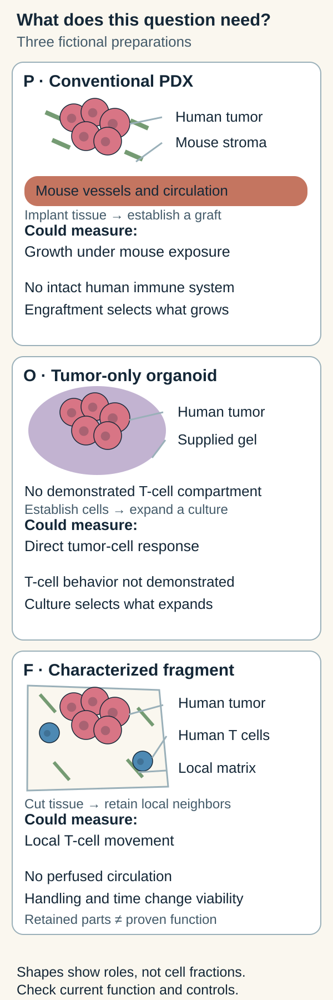

# PDX, organoid or tumor fragment: choose by the question

## In one sentence

PDX, organoids and tumor fragments preserve different cells and surroundings and take days, weeks or months to answer; the useful choice depends on the question and the decision window.

## The intuition

You can study a plant by moving it to another garden (slow, foreign soil), growing chosen seeds in a greenhouse (many conditions), or lifting a patch of soil with its neighbors for an afternoon (original neighbors, briefly). None moves the whole ecosystem.

A [patient-derived xenograft (PDX)](/wiki/education/concepts/measurement/functional-models/patient-derived-xenograft) grows human tumor in an immunodeficient mouse. An [organoid](/wiki/education/concepts/measurement/functional-models/organoid) is a three-dimensional culture of tumor cells. An [ex vivo tumor fragment](/wiki/education/concepts/measurement/functional-models/ex-vivo-tumor-fragments) is a piece of living tumor kept alive outside the body for a short experiment. In [experimental-setting](/wiki/education/concepts/measurement/functional-models/experimental-settings) terms they are in vivo, in vitro and ex vivo.

## What they share

All three need fresh, living tumor rather than formalin-fixed tissue (see [formalin-fixed, frozen or living tissue](/wiki/education/concepts/measurement/specimens/ffpe-vs-fresh-frozen-vs-viable)). All three can fail to give a result. None reproduces human drug metabolism, healthy-organ toxicity or new immune cells arriving from the blood.

## The axis on which they differ

They trade **time and expandability** against **how much of the original neighborhood survives**. The fragment keeps the most neighbors for the shortest time. The organoid keeps selected tumor cells and can be expanded and re-tested. The PDX adds a circulation, but a mouse's, and takes longest.

Each model keeps a different compartment: the PDX swaps in mouse support and circulation, the organoid keeps selected tumor cells in a gel, and the fragment keeps local neighbors without blood flow.

## Side by side

| Check | Conventional PDX | Tumor organoid | Ex vivo tumor fragment or slice |
|---|---|---|---|
| Tissue it needs | Fresh, living tumor pieces implanted into mice | Fresh, living tumor broken into cells and grown in a gel | Fresh, living tumor cut into thin slices; in one breast study, biopsy cores cut into 0.3 mm slices [4] |
| Time to a first result | **Months.** A study-ready PDX normally takes 4–8 months [1]; 16 weeks on average from engraftment to drug testing in one series [7] | **Weeks.** Median 6 weeks (range 4–10) from biopsy to a drug panel in colorectal cancer [2]; mean 6.8 weeks in pancreatic cancer [3] | **Days.** Breast slices were exposed to chemotherapy for 3 days, with results 7–14 days after the biopsy [4] |
| How often a model is obtained | 578 of 1,163 implanted tumors (49%) in a mixed series [7] | 61.5% of colorectal core biopsies [2]; 62% in pretreated pancreatic cancer [3] | 23 of 30 breast biopsies gave a usable result [4] |
| What survives | Human malignant cells; human stroma and vessels are largely replaced by mouse tissue [5] | Selected tumor populations; conventional cultures usually lack immune and supporting cells [6] | Original tumor cells, immune cells and matrix, but no blood flow, and viability falls with time |
| Throughput and repeat testing | Few drugs per model; can be passaged into more mice | Many drugs at once; can be frozen and re-tested | Few conditions; limited by the tissue piece; cannot be re-grown |
| Best-fit question | Growth under whole-animal dosing in a characterized graft | Direct tumor-cell response to many drugs | Short-term local response, including immune activity in the original neighborhood |

## What agreement with patients has looked like

In small, selected studies, breast slices matched scan response in 15 of 20 patients [4], and xenografts matched 112 of 129 treatments [7]. None shows that choosing treatment by the model improves survival. [What real concordance studies show](/wiki/education/guides/predicting-response-before-treating/04-what-concordance-studies-show) gives the denominators.

## When each wins

- **Fragment:** the decision is days away and the question needs the original immune neighbors, as with checkpoint antibodies [8].
- **Organoid:** you need to compare many drugs and can wait weeks.
- **PDX:** you need whole-animal exposure or growth over time and can wait months, as in drug development.

**Mental model:** fragment = original neighbors, days; organoid = chosen cells, many drugs, weeks; PDX = living host, months.

## Try it

A team must choose a post-surgery treatment within three weeks and wants to know whether a checkpoint antibody reactivates the tumor's own T cells. Which model fits?

**Answer:** a fragment. It keeps resident T cells and answers in days. A conventional organoid usually lacks T cells, and a PDX takes months in a host without a human immune system. The result would still be a laboratory association, not proof of benefit.

## Common confusions

- **“Patient-derived means patient-identical.”** Sampling, culture and engraftment select populations.
- **“A failed model means a resistant tumor.”** A model that does not grow gives no result; keep it in the denominator.
- **“More complex is better.”** Complexity helps only when it adds biology the question needs, in the time available.

## Takeaway

**Pick the model whose preserved biology matches the question and whose time to result fits the decision.**

## Related concepts

- [Experimental settings](/wiki/education/concepts/measurement/functional-models/experimental-settings)
- [How a model earns trust](/wiki/education/concepts/measurement/functional-models/how-a-model-earns-trust)
- [Choose a tumor model for the question](/wiki/education/guides/predicting-response-before-treating/01-choose-a-model)

## Sources and scope

Source check: November 8, 2026. Figures come from the named studies and vary by laboratory and tumor type. Expert and learner review pending.

1. [Hidalgo et al., 2014](https://pmc.ncbi.nlm.nih.gov/articles/PMC4167608/) — PDX review (PMID 25185190).
2. [Cartry et al., 2023](https://doi.org/10.1186/s13046-023-02853-4) — colorectal organoids (PMID 37880806).
3. [Boilève et al., 2024](https://doi.org/10.1053/j.gastro.2024.05.032) — pancreatic organoids (PMID 38866343).
4. [Ladan et al., 2023](https://pmc.ncbi.nlm.nih.gov/articles/PMC10542784/) — breast biopsy slices (PMID 37777518).
5. [DeRose et al., 2011](https://pmc.ncbi.nlm.nih.gov/articles/PMC3553601/) — breast grafts and mouse stroma.
6. [Neal et al., 2018](https://pubmed.ncbi.nlm.nih.gov/30550791/) — immune-containing organoids, a specialized method.
7. [Izumchenko et al., 2017](https://pmc.ncbi.nlm.nih.gov/articles/PMC5834154/) — PDX engraftment, timing and agreement (PMID 28945830).
8. [Voabil et al., 2021](https://doi.org/10.1038/s41591-021-01398-3) — tumor fragments and PD-1 blockade (PMID 34239134).

<!-- BEGIN GENERATED USED IN -->
## Used in

- [Compare related ideas](/wiki/education/comparisons/index)
- [Choose a tumor model for the question](/wiki/education/guides/predicting-response-before-treating/01-choose-a-model)
- [What real concordance studies show](/wiki/education/guides/predicting-response-before-treating/04-what-concordance-studies-show)
- [Understand what a tumor model can predict](/wiki/education/guides/predicting-response-before-treating/index)
<!-- END GENERATED USED IN -->
