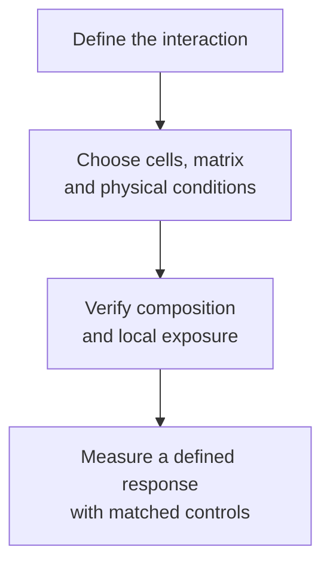
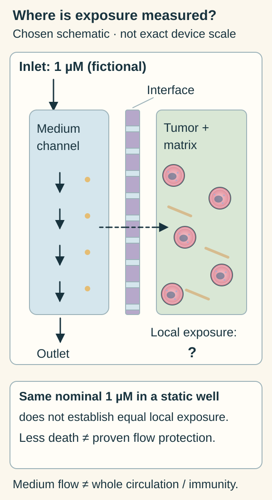

# Tumor-on-chip: a controlled tissue environment

## In one sentence

A tumor-on-chip is an engineered culture device used to study selected tumor–tissue interactions under defined physical and biological conditions.

## The intuition

A test track lets you control road conditions and traffic to investigate a vehicle. It does not recreate every journey. A chip likewise lets researchers set selected conditions around cells. Unlike vehicles, cells can alter their environment; a device's design and its measured biological state both matter.

## How it works

Small compartments or channels hold cells and supporting materials. **Microfluidics** controls fluid in small channels. Some designs supply controlled flow; others use different ways to feed cultures or exchange molecules. A chip may include an [extracellular matrix](/wiki/education/concepts/cancer-biology/tumor-microenvironment/extracellular-matrix), endothelial cells forming a vascular interface, neighboring tissue or immune cells. Each ingredient must be documented. The word “chip” does not establish that all are present.

Engineered organ models show why physical conditions can matter. Huh and colleagues built a lung-interface model incorporating breathing-like mechanical deformation. Hassell and colleagues subsequently studied lung cancer in engineered lung environments; growth and response depended on the modeled context. These are defined systems, not a demonstration that every chip recreates a whole organ or predicts all cancers. [Huh primary abstract](https://pubmed.ncbi.nlm.nih.gov/20576885/), [Hassell primary abstract](https://pubmed.ncbi.nlm.nih.gov/29020635/).

A chip can also support an immune experiment. Jenkins and colleagues cultured organotypic tumor spheroids containing source tumor and immune populations in a collagen channel, with defined treatment and readouts. Their experimental windows and retained components belonged to that protocol. A device without relevant immune cells cannot answer the same checkpoint-blockade question. [Primary methods](https://pmc.ncbi.nlm.nih.gov/articles/PMC5809290/).

*Engineering a setting and demonstrating its behavior are separate jobs.*

Start at the inlet and follow the medium channel to the outlet. The separate tumor-and-matrix compartment sits across a porous interface in this chosen schematic. It combines teaching features rather than copying the geometry of a specific device. The dashed connector indicates possible transport; it does not measure the concentration at a cell. One micromolar (1 µM) means one micromole per liter. The fictional inlet value is not a guarantee of that local exposure. Even a lower death readout than in a static well would still require exposure and control checks before attributing protection to flow. [Primary lung-chip design, selected passages](https://pmc.ncbi.nlm.nih.gov/articles/PMC8335790/), [Jenkins methods](https://pmc.ncbi.nlm.nih.gov/articles/PMC5809290/).

## Why it matters in cancer

A chip can investigate transport barriers, neighboring-cell signals or a mechanical effect with more control than a complete organism. **Perfusion** means supplying fluid through a system; it can affect delivery and removal of molecules. It is not the patient's full circulation. Inlet drug concentration need not establish exposure at every cell, especially across a tissue barrier. Measure the feature the model claims to reproduce.

[Bioprinting](./bioprinting) can fabricate part of a chip model; [organoids](./organoid) or [co-cultures](./co-culture) can supply biological components. These terms describe different design choices and can overlap.

## Model and assay card

| Field | What to retain |
|---|---|
| Measures / how | Chosen interaction assessed by imaging, fluid sampling or another specified assay; a chip is the experimental setting |
| Input and tissue cost | Defined viable cells/tissue and matrix; preparation, channel loading and quality control use finite material |
| Output and units | Population-specific counts or death, transport/permeability (movement across a barrier), cytokine concentration or measured motion; retain units and collection times |
| Thresholds | Device, flow and biological acceptance criteria; no universal chip-response cutoff establishes clinical benefit |
| Failure modes | Incorrect composition, poor barriers, unequal delivery, loss of cells, incompatible materials or baseline deterioration |
| Cannot tell alone | Whole-body exposure, normal-organ safety, complete immunity or treatment benefit |
| Validation context | Verify reproducible physical conditions and the intended biological feature; any clinical prediction needs separate validation |

## Common confusions

- **Chip versus computer:** this is a living experimental device; a [virtual cell model](/wiki/education/concepts/measurement/computational-analysis/virtual-cell-model) computes a response.
- **Flow versus vessels:** a fluid channel does not automatically provide a living vascular interface.
- **Immune presence versus specificity:** added immune cells need identity and recognition controls.
- **Better detail versus better prediction:** complexity helps only when it represents the question and remains measurable.

## Try it

A fictional flowing chip shows less tumor-cell death than a static well at the same nominal drug concentration. Has flow been proved to protect tumor cells biologically?

**Answer:** No. Check local drug exposure, initial cell populations and baseline survival. Delivery differences could change the effective exposure. Then compare conditions that isolate flow's contribution with suitable controls.

## Explain it back

“A chip controls ___; its missing surroundings limit ___.”

One answer: “selected physical and biological conditions; how far its result can travel beyond those conditions.”

## Takeaway

**Read the chip's cell sources, environment, exposure and endpoint before interpreting its response.**

## Related concepts

- [Ex vivo drug screen](./ex-vivo-drug-screen).
- [Functional cytotoxicity assays](/wiki/education/concepts/measurement/immune-monitoring/functional-cytotoxicity-assays).

## Sources and scope

Source check: October 10, 2026. Primary abstracts support the bounded lung examples; accessible Jenkins primary methods/results support the spheroid device example. None supplies universal clinical prediction. The exercise is fictional. Expert and learner review remain pending.

- [Huh et al., 2010: Reconstituting organ-level lung functions on a chip](https://pubmed.ncbi.nlm.nih.gov/20576885/).
- [Hassell et al., 2017: Human Organ Chip Models Recapitulate Orthotopic Lung Cancer Growth, Therapeutic Responses, and Tumor Dormancy In Vitro](https://pubmed.ncbi.nlm.nih.gov/29020635/).
- [Jenkins et al., 2018: Ex Vivo Profiling of PD-1 Blockade Using Organotypic Tumor Spheroids](https://pmc.ncbi.nlm.nih.gov/articles/PMC5809290/).

<!-- BEGIN GENERATED USED IN -->
## Used in

- [Understand what a tumor model can predict](/wiki/education/guides/predicting-response-before-treating/index)
- [Choose a tumor model for the question](/wiki/education/modeling-tumor-response/index)
<!-- END GENERATED USED IN -->
