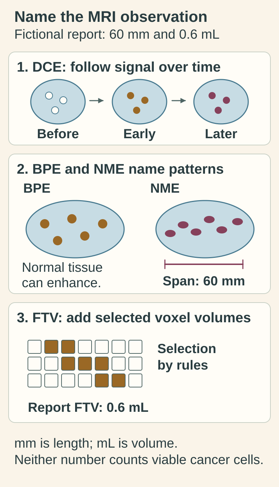

# Breast MRI: enhancement, extent and research volume

## In one sentence

Breast MRI uses magnetic fields and radio waves to characterize breast tissue, with contrast enhancement and research-derived volumes describing imaging behavior rather than directly counting viable cancer cells.

## The intuition

Think of observing how a marker spreads through a landscape over time. The pattern depends on delivery and the landscape's properties. Contrast-enhanced breast MRI offers a related view of tissue behavior, alongside structural information.

The analogy stops at a visible pattern. A bright region is not a photograph of cancer cells, and “functional” does not mean every selected image element contains living tumor.

## How it works

**Magnetic resonance imaging (MRI)** uses magnetic fields and radiofrequency signals to form images. It does not use ionizing X-rays. Breast cancer evaluation commonly includes intravenous gadolinium-based contrast and multiple images before and after its administration.

**Dynamic contrast-enhanced MRI (DCE-MRI)** follows changing signal over time. Enhancement depends on contrast delivery, vascular properties and tissue distribution, together with acquisition settings. Radiologists interpret shape and distribution alongside enhancement kinetics, the pattern of signal change. Benign tissue can enhance too. [RadiologyInfo breast MRI](https://www.radiologyinfo.org/en/info/breastmr).

## Four report terms to keep separate

**Background parenchymal enhancement (BPE)** is enhancement of normal fibroglandular breast tissue. It describes background enhancement, not the amount of tumor. It is also different from the amount of fibroglandular tissue or [mammographic density](/wiki/education/concepts/measurement/imaging/mammography). A report may describe BPE as minimal, mild, moderate or marked. [Primary BPE interpretation study](https://pmc.ncbi.nlm.nih.gov/articles/PMC5831266/).

**Non-mass enhancement (NME)** describes an enhancing region that is neither a discrete three-dimensional mass nor a tiny focus, and is distinguishable from BPE. “Non-mass” does not mean “non-cancer.” Benign, high-risk and malignant processes can share NME patterns; distribution and internal pattern contribute to assessment. [UCLA's teaching explanation](https://www.uclahealth.org/departments/radiology/education/breast-imaging-teaching-resources/birads/breast-mri-findings-non-mass-enhancement-nme).

**Functional tumor volume (FTV)** is a method-defined research measurement. In the ACRIN 6657/I-SPY studies, investigators selected an image region and summed voxels—three-dimensional image elements—meeting specified enhancement and processing rules. Changing thresholds can change the included volume. FTV is therefore not interchangeable with a radiologist's NME span, an anatomical volume or the amount of viable tumor measured in removed tissue. [Primary threshold study](https://pmc.ncbi.nlm.nih.gov/articles/PMC5214452/).

DCE names acquisition and signal behavior; BPE names background enhancement; NME names a finding's morphology; FTV names a calculation. Seeing all four in a report need not mean four competing estimates of the same quantity.

*The original 60 mm span and 0.6 mL FTV can coexist: length and method-selected volume describe different quantities. The grid is a selection cartoon without voxel counts or sizes for recalculating FTV; enhancement does not establish histology or viable-cell number.*

[Open the light diagram](./images/mri-pattern-span-and-voxel-selection-v1-light.svg) · [Open the dark diagram](./images/mri-pattern-span-and-voxel-selection-v1-dark.svg)

## Why it matters in cancer

MRI can help evaluate extent and changes during treatment. A change in enhancement can be informative without proving [pathologic complete response (pCR)](/wiki/education/concepts/breast-cancer/surgery-and-pathology-results/pcr). Residual cancer may not produce a conspicuous qualifying image signal, and enhancement may reflect nonmalignant processes.

The 2016 ACRIN 6657/I-SPY 1 FTV study examined associations with recurrence-free survival in a defined neoadjuvant breast-cancer cohort. That is evidence about a research measure in its study context. It does not establish a personal recurrence calculator or prove that changing treatment according to FTV improves outcomes. [Primary report](https://pmc.ncbi.nlm.nih.gov/articles/PMC4819899/).

## How it is measured

**Input:** tissue within the examination's field of view; no excised tissue. **Output:** images, dimensions, morphology and enhancement assessments. A length or NME span uses millimeters (mm) or centimeters (cm); FTV uses cubic centimeters (cm³), equivalent to milliliters (mL).

For quantitative comparisons, identify acquisition times after contrast, protocol, region selection, software and thresholds. Motion and misregistration—images failing to align—can alter calculations. A research FTV of zero means no volume met that method's inclusion rules; it does not establish zero cancer cells. [Primary FTV methods](https://pmc.ncbi.nlm.nih.gov/articles/PMC4819899/).

Breast MRI examines the prescribed region. A negative examination cannot establish absence of microscopic disease or exclude disease throughout the body.

## Common confusions

- **Enhancement versus viability:** signal behavior is not a direct viable-cell assay.
- **BPE versus density:** background enhancement and tissue amount are different descriptors.
- **NME versus benign tissue:** morphology does not establish histology.
- **FTV versus every tumor cell:** segmentation and thresholds define what enters the measurement.

## Try it

A fictional MRI describes NME spanning 60 mm and a research FTV of 0.6 mL. Is one number necessarily wrong?

**Answer:** No. A span describes length across a region; FTV sums selected enhancing voxels under specified rules. They measure different quantities. Ask about segmentation and thresholds before comparing values, and do not convert either into a viable-cell count.

## Explain it back

“DCE describes ___; NME describes ___; FTV depends on ___.”

One answer: “a sequence of contrast-dependent images; an enhancement pattern; the defined calculation and included voxels.”

## Takeaway

Name the MRI observation or calculation before interpreting its change. Enhancement, length, research volume and tissue response have distinct meanings.

## Related concepts

- [Core needle biopsy](/wiki/education/concepts/measurement/specimens/core-needle-biopsy): tissue sampling of an imaging target.
- [Response criteria](/wiki/education/concepts/measurement/imaging/response-criteria): formal categories require specified rules.

## Sources and scope

Source check: October 10, 2026. General imaging and a fictional exercise; expert and learner review remain pending. FTV is described as a method-defined research measure, without individual prediction or treatment advice.

- [ACR/RSNA RadiologyInfo, Breast MRI](https://www.radiologyinfo.org/en/info/breastmr): acquisition, contrast and interpretation limits.
- [Primary BPE interpretation study](https://pmc.ncbi.nlm.nih.gov/articles/PMC5831266/): normal-tissue enhancement and qualitative categories; indexed abstract and selected methods checked.
- [UCLA Radiology, Non-mass enhancement](https://www.uclahealth.org/departments/radiology/education/breast-imaging-teaching-resources/birads/breast-mri-findings-non-mass-enhancement-nme): NME distinction and overlapping outcomes, using the cited 2013 lexicon.
- [Hylton et al. (2016), ACRIN 6657/I-SPY 1](https://pmc.ncbi.nlm.nih.gov/articles/PMC4819899/): FTV methods and cohort-specific recurrence-free survival association.
- [Li et al. (2016), contrast thresholds](https://pmc.ncbi.nlm.nih.gov/articles/PMC5214452/): dependence of FTV and predictive performance on analysis parameters.

<!-- BEGIN GENERATED USED IN -->
## Used in

- [Match each measurement to its claim](/wiki/education/local-treatment-modalities/05-tissue-and-sample-budget)
- [Compare blood results with imaging](/wiki/education/molecular-profiling/ctdna-ppm-and-mri)
<!-- END GENERATED USED IN -->
