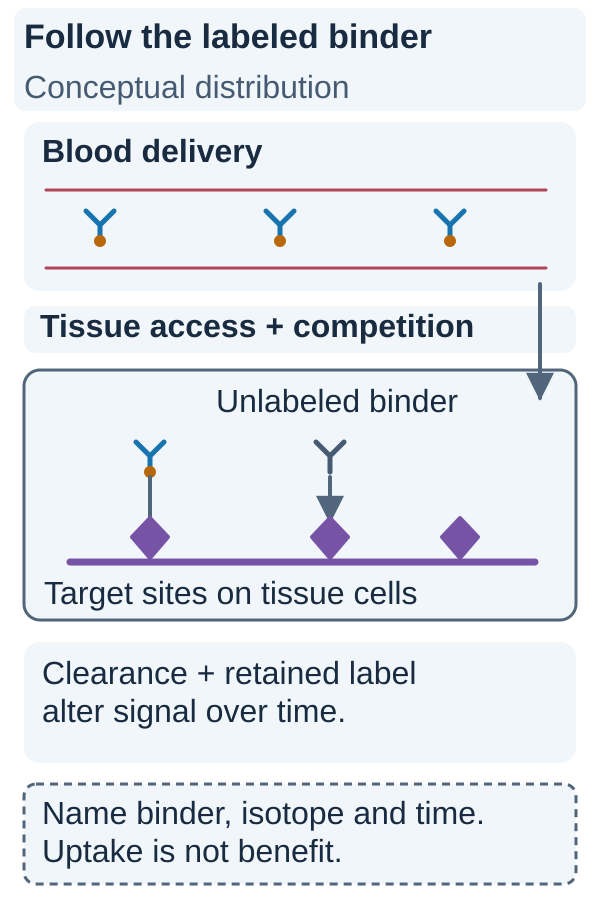

# Immuno-PET: tracking an antibody-based tracer

## In one sentence

Immuno-PET uses a radiolabeled antibody or antibody-derived binding format to image its distribution, with uptake reflecting target access and tracer behavior rather than proving therapeutic benefit.

## The intuition

Imagine labeling a particular binding tool so you can follow where it goes. If the tool collects in a region, that is evidence about its distribution. You still need to ask what it bound, what prevented binding elsewhere and how much signal came from circulating material.

The label does not make the tool a perfect cancer detector.

## How it works

[Antibodies](/wiki/education/concepts/immunology/antibodies-and-b-cells/antibody-structure) recognize molecular features through their binding regions. In immuno-PET, an antibody or an antibody-derived binder carries a positron-emitting isotope, allowing [PET](/wiki/education/concepts/measurement/imaging/pet-ct) to follow radioactive distribution.

A full **immunoglobulin G (IgG)** antibody and a smaller **Fab fragment** are different formats; Fab retains an antigen-binding region without the full antibody architecture. A **nanobody** is an antibody-derived single-domain binder. Size and format influence blood clearance, tissue penetration, retention and normal-organ uptake. Formats do not have a universal imaging advantage.

The isotope must suit the binder's biological time course. Zirconium-89 (**89Zr**) has been used with full antibodies whose useful contrast may develop over days. Gallium-68 (**68Ga**) has been used with faster-clearing binders imaged earlier. These examples are product-specific.

**Protein mass matters as well as radioactivity.** Unlabeled antibody or an ongoing therapeutic antibody can compete for binding sites, alter distribution or affect background. Less uptake after such exposure may reflect blocking or changed access; it does not automatically establish target loss. [Primary trastuzumab feasibility study](https://pubmed.ncbi.nlm.nih.gov/20357763/).

### Read the visual

*An uptake image records the tested tracer’s distribution at a particular time.*

The orange dot marks the radioactive label; the blue Y is the binder. A gray, unlabeled binder can occupy the same target without adding PET signal. Delivery from blood, access to tissue, competition, clearance and retention all shape the recorded distribution. The diagram is conceptual and does not assign uptake values. Record the isotope and binder format together with protein mass, activity and time. For example, the trastuzumab feasibility study tested a full antibody labeled with zirconium-89 over a multi-day imaging window; the gallium-68 nanobody study used a different binder and earlier scans. Their timing is study-specific, not an interchangeable imaging rule. [Dijkers primary feasibility study](https://pubmed.ncbi.nlm.nih.gov/20357763/).

## Why it matters in cancer

Immuno-PET can investigate how an antibody-based product distributes among visible lesions and normal tissues. It adds distribution information without recreating histology or removing detection limits.

Dijkers and colleagues studied 89Zr-trastuzumab in 14 people with HER2-positive metastatic breast cancer. Imaging time and antibody mass affected the usable result. **HER2** means human epidermal growth factor receptor 2. This was a feasibility study, not evidence that any HER2-directed tracer selects effective treatment in every breast-cancer setting.

Keyaerts and colleagues studied a 68Ga-HER2 nanobody in 20 women with primary or metastatic breast carcinoma and HER2 immunohistochemical scores of 2+ or 3+. The study evaluated safety, distribution, radiation dosimetry and tumor-targeting potential; it did not establish treatment benefit. [Primary phase 1 study](https://pubmed.ncbi.nlm.nih.gov/26449837/).

In Bensch and colleagues' 22-person study across three tumor types, 89Zr-atezolizumab showed heterogeneous uptake and substantial lymphoid-tissue and inflammation signal. Associations with later response were exploratory, not a universal patient-selection threshold. Its target, **programmed death-ligand 1 (PD-L1)**, participates in [immune checkpoint signaling](/wiki/education/concepts/therapeutics/immunotherapy/immune-checkpoint-inhibitor). PET signal did not uniquely identify malignant cells. [Primary study](https://pubmed.ncbi.nlm.nih.gov/30478423/).

## How it is measured

**Input:** the exact antibody or fragment, radioactive label, protein mass, administered activity and timing. **Output:** activity distribution and region-based uptake, such as [standardized uptake value](/wiki/education/concepts/measurement/imaging/pet-ct). Activity uses megabecquerels (MBq); protein mass may use micrograms or milligrams. Neither unit means the proportion of tumor cells bearing the target.

Interpret uptake with blood-pool background, normal-organ distribution, lesion size and clearance. A single image cannot separate every component of binding, blood delivery and retention, establish receptor occupancy or calculate therapeutic absorbed dose.

## Common confusions

- **Immuno-PET versus proof of immune killing:** “immuno” refers to the antibody-based binder. The target may be on tumor or immune cells.
- **Immune-related PET versus antibody PET:** a peptide tracer measuring an immune-associated process is not an antibody tracer merely because its biology involves immunity.
- **Uptake versus expression percentage:** distribution includes exposure and access, not just target amount.
- **Exploratory correlation versus clinical utility:** an association with response does not prove that using the scan improves treatment outcomes.

## Try it

A fictional antibody tracer shows less tumor uptake after treatment with an unlabeled antibody recognizing the same target. A colleague concludes, “The tumor stopped expressing the target.” What else could explain the scan?

**Answer:** Competition, altered available binding sites, exposure, clearance or imaging conditions could contribute. The scan alone does not isolate target loss. Compare the exact product, protein mass, timing and background; tissue or controlled binding evidence would address different parts of the question. No treatment choice follows automatically.

## Explain it back

“Immuno-PET tracks ___ under ___; high uptake does not establish ___.”

One answer: “a named antibody-based tracer; its dose and imaging conditions; effective therapy or cancer-exclusive binding.”

## Takeaway

Read the binder, label, mass, clearance and target context together. An image is evidence about the tested tracer, not a promise about treatment.

## Related concepts

- [Target PET and theranostic imaging](/wiki/education/concepts/measurement/imaging/target-pet-and-theranostic-imaging): distribution, absorbed dose and benefit are distinct claims.
- [Clinical validity and utility](/wiki/education/concepts/measurement/computational-analysis/analytical-validity-clinical-validity-and-utility): correlation versus useful clinical decisions.

## Sources and scope

Source check: October 10, 2026. Primary abstracts checked; full-text methods were not accessible for these three studies during this check. Examples support bounded format and distribution explanations, without a current approval or access claim. Practice is fictional; expert and learner review remain pending.

- [Dijkers et al. (2010), 89Zr-trastuzumab](https://pubmed.ncbi.nlm.nih.gov/20357763/): 14-person HER2-positive metastatic breast feasibility study; mass and imaging-time context.
- [Keyaerts et al. (2016), 68Ga-HER2 nanobody](https://pubmed.ncbi.nlm.nih.gov/26449837/): phase 1 imaging, biodistribution and dosimetry; 20 women with HER2 IHC scores of 2+ or 3+.
- [Bensch et al. (2018), 89Zr-atezolizumab](https://pubmed.ncbi.nlm.nih.gov/30478423/): 22-person exploratory study across three tumor types; heterogeneous and normal-tissue uptake, with response association.

<!-- BEGIN GENERATED USED IN -->
## Used in

- [Match each measurement to its claim](/wiki/education/local-treatment-modalities/05-tissue-and-sample-budget)
<!-- END GENERATED USED IN -->
