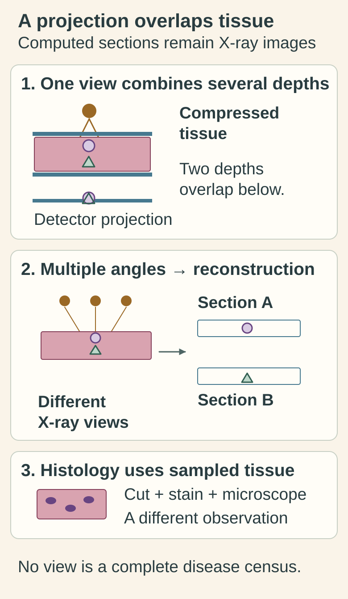

# Mammography: X-ray patterns in the breast

## In one sentence

Mammography uses low-dose X-rays to show breast tissue patterns, including masses and calcifications, without directly identifying every cancer cell.

## The intuition

Think of photographing a layered stack of objects from several directions. Overlap can hide a small feature, and a visible feature still needs interpretation. Mammography has the same overlap problem, but its contrast comes from how tissues attenuate, or reduce, X-rays rather than how they reflect light.

The analogy stops at visibility. A mammogram is neither a microscope nor a census of cells. It shows physical patterns that can raise or lower suspicion.

## How it works

The breast is positioned and compressed between plates. Compression spreads tissue, reduces overlap and movement, and reduces the thickness X-rays must traverse. Detectors record differences in X-ray transmission. Fat and fibroglandular tissue—glandular and supporting fibrous tissue—produce different image appearances.

Conventional digital mammography produces projection images. **Digital breast tomosynthesis (DBT)** acquires projections from several angles and reconstructs thin image sections. It can reduce the effect of overlapping tissue; it does not produce histological sections from an excised breast. [NCI mammography explanation](https://www.cancer.gov/types/breast/screening/mammograms).

A **screening** examination looks for suspicious findings before symptoms prompt evaluation. A **diagnostic** examination addresses a finding or symptom and may use additional views. These names describe the clinical question and examination, not whether cancer has already been proved.

*Several depths contribute to one projection. Tomosynthesis uses multiple X-ray views to reconstruct sections with less overlap; those sections remain imaging evidence. The shapes are fictional and do not identify cancer or prove complete detection.*

[Open the light diagram](./images/mammography-projection-and-reconstructed-sections-v1-light.svg) · [Open the dark diagram](./images/mammography-projection-and-reconstructed-sections-v1-dark.svg)

## Why it matters in cancer

A **mass** is a space-occupying finding. **Calcifications** are calcium deposits visible on the image. Their pattern and distribution can be informative, but calcium is not itself a diagnosis of cancer. Neither a persistent calcification nor a smaller mass directly measures how many viable cancer cells remain after treatment.

**Breast density** describes the appearance and relative amount of fibroglandular tissue on mammography. Dense tissue can obscure a lesion because both can appear relatively bright. Density is not the percentage of the breast occupied by cancer. [NCI dense-breast explanation](https://www.cancer.gov/types/breast/breast-changes/dense-breasts).

When tissue characterization is needed, a [core needle biopsy](/wiki/education/concepts/measurement/specimens/core-needle-biopsy) obtains a sample for examination. Its findings and the images need to fit together; one does not make the other's sampling limits disappear.

## How it is measured

**Input:** the positioned breast; no tissue is removed by the scan. **Output:** images and a radiologist's description of location, shape, margins and calcification patterns. Dimensions or a calcification span may be reported in millimeters (mm) or centimeters (cm). A span is an extent, not a cell count or a three-dimensional volume.

The **Breast Imaging Reporting and Data System (BI-RADS)** organizes findings and assessment categories. An assessment category is different from a pathological diagnosis or a cancer stage. Reports also describe density and comparison examinations. A comparison needs dates and sufficiently comparable views. [RadiologyInfo report guide](https://www.radiologyinfo.org/en/info/article-breast-imaging-report).

There is no universal image threshold that establishes the absence of microscopic disease. Overlap, density, positioning and the type of lesion affect detection. The examined breasts also do not represent every organ in the body.

## Common confusions

- **“3D” versus histology:** reconstructed tomosynthesis sections remain X-ray images.
- **Calcification versus active cancer:** a radiographic deposit does not establish malignancy or viability by itself.
- **Density versus tumor burden:** density describes background tissue appearance.
- **A negative mammogram versus zero disease:** the scan did not identify suspicious evidence under its conditions; it cannot count every cell.

## Try it

What separates reconstructed section A from the stained tissue picture? **Answer:** Section A is computed from X-ray projections. The stained picture represents physically sampled and prepared tissue; neither observation supplies a complete census of disease.

A fictional report describes a 24 mm calcification span and no discrete mass. A learner concludes, “There are 24 mm of invasive cancer, and ultrasound will show its exact size.” Which parts go beyond the observation?

**Answer:** Both conclusions overreach. The measurement describes the span of visible calcifications. It does not establish invasion, viable tumor extent or what another modality will detect. [Breast ultrasound](/wiki/education/concepts/measurement/imaging/breast-ultrasound) measures a different signal. Tissue findings and image–pathology agreement address additional questions.

## Explain it back

“A mammogram shows ___; its measured span does not tell me ___.”

One answer: “X-ray patterns in an examined breast; the exact amount or type of viable cancer.”

## Takeaway

Keep the visible pattern, the assessment and the tissue diagnosis as connected observations with distinct meanings.

## Related concepts

- [Breast anatomy](/wiki/education/concepts/breast-cancer/anatomy-and-histology/breast-anatomy): the structures being imaged.
- [Breast MRI](/wiki/education/concepts/measurement/imaging/breast-mri): a different signal and a different definition of enhancement.

## Sources and scope

Source check: October 10, 2026. General modality education and a fictional exercise; expert and learner review remain pending. Screening schedules and individual follow-up decisions are outside this page.

- [NCI, Mammograms](https://www.cancer.gov/types/breast/screening/mammograms): projection imaging, tomosynthesis and screening versus diagnostic examinations.
- [NCI, Dense breasts](https://www.cancer.gov/types/breast/breast-changes/dense-breasts): density and masking.
- [ACR/RSNA RadiologyInfo, Reading a breast imaging report](https://www.radiologyinfo.org/en/info/article-breast-imaging-report): findings, comparisons and BI-RADS assessments.

<!-- BEGIN GENERATED USED IN -->
## Used in

- [Compare blood results with imaging](/wiki/education/molecular-profiling/ctdna-ppm-and-mri)
<!-- END GENERATED USED IN -->
