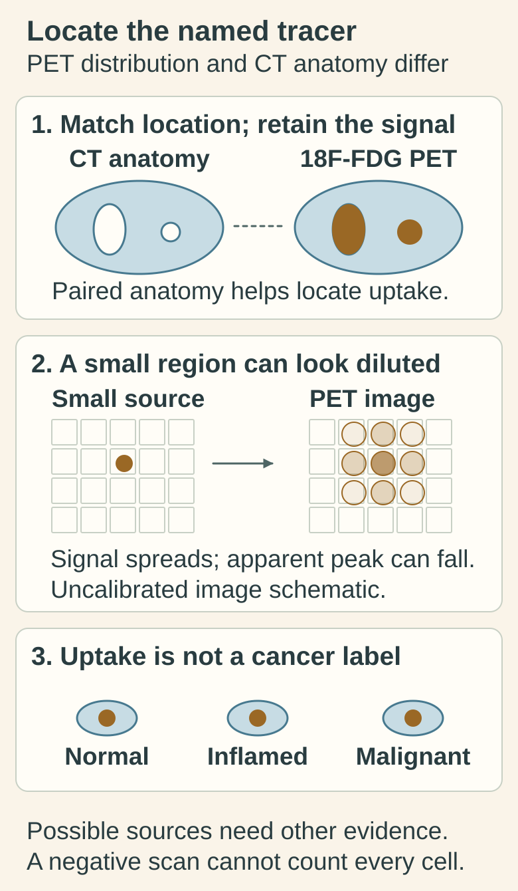

# PET-CT: tracer distribution alongside anatomy

## In one sentence

PET-CT combines a map of an administered radioactive tracer with X-ray anatomy, so uptake describes tracer behavior rather than uniquely identifying cancer or excluding microscopic disease.

## The intuition

Imagine combining a map of where a labeled material collects with a map of buildings and roads. One map shows distribution; the other helps locate it. PET-CT combines related kinds of information inside the body.

The analogy is limited: the tracer is not a courier carrying a cancer label. Its distribution depends on the chosen molecule, physiology and examination conditions.

## How it works

**Positron emission tomography (PET)** uses a radiotracer, a molecule labeled with a radioactive isotope that emits positrons. When a positron meets an electron, their annihilation produces photons detected by the scanner. Reconstruction estimates where radioactive activity was located.

**Computed tomography (CT)** uses X-rays to describe anatomy. In PET-CT, the CT also helps correct PET data for attenuation, the loss of detected photons passing through tissue. The CT may be low-dose for localization and correction, or a diagnostic examination with different settings and sometimes contrast. “PET-CT” alone does not specify which CT was obtained. [NIH nuclear medicine explanation](https://www.nibib.nih.gov/science-education/science-topics/nuclear-medicine).

A common cancer tracer is fluorine-18 fluorodeoxyglucose (**18F-FDG**), a glucose-related molecule. Its uptake and retention reflect aspects of glucose handling. Cancer can be FDG-avid, meaning it accumulates FDG, but normal tissues and inflammation can be avid too. Some cancers or lesions produce little detectable signal. [RadiologyInfo PET-CT](https://www.radiologyinfo.org/en/info/pet).

**The tracer name belongs with the scan name.** [Target-directed PET](/wiki/education/concepts/measurement/imaging/target-pet-and-theranostic-imaging) asks about a particular molecular interaction. A result from FDG cannot substitute for a result from an antibody or another targeted tracer.

*The named FDG tracer and CT anatomy contribute different evidence. A small region can have its apparent peak reduced as signal spreads at finite resolution; this uncalibrated cartoon is not an uptake simulation or a cell count. Normal and inflammatory tissue may also be avid.*

[Open the light diagram](./images/pet-ct-distribution-anatomy-and-dilution-v1-light.svg) · [Open the dark diagram](./images/pet-ct-distribution-anatomy-and-dilution-v1-dark.svg)

## Why it matters in cancer

PET-CT can contribute to detection, staging and response assessment in appropriate settings. The CT and PET findings should be interpreted together: a structural abnormality may lack FDG uptake, and an avid region may be nonmalignant.

Spatial resolution, lesion size, background activity and tracer biology limit detection. The **partial-volume effect** makes activity in a small structure spread across image elements, which can lower its apparent uptake. A negative scan cannot establish absence of microscopic cancer.

Also check coverage. Torso imaging may extend from the skull base to mid-thigh, while another protocol covers a different range. Even imaging the entire body is not a complete census of disease. [EANM technical guideline, version 2.0](https://snmmi.org/common/Uploaded%20files/Web/Clinical%20Practice/Procedure%20Standards/2018/2015_GL_PET_CT_TumorImaging_V2.pdf).

## How it is measured

**Input:** administered tracer, the imaged body region and the acquisition protocol. **Output:** activity distribution, anatomical findings and their interpretation. Administered activity uses megabecquerels (MBq); activity concentration can use kilobecquerels per milliliter (kBq/mL).

**Standardized uptake value (SUV)** normalizes activity concentration to administered activity and a body-size measure, commonly body weight. **SUL** uses lean body mass. SUVmax refers to the highest voxel value in a defined region; another summary such as SUVmean answers a different question. These are semiquantitative uptake measures, not percentages of cells that are cancerous.

Uptake time after injection, blood glucose for FDG, calibration, reconstruction and region selection matter. Comparing raw SUV values across tracers or substantially different protocols is not a controlled biological comparison. This page gives no universal SUV cutoff for malignancy or response.

## Common confusions

- **“Hot” versus malignant:** uptake can reflect normal tissue or inflammation.
- **Lower SUV versus fewer cells by the same fraction:** uptake is influenced by physiology and measurement conditions.
- **PET-CT versus a complete diagnostic CT:** the CT component's purpose and protocol matter.
- **No avid lesion versus no cancer:** a method can miss small or low-uptake disease.

## Try it

Does the lower-looking peak in the small-region cartoon prove less tracer in the original region? **Answer:** No. Finite-resolution spreading changes the apparent image concentration; the picture provides no calibrated activity estimate. Brightness also does not establish whether the region contains cancer.

A fictional FDG scan shows an avid lymph node shortly after inflammation in its drainage region. A learner calls it a proven metastasis. What is the more precise statement?

**Answer:** The node shows FDG uptake under the recorded conditions. Uptake alone does not distinguish malignancy from inflammation. Anatomical appearance, history, comparison studies and sometimes tissue evidence add information. Nor would a non-avid node prove that it contains no cancer.

## Explain it back

“PET tells me where ___ accumulated; CT helps describe ___; neither establishes ___ by itself.”

One answer: “the named tracer; anatomy; the identity of every cell or absence of microscopic disease.”

## Takeaway

Read the tracer, coverage, timing, uptake measure and anatomical findings together before interpreting a PET-CT result.

## Related concepts

- [Response criteria](/wiki/education/concepts/measurement/imaging/response-criteria): formal anatomical response differs from an informal uptake comparison.
- [Immuno-PET](/wiki/education/concepts/measurement/imaging/immuno-pet): antibody-based tracer distribution.

## Sources and scope

Source check: October 10, 2026. General modality education and fictional practice; expert and learner review remain pending. No scan schedule or treatment decision is supplied.

- [NIH/NIBIB, Nuclear medicine](https://www.nibib.nih.gov/science-education/science-topics/nuclear-medicine): positron detection and molecular imaging.
- [ACR/RSNA RadiologyInfo, PET-CT](https://www.radiologyinfo.org/en/info/pet): tracer versus anatomy and clinical interpretation.
- [Boellaard et al. (2015), EANM version 2.0](https://snmmi.org/common/Uploaded%20files/Web/Clinical%20Practice/Procedure%20Standards/2018/2015_GL_PET_CT_TumorImaging_V2.pdf): technical definitions, SUV and detection limits. Used for these definitions; it is not presented as the latest guideline. EANM lists [version 3.0 (2025)](https://doi.org/10.1016/j.eanmj.2025.100006); its full text was not accessible during this check.

<!-- BEGIN GENERATED USED IN -->
## Used in

- [Match each measurement to its claim](/wiki/education/local-treatment-modalities/05-tissue-and-sample-budget)
- [Compare blood results with imaging](/wiki/education/molecular-profiling/ctdna-ppm-and-mri)
<!-- END GENERATED USED IN -->
