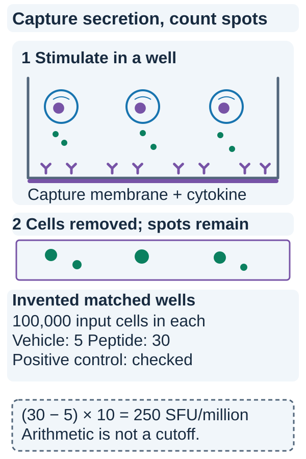

# ELISpot (enzyme-linked immunospot)

## In one sentence

ELISpot counts spots formed when sampled cells release a chosen molecule under defined test conditions.

## The intuition

Picture a plate that catches small droplets where each cell sits. A cell releasing the molecule being measured leaves a mark. The assay counts those marks; it does not watch the cell kill a tumor. That distinction makes a positive result useful without asking it to answer every question.

## How it works

Antibodies on a membrane capture a selected molecule, often [interferon gamma (IFNγ)](/wiki/education/concepts/immunology/the-immune-system/interferons), released by nearby cells. After stimulation and incubation, detection reagents make localized spots visible. The laboratory reports spot-forming units relative to the number of cells tested, with the method and background stated.

For antigen testing, cells may receive a candidate peptide or peptide pool. A negative control estimates background; a positive control checks whether the sample can respond. Replicates and predefined criteria help distinguish a response from noise. Viability, prior freezing and sample handling also matter.

A conventional mixed-cell assay does not identify every responding cell. Sorting or additional measurements may be needed to assign a response to a cell type. Spot size and intensity are not a direct meter of tumor killing.

### Read the visual

*Spots are secretion readouts with an input denominator and controls.*

Look below the cells: capture antibodies hold the released molecule near the membrane. After the cells are removed, detection makes localized deposits visible. The plate records secretion during the chosen stimulation window, rather than filming target-cell death. The pictured spots are schematic. The invented counts match the exercise below: 30 stimulated spots minus 5 background spots, each from 100,000 input cells, gives 250 spot-forming units per million input cells. A suitable positive control is checked separately, alongside replicates and assay-specific rules. That arithmetic does not establish positivity, a T-cell subset frequency or tumor recognition. [Official ELISpot principle documentation](https://www.mabtech.com/knowledge-hub/elispot).

## Why it matters in cancer

A vaccine study can compare responses before and after dosing under a consistent protocol. A rise supports increased activity against the test stimulus, within the assay's limits. [Human leukocyte antigen (HLA)](/wiki/education/concepts/immunology/antigen-presentation/hla) displays the naturally processed peptide. Artificial peptide addition can bypass the tumor's natural processing and presentation. A response to a peptide therefore needs a separate bridge to recognition of actual tumor cells.

## How it is measured

| Field | Interpretation |
|---|---|
| Measures | Cells secreting the selected molecule under defined stimulation, estimated through spots |
| How | Capture secretion on an antibody-coated membrane; incubate; detect localized spots; count with controls |
| Input and tissue cost | Viable cells, often [peripheral blood mononuclear cells (PBMCs)](/wiki/education/concepts/measurement/immune-monitoring/peripheral-blood-mononuclear-cells); testing and any expansion consume cells |
| Output and units | Spot-forming units per stated input-cell number, with background subtraction or other handling specified |
| Thresholds | Predefined assay-specific response and quality rules; subtraction alone does not establish positivity |
| Failure modes | High background, dead cells, weak stimulation, merged spots, inconsistent counting or failed controls |
| What it cannot tell you | Each receptor's target, natural tumor recognition, healthy-tissue safety or clinical benefit |
| Validation tier | Must match the preparation, stimulus, species and intended use; protocol validation is not clinical efficacy |

The response cutoff belongs to the specific assay and study. Do not import one paper's positivity rule into a different laboratory report.

## Worked example

In a fictional experiment, post-dose cells produce more spots with a candidate peptide than with vehicle. Good controls support a peptide-stimulated response. If the experiment used an expanded culture, that result describes the cultured cells; it is not the direct frequency of responding cells in the original blood draw.

## Common confusions

- “More spots” and “more tumor killing” are different observations.
- A negative result can reflect sample or assay limitations rather than no relevant cells anywhere.
- [T-cell receptor (TCR)](/wiki/education/concepts/immunology/t-cells/t-cell-receptor) sequencing tracks receptor sequences; its [assay concept](/wiki/education/concepts/measurement/immune-monitoring/tcr-sequencing) explains the readout; ELISpot measures secretion after stimulation.

## Try it

A fictional well with 100,000 input cells has 30 spots after peptide stimulation; a matched vehicle well has 5. What is the background-subtracted signal per million input cells?

**Answer:** (30 − 5) × 10 = 250 spot-forming units per million input cells. This is an arithmetic summary, not a validated positivity cutoff. Replicates, controls and the prespecified response rule still matter. In mixed PBMCs it is not automatically the frequency of a particular T-cell subset.

## Explain it back

“ELISpot measures ___ under ___; tumor killing requires ___.” One answer: “secretion; defined stimulation conditions; a separate controlled assay with suitable targets.”

## Takeaway

**Keep the stimulus, input denominator, background and preparation beside every spot count.**

## Related concepts

- [Peptide–HLA multimer staining](/wiki/education/concepts/measurement/immune-monitoring/peptide-hla-multimer-staining)
- [Immunopeptidomics](/wiki/education/concepts/measurement/proteins-and-spatial/immunopeptidomics)

## Sources and scope

Source check: October 10, 2026. This page explains a method or mechanism. Expert and learner review remain pending.

- [Peptide-specific interferon-gamma ELISpot protocol](https://pmc.ncbi.nlm.nih.gov/articles/PMC8410284/).
- [IFN-gamma ELISpot protocol and interpretation in vaccine research](https://www.nature.com/articles/nprot.2009.7).
- [Primary assay-validation study in nonhuman primates](https://www.nature.com/articles/s41434-020-00214-w) — method validation does not establish cancer efficacy.

<!-- BEGIN GENERATED USED IN -->
## Used in

- [Measure presentation, binding and response](/wiki/education/designing-a-vaccine/03-immunopeptidomics)
- [Dose a vaccine and measure its response](/wiki/education/guides/personalized-cancer-vaccine/08-dosing-and-measuring-response)
- [How a personalized cancer vaccine is designed](/wiki/education/guides/personalized-cancer-vaccine/index)
- [T-cell receptors and TCR sequencing](/wiki/education/molecular-profiling/tcr-and-tcr-sequencing)
- [Why a T-cell count does not tell the whole story](/wiki/education/oncology-101/3-t-cell-states)
- [Measure each part of a T-cell response](/wiki/education/reading-a-tumor/measuring-t-cell-engagement)
<!-- END GENERATED USED IN -->
