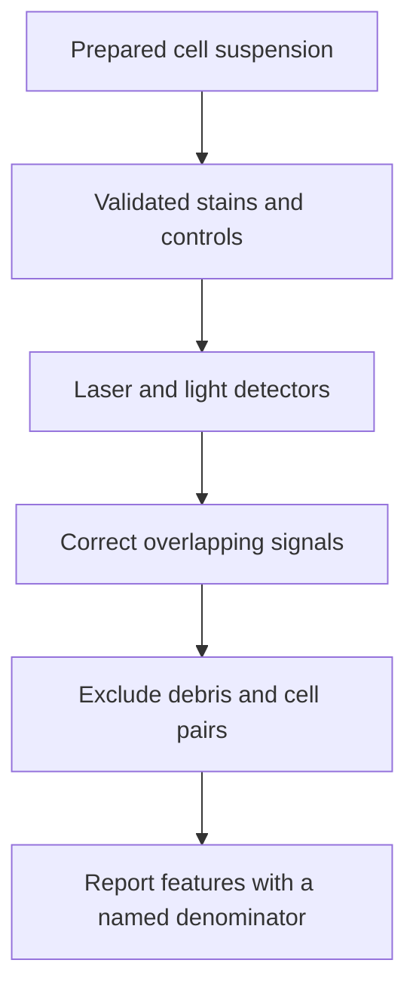

# Flow cytometry

## In one sentence

Flow cytometry measures light signals from individual particles passing through a laser, allowing prepared cells to be counted and grouped by their measured features.

## The intuition

Imagine a checkpoint where people pass a scanner carrying several colored badges. You can count badge combinations rather than average the whole crowd. The badges stand for stains, often antibodies attached to fluorescent dyes.

The analogy has a limit: a detector records an event, which might be one cell, two stuck together or debris. Recognizing a useful cell population requires controls and analysis. A badge combination does not automatically reveal what that cell can do.

## How it works

A laboratory prepares a cell suspension from blood or dissociated tissue. Selected stains report surface proteins, intracellular molecules or viability. The panel is the chosen set of measurements; features outside that panel remain unmeasured.

Cells pass through laser light. Detectors record scattered light and fluorescence. Scatter helps characterize particles but does not precisely determine cell identity. Different fluorescent dyes can contribute signal to the same detector. Conventional instruments correct this overlap by **compensation**; spectral instruments separate measured light patterns by **unmixing**. Neither procedure repairs a poorly chosen stain or restores information lost in noise.

Analysis uses **gates**, rules selecting events with particular features. A typical sequence excludes debris and cell pairs, selects cells viable before fixation, then identifies a population using several markers. Automated clustering can assist; its groups still need biological and technical checks.

A percentage must name its parent population. “Positive among sampled T cells” and “positive among all recovered cells” answer different questions. Absolute counts require an appropriate counting method, such as counting beads or a validated volume measurement.

## Why it matters in cancer

[Human leukocyte antigen (HLA)](/wiki/education/concepts/immunology/antigen-presentation/hla) displays peptide fragments. Flow can characterize immune populations and measure [peptide–HLA multimer binding](/wiki/education/concepts/measurement/immune-monitoring/peptide-hla-multimer-staining). [Intracellular cytokine staining](/wiki/education/concepts/measurement/immune-monitoring/intracellular-cytokine-staining) adds a defined-stimulus response test. Tissue dissociation removes geography and can recover cell types unevenly. The suspension is therefore a prepared sample of the tissue, not a complete map of it.

## Assay card

| Field | What to record |
|---|---|
| Input and tissue cost | Whole blood, isolated cells or dissociated tissue; preparation and staining consume an aliquot. Required cell numbers depend on the panel and the rarity of the population. |
| Output and units | Event counts; percent of a named parent population; fluorescence intensity in instrument-dependent units; cells per volume only with a validated counting method. |
| Controls | Instrument checks, unstained and single-stain controls, viability assessment, appropriate biological controls and fluorescence-minus-one controls for difficult boundaries. The latter omit one stain while retaining the others. |
| Thresholds | Positivity gates and minimum event requirements set for the panel and purpose; no universal immune-response cutoff. |
| Failure modes | Dead cells, aggregates, weak markers, nonspecific staining, signal overlap, cell loss and inconsistent gates. |
| What it cannot tell you | Unmeasured proteins, original tissue position, antigen specificity from general markers, or patient benefit. |
| Validation context | Flow is a platform used in research and clinical laboratories. Validation belongs to the specific specimen, panel, instrument, analysis and intended use. |

## Worked example

In a fictional sample, 100 of 1,000 gated T cells bind a reagent, among 10,000 recovered cells. Which percentage describes binding among T cells?

**Answer:** 10%. The same events are 1% of all recovered cells. Both calculations can be correct, but exchanging their denominators would change the claim. Neither percentage proves killing.

## Common confusions

- **An event is not automatically a cell:** debris and aggregates need exclusion.
- **Marker expression is not function:** a cytotoxic-associated marker does not demonstrate target-cell death.
- **Compensation is not a positivity gate:** it addresses signal overlap; controls guide the biological boundary.
- **Flow analysis is not cell sorting:** some instruments can physically collect selected cells; routine analysis alone does not.

## Related concepts

- [Peripheral blood mononuclear cells](/wiki/education/concepts/measurement/immune-monitoring/peripheral-blood-mononuclear-cells)
- [Functional cytotoxicity assays](/wiki/education/concepts/measurement/immune-monitoring/functional-cytotoxicity-assays)
- [T-cell states](/wiki/education/concepts/immunology/t-cells/t-cell-states)

## Sources and scope

Source-checked October 9, 2026. Platform principles and a fictional calculation; expert and learner review pending.

- [Cossarizza et al., 2021: guidelines for flow cytometry and cell sorting, third edition](https://pubmed.ncbi.nlm.nih.gov/34910301/). Community methods guidance on specimen preparation, instruments, panels and analysis.
- [Roederer, 2001: spectral compensation, artifacts and limitations](https://pubmed.ncbi.nlm.nih.gov/11746088/). Primary experimental and mathematical analysis of signal overlap and gating controls.

<!-- BEGIN GENERATED USED IN -->
## Used in

- [Measure presentation, binding and response](/wiki/education/designing-a-vaccine/03-immunopeptidomics)
- [Dose a vaccine and measure its response](/wiki/education/guides/personalized-cancer-vaccine/08-dosing-and-measuring-response)
- [How a personalized cancer vaccine is designed](/wiki/education/guides/personalized-cancer-vaccine/index)
- [Measure each part of a T-cell response](/wiki/education/reading-a-tumor/measuring-t-cell-engagement)
<!-- END GENERATED USED IN -->
