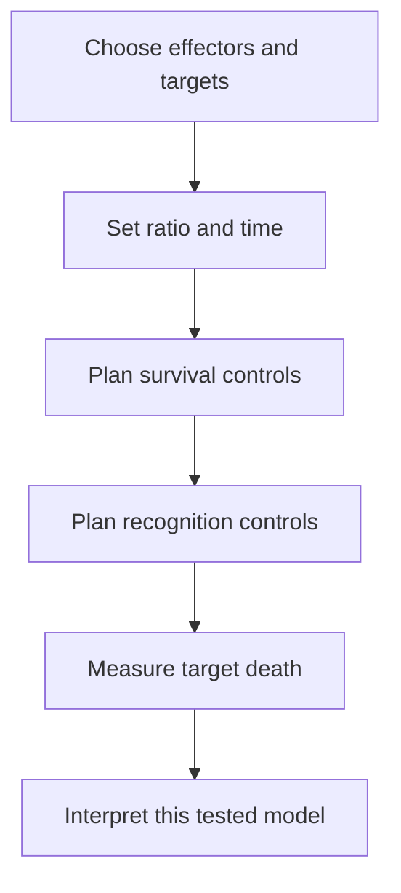

# Functional cytotoxicity assays

## In one sentence

Functional cytotoxicity assays test whether effector cells cause death of specified target cells under controlled laboratory conditions.

## The intuition

Recognizing a lock, turning a key and opening the door are separate events. Binding and cytokine production tell us about earlier parts of an immune response. A killing assay asks whether the tested target cells actually die.

The analogy ends at the laboratory model. Success with one target, cell ratio and time window does not show that the cells can reach every tumor, spare healthy tissue or improve a patient's outcome.

## How it works

Researchers combine **effector cells**, the cells being tested for killing, with identifiable **target cells**. They specify the effector-to-target ratio, incubation time and medium. Target cells may be a cell line, engineered cells or a patient-derived preparation. Each choice changes the question.

Methods detect death or loss of targets in different ways. [Flow cytometry](/wiki/education/concepts/measurement/immune-monitoring/flow-cytometry) can distinguish labeled targets from effectors and assess death-associated staining. Release assays detect material escaping damaged targets. Imaging can follow target cells over time. A decrease in metabolic or growth signal alone can reflect slowed proliferation or changed metabolism, so it needs validation as evidence of death.

Target-only wells establish spontaneous death or survival without effectors. Suitable positive controls establish assay responsiveness. Irrelevant or antigen-negative targets, and appropriate [perturbations](/wiki/education/concepts/evidence-and-statistics/study-design/perturbation-and-controls), help test why killing occurred. For a [T-cell receptor (TCR)](/wiki/education/concepts/immunology/t-cells/t-cell-receptor), altering the intended antigen or [human leukocyte antigen (HLA)](/wiki/education/concepts/immunology/antigen-presentation/hla) presentation can strengthen a recognition claim when the controls themselves remain interpretable.

Peptide-loaded targets can test recognition of a supplied peptide. They may bypass the tumor's own protein production, processing and display. Naturally presenting cancer cells address that bridge more directly, but their identity, presentation and condition still require checks.

## Why it matters in cancer

These assays help characterize candidate immune cells and targets. They complement [peptide–HLA multimer binding](/wiki/education/concepts/measurement/immune-monitoring/peptide-hla-multimer-staining), [enzyme-linked immunospot (ELISpot)](/wiki/education/concepts/measurement/immune-monitoring/elispot) and [intracellular cytokine staining](/wiki/education/concepts/measurement/immune-monitoring/intracellular-cytokine-staining). Each adds evidence about a different step. A negative result can also be informative, provided poor cell health or an unsuitable target model has not hidden a response.

## Assay card

| Field | What to record |
|---|---|
| Input and tissue cost | Viable effectors and viable specified targets; each condition consumes cells. Culture or expansion may select populations and alter their state. |
| Output and units | Percent target death or control-corrected specific lysis; viable-target counts; time-dependent killing curves. State the formula, ratio and time. |
| Controls | Target-only survival, effector identification and viability, positive-control response, irrelevant targets and suitable antigen or presentation controls. Maximum-release controls apply to relevant release assays. |
| Thresholds | Platform- and purpose-specific criteria; no universal percentage that establishes clinical effectiveness. |
| Failure modes | High spontaneous death, mistaken target identity, aggregates, dye transfer, artificial loading, unmatched ratios or a readout that mainly measures growth. |
| What it cannot tell you | Universal tumor recognition, trafficking, persistence, comprehensive healthy-tissue safety or patient benefit. |
| Validation context | Model-specific functional evidence. Reproducibility and biological specificity must be checked for the specimen and intended claim. |

## Worked example

A fictional assay records 40% target death with effectors and 30% in target-only wells. A reader calls this “40% immune killing.” Is that justified?

**Answer:** No. Much of the death occurs without effectors. An excess-death calculation and a control-normalized lysis formula give different quantities; report the method rather than treating raw death as attributable killing. High baseline death may also make the experiment unsuitable.

## Common confusions

- **Cytokine production is not killing:** response signals and target death require different readouts.
- **Degranulation is not completed killing:** release of granules is an indicator of effector activity.
- **Reduced growth is not necessarily death:** cytostasis can lower a signal without killing targets.
- **Peptide-loaded killing is not natural tumor recognition:** target preparation matters.

## Related concepts

- [T-cell states](/wiki/education/concepts/immunology/t-cells/t-cell-states)
- [Antigen processing machinery](/wiki/education/concepts/immunology/antigen-presentation/antigen-processing-machinery)
- [Ex vivo drug screens](/wiki/education/concepts/measurement/functional-models/ex-vivo-drug-screen)

## Sources and scope

Source-checked October 9, 2026. Laboratory function and a fictional interpretation exercise; expert and learner review pending.

- [Rabinovich et al., 2019: a versatile flow-based cytotoxicity assay](https://pubmed.ncbi.nlm.nih.gov/31525367/). Primary method tested with several effector–target systems, including natural killer cells and expanded tumor-infiltrating lymphocytes.
- [Noto et al., 2013: a cell-based cytotoxicity assay](https://pubmed.ncbi.nlm.nih.gov/24378436/). Primary protocol using peptide-loaded targets; its results must be interpreted within that preparation.
- [Betts et al., 2003: flow-based detection of degranulation](https://pubmed.ncbi.nlm.nih.gov/14580882/). Primary functional-indicator study; degranulation is distinct from target-cell death.

<!-- BEGIN GENERATED USED IN -->
## Used in

- [Compare immune-cell recognition systems](/wiki/education/cellular-therapies/02-car-tcr-til-comparison)
- [How to engineer T cells inside the body](/wiki/education/cellular-therapies/06-in-vivo-delivery)
- [Measure presentation, binding and response](/wiki/education/designing-a-vaccine/03-immunopeptidomics)
- [Dose a vaccine and measure its response](/wiki/education/guides/personalized-cancer-vaccine/08-dosing-and-measuring-response)
- [How a personalized cancer vaccine is designed](/wiki/education/guides/personalized-cancer-vaccine/index)
- [Why a T-cell count does not tell the whole story](/wiki/education/oncology-101/3-t-cell-states)
- [Measure each part of a T-cell response](/wiki/education/reading-a-tumor/measuring-t-cell-engagement)
<!-- END GENERATED USED IN -->
