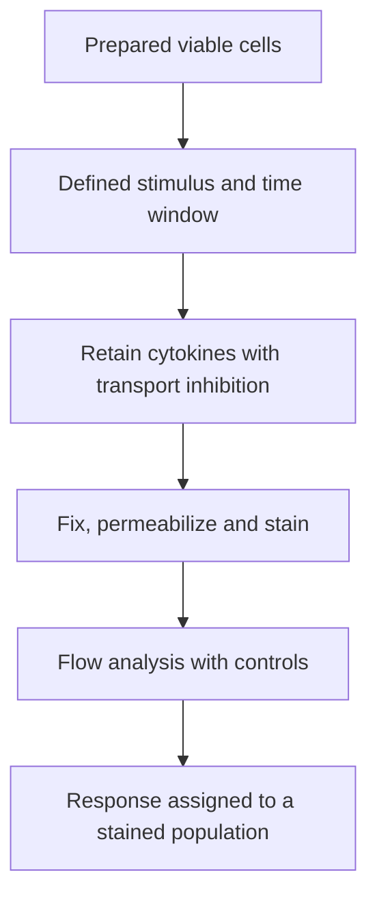

# Intracellular cytokine staining

## In one sentence

Intracellular cytokine staining measures cytokines retained inside cells during a defined assay, allowing a response to be assigned to stained cell populations.

## The intuition

Suppose you want to know which people in a group wrote a message. Collecting messages from the room tells you something happened. Looking inside each person's outbox adds information about who produced them.

That is the attraction of intracellular cytokine staining (ICS). The analogy stops at the assay: the laboratory deliberately changes secretion and fixes the cells. The readout describes the tested conditions, not an untouched snapshot of their behavior inside a tumor.

## How it works

Cells are exposed to a defined stimulus, such as a peptide pool, a protein or a broad activating reagent. [Peripheral blood mononuclear cells (PBMCs)](/wiki/education/concepts/measurement/immune-monitoring/peripheral-blood-mononuclear-cells) are a common input. Different stimuli test different biological steps. A synthetic peptide can bypass some requirements for making and processing the original protein.

Transport inhibitors, commonly brefeldin A or monensin, are used during a specified incubation window so newly made [cytokines](/wiki/education/concepts/immunology/immune-regulation/cytokine-and-chemokine) accumulate inside cells. Timing and inhibitor choice affect the result. Cells are then fixed and their membranes made permeable so antibodies can reach intracellular molecules.

[Flow cytometry](/wiki/education/concepts/measurement/immune-monitoring/flow-cytometry) measures the cytokine stains alongside markers identifying cell populations. An appropriate viability stain applied before fixation helps exclude cells already dead. Analysis reports cytokine-positive cells within a named parent population, with background and positivity rules recorded.

Measuring several cytokines can identify **polyfunctional** cells: cells meeting the assay's rules for multiple measured functions. That word always needs the panel and stimulus attached. Three positive cytokine stains are not a universal rank of antitumor effectiveness.

## Why it matters in cancer

ICS can help ask which sampled immune populations respond to a vaccine antigen or other stimulus. It complements [enzyme-linked immunospot (ELISpot)](/wiki/education/concepts/measurement/immune-monitoring/elispot), which records secretion-associated spots. Standard ICS does not identify a responding cell's receptor sequence. Linking that response to a particular receptor requires an additional compatible identification strategy.

## Assay card

| Field | What to record |
|---|---|
| Input and tissue cost | Viable blood-derived or tissue-derived cells; stimulus conditions use separate aliquots. Fixation makes analyzed cells unavailable for subsequent living-cell assays. |
| Output and units | Percent cytokine-positive cells in a stated parent population; percent with specified cytokine combinations; stain intensity in instrument-dependent units. |
| Controls | Unstimulated or vehicle control, suitable positive stimulation, viability and cell recovery, single-stain controls, and appropriate staining-boundary controls. |
| Thresholds | Prespecified background, event-count and positivity rules for the assay; no universal protective or tumor-response threshold. |
| Failure modes | Poor recovery, handling delays, high background, few responding events, altered epitopes after fixation, signal overlap or different stimulation windows. |
| What it cannot tell you | Natural tumor presentation, direct target-cell killing, receptor sequence identity or clinical benefit. |
| Validation context | A defined panel and protocol require reproducibility checks. Multilaboratory standardization studies do not validate every panel, stimulus or disease application. |

## Worked example

A fictional report finds cells positive for both interferon-gamma and tumor necrosis factor after peptide stimulation. May it call them tumor-killing cells?

**Answer:** It can call them double-cytokine-positive under that assay. Natural tumor recognition and death of appropriate target cells need separate testing. A broad positive-control response confirms some assay responsiveness, not recognition of the intended peptide.

## Common confusions

- **Intracellular retention is not measured secretion:** transport inhibition is part of the experiment.
- **Polyfunctionality is panel-dependent:** adding or removing measured functions changes the definition.
- **A degranulation marker is not target-cell death:** releasing killing machinery and successfully killing are separate readouts.
- **Population identity is not receptor identity:** stained T-cell subsets can contain many receptors.

## Related concepts

- [Peptide–human leukocyte antigen multimer staining](/wiki/education/concepts/measurement/immune-monitoring/peptide-hla-multimer-staining)
- [Functional cytotoxicity assays](/wiki/education/concepts/measurement/immune-monitoring/functional-cytotoxicity-assays)
- [T-cell receptor sequencing](/wiki/education/concepts/measurement/immune-monitoring/tcr-sequencing)

## Sources and scope

Source-checked October 9, 2026. Defined-stimulus assay teaching; expert and learner review pending.

- [Maecker et al., 2005: standardization of cytokine flow cytometry assays](https://pubmed.ncbi.nlm.nih.gov/15978127/). Primary multilaboratory study in vaccine-monitoring settings; supports the importance of protocol and gating consistency.
- [Cossarizza et al., 2021: flow cytometry guidelines, third edition](https://pubmed.ncbi.nlm.nih.gov/34910301/). Methods guidance for stimulation, transport inhibition, fixation, staining and controls.
- [Betts et al., 2003: flow-based detection of T-cell degranulation](https://pubmed.ncbi.nlm.nih.gov/14580882/). Primary study of an additional functional indicator, distinct from measuring target-cell death.

<!-- BEGIN GENERATED USED IN -->
## Used in

- [Measure presentation, binding and response](/wiki/education/designing-a-vaccine/03-immunopeptidomics)
- [Dose a vaccine and measure its response](/wiki/education/guides/personalized-cancer-vaccine/08-dosing-and-measuring-response)
- [How a personalized cancer vaccine is designed](/wiki/education/guides/personalized-cancer-vaccine/index)
- [Measure each part of a T-cell response](/wiki/education/reading-a-tumor/measuring-t-cell-engagement)
<!-- END GENERATED USED IN -->
