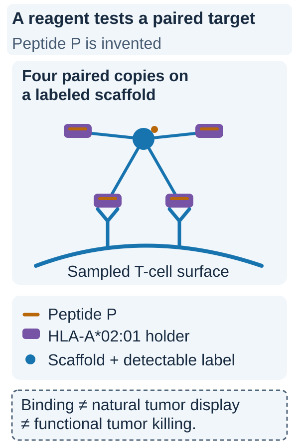

# Peptide–HLA multimer staining

## In one sentence

Multimer staining labels cells whose receptors bind a specified peptide held by its display molecule under the assay conditions.

## The intuition

A labeled test piece lets researchers find cells that bind a chosen target shape. Using several copies together makes the contact easier to detect. Think of it as a binding label, not a certificate that the labeled cell can kill cancer.

Here, [human leukocyte antigen (HLA)](/wiki/education/concepts/immunology/antigen-presentation/hla) holds the peptide. The reagent tests contact with a [T-cell receptor (TCR)](/wiki/education/concepts/immunology/t-cells/t-cell-receptor). It does not contain a whole tumor cell.

## How it works

Researchers assemble a specified HLA molecule with a selected peptide and attach multiple copies to a detectable scaffold. A tetramer is one commonly used format. Cells are exposed to the reagent and analyzed, often by [flow cytometry](/wiki/education/concepts/measurement/immune-monitoring/flow-cytometry), which records fluorescence and selected cell markers.

The peptide sequence and HLA allele define what was tested. A mismatched allele or poorly formed reagent can make a negative result uninformative. Controls help address nonspecific binding, dead cells and background fluorescence. Some relevant receptors bind too weakly for a particular staining method.

Staining can be combined with cell-state markers or receptor sequencing. That links a binding observation to the sampled cell's identity. It still does not prove functional activation, persistence or recognition of naturally processed antigen on cancer cells.

### Read the visual

*Multimer binding belongs to the specified peptide–HLA reagent and assay conditions.*

Peptide P is an invented identifier, and HLA-A*02:01 is the named example allele. Each purple holder carries the same orange peptide. Multiple copies attach to the labeled scaffold, helping the reagent remain associated with matching receptors through multivalent contact, or avidity. This reagent is not a tumor cell. An observed stain identifies binding under the tested conditions; it does not show natural processing and display of that pair by a tumor. Functional activation and target-cell killing need suitable, separate tests. [Altman primary tetramer study](https://pubmed.ncbi.nlm.nih.gov/8810254/).

## Why it matters in cancer

Multimers can help count or isolate candidate antigen-reactive cells in a vaccine or receptor-discovery experiment. They are most informative when used alongside controlled functional studies. Different assays answer neighboring questions; agreement helps connect the chain, while disagreement can reveal a missing step.

## How it is measured

| Field | What the report needs |
|---|---|
| Measures | Binding to a specified peptide–HLA reagent under the staining conditions |
| How | Assemble labeled complexes; expose cells; select viable cells and analysis gates; count positive events |
| Input and tissue cost | Suitable blood- or tissue-derived cells; preparation and staining consume an aliquot; reagent must match peptide and allele |
| Output and units | Percent positive within a named gate, or counts with an appropriate counting method |
| Thresholds | Gate and positivity rules require background and reagent controls; no universal percent establishes efficacy |
| Failure modes | Nonspecific binding, weak binding, dead cells, incorrect reagent, chain/context differences or sampling loss |
| What it cannot tell you | Cytokine response, tumor-cell killing, healthy-tissue specificity or patient benefit |
| Validation tier | Reagent and workflow validation are use-specific; a research labeling method is not automatically a treatment-selection test |

Cell fractions depend on the denominator. A percentage of [CD8 T cells](/wiki/education/concepts/immunology/t-cells/cd4-vs-cd8) cannot be compared directly with a percentage of all blood cells.

## Worked example

A fictional multimer labels a small population after vaccination. Those cells bind the test reagent under the chosen conditions. An [ELISpot assay](/wiki/education/concepts/measurement/immune-monitoring/elispot) could test secretion after stimulation. A tumor-cell assay would ask whether naturally presented antigen supports useful function. Neither follow-up answer is contained in the staining percentage.

## Common confusions

- Binding a reagent is different from killing a naturally presenting tumor cell.
- A tetramer-negative result is not a census of every possible relevant receptor.
- HLA restriction belongs to the peptide–HLA pair, not the peptide alone.

## Try it

Invented numbers: 100 stained cells are found among 10,000 gated CD8 T cells. The same acquired sample contains 40,000 viable cells overall. What are the two percentages?

**Answer:** They are 1% of gated CD8 T cells and 0.25% of the acquired viable cells. Both can be correct, but they answer different denominator questions. Neither is a body-wide census or a killing rate.

## Explain it back

“Multimer staining establishes binding to ___; it does not establish ___.” One answer: “the specified peptide–HLA reagent; natural tumor recognition or useful killing.”

## Takeaway

**Read the peptide, allele, gate and controls before interpreting the percentage.**

## Related concepts

- [T-cell states](/wiki/education/concepts/immunology/t-cells/t-cell-states)
- [Immunopeptidomics](/wiki/education/concepts/measurement/proteins-and-spatial/immunopeptidomics)

## Sources and scope

Source check: October 10, 2026. This page explains a method or mechanism. Expert and learner review remain pending.

- [Altman et al., primary antigen-specific T-cell labeling study](https://pubmed.ncbi.nlm.nih.gov/8810254/).
- [Primary tetramer-production method](https://pubmed.ncbi.nlm.nih.gov/17187819/).
- [Peptide-specific functional assay protocol](https://pmc.ncbi.nlm.nih.gov/articles/PMC8410284/) — complementary secretion measurement.

<!-- BEGIN GENERATED USED IN -->
## Used in

- [Measure presentation, binding and response](/wiki/education/designing-a-vaccine/03-immunopeptidomics)
- [Dose a vaccine and measure its response](/wiki/education/guides/personalized-cancer-vaccine/08-dosing-and-measuring-response)
- [How a personalized cancer vaccine is designed](/wiki/education/guides/personalized-cancer-vaccine/index)
- [T-cell receptors and TCR sequencing](/wiki/education/molecular-profiling/tcr-and-tcr-sequencing)
- [Why a T-cell count does not tell the whole story](/wiki/education/oncology-101/3-t-cell-states)
- [Measure each part of a T-cell response](/wiki/education/reading-a-tumor/measuring-t-cell-engagement)
<!-- END GENERATED USED IN -->
