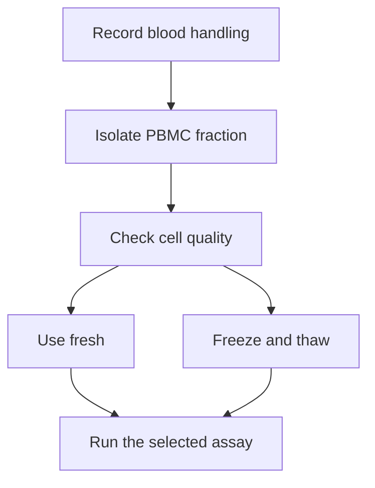
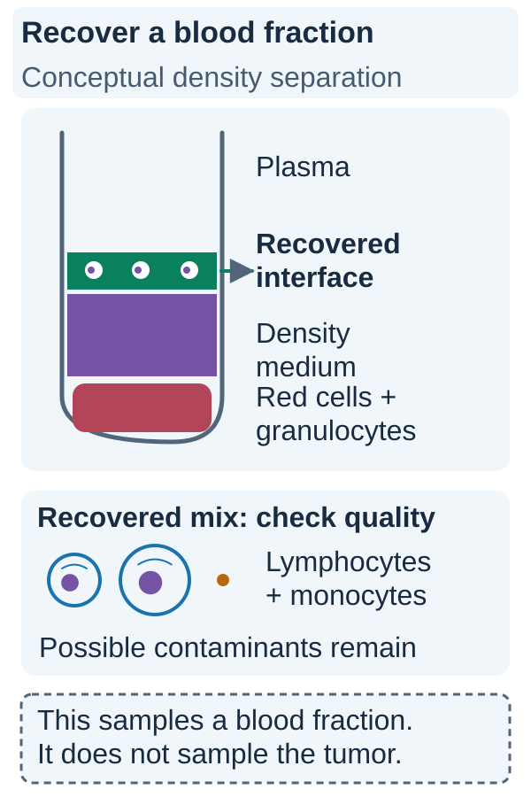

# Peripheral blood mononuclear cells

## In one sentence

Peripheral blood mononuclear cells are the circulating white blood cells with a single, unsegmented nucleus, mainly lymphocytes and monocytes, that can be isolated for immune assays.

## The intuition

Think of a blood sample as a mixed crowd. Preparing peripheral blood mononuclear cells (PBMCs) selects one part of that crowd for further study. It gives researchers a useful working collection, not a miniature version of the whole immune system.

The analogy breaks at location and selection. Cells recovered from blood do not represent every cell in a tumor or lymph node. Even the recovered blood mixture depends on how it was collected and processed.

## How it works

PBMCs include T cells, B cells, [natural killer (NK) cells](/wiki/education/concepts/immunology/innate-and-unconventional-cells/nk-cell-and-missing-self), monocytes and smaller populations. “Mononuclear” describes the nucleus, not a single cell type or shared function. Most conventional granulocytes, such as neutrophils, are outside this category.

A common preparation layers anticoagulated blood over a density-separation medium and centrifuges it. Mononuclear cells accumulate in an interface that can be collected and washed. Red cells and many granulocytes separate elsewhere. Recovery is incomplete; platelets, red cells or low-density granulocytes can contaminate a preparation. The label PBMC therefore does not guarantee purity.

The laboratory counts cells, measures viability and allocates aliquots. Cells may be used fresh or frozen under a validated cryopreservation procedure. Thawing, washing and any resting step can change the recovered mixture. A high viability percentage alone does not prove that all populations or functions were preserved.

Preparing PBMCs is a sample-processing step. [Flow cytometry](/wiki/education/concepts/measurement/immune-monitoring/flow-cytometry), [intracellular cytokine staining](/wiki/education/concepts/measurement/immune-monitoring/intracellular-cytokine-staining) and [enzyme-linked immunospot (ELISpot)](/wiki/education/concepts/measurement/immune-monitoring/elispot) then ask different questions of that material.

### Read the visual

*PBMC preparation selects a recoverable blood fraction whose composition still needs checking.*

The narrow interface is the fraction collected in this common density-separation approach. Lymphocytes and monocytes concentrate there; red cells and many conventional granulocytes separate lower down. Platelets and other contaminants can remain, including low-density granulocytes in some samples. Check recovery, viability and population composition before assigning aliquots to an assay. The tube drawing is a compartment map, not a processing protocol. Even a clean recovered blood fraction does not sample tumor tissue or provide a complete immune census. [Official density-separation principle handbook](https://cdn.cytivalifesciences.com/api/public/content/digi-16156-pdf).

## Why it matters in cancer

Repeated blood sampling can support immune monitoring without repeatedly obtaining tumor tissue. But blood and tumor are different compartments. A blood response may not reach the cancer; an important tumor-localized response may be missed in blood.

Handling is part of the evidence. Comparing a rapidly processed baseline sample with a delayed follow-up sample can confound a biological comparison. Cell banking also preserves material only to the extent supported by the collection, storage and downstream assay validation.

## Preparation card

| Field | What to record |
|---|---|
| Input and tissue cost | Anticoagulated blood or an appropriate blood-cell collection product; separation consumes that aliquot. Available viable cells, rather than blood volume alone, limit downstream tests. |
| Output and units | Recovered cell number, viable-cell percentage, recovery after thawing and measured population fractions; cells per original blood volume require a documented calculation. |
| Controls | Collection and processing timestamps, anticoagulant, storage conditions, counting and viability methods, contamination checks and matched handling across time points. |
| Thresholds | Acceptance rules established for the intended downstream assay, not one universal PBMC-quality number. |
| Failure modes | Delay, poor separation, contamination, selective cell loss, freezing or thawing injury and insufficient cells for rare responses. |
| What it cannot tell you | Tumor infiltration, immune function, receptor specificity or whether stored cells are suitable for every future assay or treatment. |
| Validation context | The preparation and downstream assay must be assessed together. A handling protocol validated for one stimulus or study cannot automatically be transferred to another. |

## Worked example

In a fictional study, two tubes yield equally high viable-cell percentages. One has far fewer recovered monocytes. Are they interchangeable for a whole-protein stimulation assay?

**Answer:** Not automatically. Monocytes can contribute antigen presentation, and selective loss may change the response. Check composition, recovery and assay performance, not viability alone.

## Common confusions

- **PBMCs are not all blood cells:** red cells and most granulocytes are not the intended fraction.
- **Isolation is not purification of T cells:** the fraction contains several immune populations.
- **Blood sampling is not tumor sampling:** repertoire overlap does not erase the compartment difference.
- **Freezing is not guaranteed preservation:** suitability depends on the cells, handling and intended use.

## Related concepts

- [T-cell repertoire](/wiki/education/concepts/immunology/t-cells/t-cell-repertoire)
- [T-cell receptor sequencing](/wiki/education/concepts/measurement/immune-monitoring/tcr-sequencing)
- [Immune cell roster](/wiki/education/concepts/immunology/the-immune-system/immune-cell-roster)

## Sources and scope

Source-checked October 9, 2026. Sample preparation, not a personal collection or banking recommendation; expert and learner review pending.

- [Böyum, 1968: isolation of mononuclear cells and granulocytes from human blood](https://pubmed.ncbi.nlm.nih.gov/4179068/). Foundational primary separation method.
- [Bull et al., 2007: blood-processing parameters for cryopreserved antigen-specific responses](https://pmc.ncbi.nlm.nih.gov/articles/PMC1904432/). Primary HIV-vaccine assay study; establishes handling sensitivity in its tested protocols, not a universal cancer-assay schedule.
- [Cossarizza et al., 2021: flow cytometry guidelines, third edition](https://pubmed.ncbi.nlm.nih.gov/34910301/). Methods guidance on preparation, viability and analysis.

<!-- BEGIN GENERATED USED IN -->
## Used in

- [Measure presentation, binding and response](/wiki/education/designing-a-vaccine/03-immunopeptidomics)
- [Dose a vaccine and measure its response](/wiki/education/guides/personalized-cancer-vaccine/08-dosing-and-measuring-response)
- [How a personalized cancer vaccine is designed](/wiki/education/guides/personalized-cancer-vaccine/index)
- [Measure each part of a T-cell response](/wiki/education/reading-a-tumor/measuring-t-cell-engagement)
<!-- END GENERATED USED IN -->
