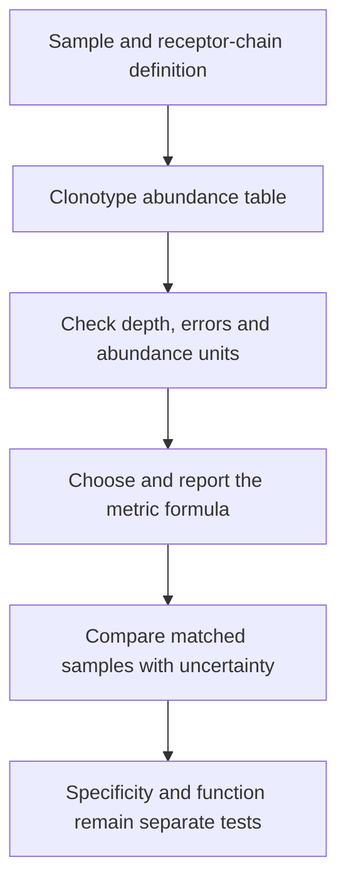

# T-cell receptor clonality metrics

## In one sentence

T-cell receptor clonality metrics summarize how unevenly sampled receptor identities are distributed, without identifying what those receptors recognize.

## The intuition

Imagine a playlist. It may contain many different songs, yet one song accounts for most plays. **Richness** asks how many songs appear. **Evenness** asks how equally the plays are shared. Clonality metrics describe dominance of [T-cell receptor (TCR)](/wiki/education/concepts/immunology/t-cells/t-cell-receptor) identities in a sampled [repertoire](/wiki/education/concepts/immunology/t-cells/t-cell-repertoire).

The analogy cannot tell you what the songs mean. Likewise, a dominant receptor may recognize a virus, a cancer-related target or something untested. A summary of frequencies is not a target-identification test.

## How it works

[TCR sequencing](/wiki/education/concepts/measurement/immune-monitoring/tcr-sequencing) produces receptor identities and abundance estimates. A **clonotype** is an identity defined by the analysis rules: for example, a particular receptor-chain sequence with specified joining information. A single-chain definition and a paired-chain definition need not group cells the same way.

Several summaries describe that table:

- **Observed richness:** the number of distinct clonotypes detected. Deeper sampling can reveal additional rare identities.
- **Shannon entropy:** a measure combining richness and evenness. With each clonotype's relative weight represented by `pᵢ`, it is `H = −Σ pᵢ ln(pᵢ)`, using natural logarithms.
- **Normalized Shannon clonality:** one common convention is `1 − H/ln(K)`, where `K` is observed richness and greater than one. Equal weights give zero; stronger dominance raises the score. Handling a one-clonotype sample must be specified.
- **Effective diversity:** measures such as the exponential of `H` or inverse Simpson diversity describe an effective number of clonotypes. They emphasize rare and dominant identities differently.

The metric's formula matters as much as its name. Software may report Shannon entropy, its exponential or a normalized version. Those outputs cannot be exchanged because they share a familiar label.

Relative weights may derive from reads, corrected molecules or sampled cells. These are not automatically equivalent. Comparing samples requires attention to assay version, compartment, input, sequence filtering and depth. Subsampling to a comparable depth can help assess sampling effects, but cannot recover cells that were never sampled.

## Why it matters in cancer

A treatment study may examine whether the repertoire becomes more concentrated or whether particular clonotypes change frequency. This can guide follow-up experiments. It does not establish which cells recognized cancer, whether they killed it, or whether treatment helped a patient. There is no universal clonality score that means an immune therapy is working.

## Measurement card

| Field | What to record |
|---|---|
| Input and tissue cost | A sequencing-derived clonotype table; calculation consumes no additional tissue. The upstream sequencing assay consumes its sample aliquot. |
| Output and units | Richness as a count; entropy and normalized clonality as dimensionless quantities; effective diversity as an effective clonotype count. Include formula and software version. |
| Controls | Matched sample compartments and handling, receptor-chain definitions, error filtering, abundance units, sequencing-depth assessment, and technical replicates or resampling where appropriate. |
| Thresholds | Study-specific rules with their population and endpoint; no universal tumor-reactive cutoff. |
| Failure modes | Low input, unequal depth, amplification bias, sequence errors, changing cell mixtures and inconsistent definitions. |
| What it cannot tell you | Antigen target, absolute cell expansion, tissue location, killing or clinical benefit. |
| Validation context | Reproducible repertoire analysis is analytical validation. A prognostic association or treatment-benefit prediction needs separate, context-specific clinical evidence. |

## Worked example

In a fictional sample, clonotype A contributes 30 of 100 measured molecules. Later it contributes 30 of 50. Has A doubled?

**Answer:** Its relative frequency rose from 30% to 60%; its measured molecule count did not increase. The other measured identities declined. These molecule counts also do not automatically equal absolute cell counts in blood.

## Common confusions

- **Richness is not evenness:** many identities can coexist with strong dominance.
- **Relative enrichment is not absolute expansion:** the denominator can change.
- **A shared sequence is not proven cancer specificity:** overlap between blood and tumor needs functional interpretation.
- **One number is not the whole repertoire:** inspect the distribution and sampling context.

## Related concepts

- [Peptide–human leukocyte antigen multimer staining](/wiki/education/concepts/measurement/immune-monitoring/peptide-hla-multimer-staining)
- [Functional cytotoxicity assays](/wiki/education/concepts/measurement/immune-monitoring/functional-cytotoxicity-assays)
- [Prognostic versus predictive biomarkers](/wiki/education/concepts/evidence-and-statistics/biomarkers/prognostic-vs-predictive)

## Sources and scope

Source-checked October 9, 2026. Descriptive repertoire analysis and a fictional denominator exercise; expert and learner review pending.

- [Shugay et al., 2015: VDJtools repertoire post-analysis](https://pubmed.ncbi.nlm.nih.gov/26606115/). Primary methods paper on repertoire comparison and diversity analysis.
- [VDJtools authors: diversity estimation documentation](https://vdjtools-doc.readthedocs.io/en/master/diversity.html). Defines distinct Shannon outputs and depth-adjusted comparisons; formulas and software settings must be reported.
- [Zhang et al., 2017: diversity, dynamics and differential repertoire analysis](https://pmc.ncbi.nlm.nih.gov/articles/PMC5327583/). Primary methods paper defining diversity measures and normalized Shannon clonality; its clinical examples do not supply a universal response threshold.

<!-- BEGIN GENERATED USED IN -->
## Used in

- [Measure presentation, binding and response](/wiki/education/designing-a-vaccine/03-immunopeptidomics)
- [Dose a vaccine and measure its response](/wiki/education/guides/personalized-cancer-vaccine/08-dosing-and-measuring-response)
- [How a personalized cancer vaccine is designed](/wiki/education/guides/personalized-cancer-vaccine/index)
- [T-cell receptors and TCR sequencing](/wiki/education/molecular-profiling/tcr-and-tcr-sequencing)
- [Measure each part of a T-cell response](/wiki/education/reading-a-tumor/measuring-t-cell-engagement)
<!-- END GENERATED USED IN -->
