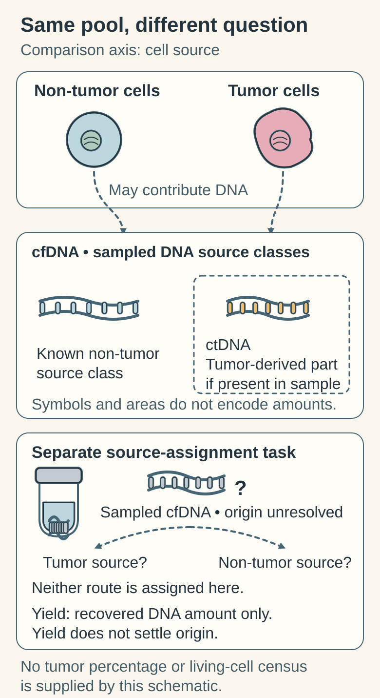

# Cell-free DNA versus circulating tumor DNA

## In one sentence

Cell-free DNA is DNA outside intact cells in a sample; circulating tumor DNA is the portion that comes from tumor cells.

## The intuition

Picture a river carrying scraps of paper from many buildings. Finding paper tells you material entered the river; identifying its origin requires more information. Likewise, [DNA](/wiki/education/concepts/biology-basics/molecules/dna) fragments in plasma come from several cell populations. The analogy stops at source identification: DNA release, transport and clearance are biological processes, and one fragment does not count one living cell.

## How it works

Blood contains cells and a fluid component. Plasma is separated from collected blood before extracting cell-free DNA (cfDNA). Most cfDNA comes from dying blood cells: in healthy donors, a methylation atlas attributed about 55% to white blood cells, 30% to red-cell precursors, 10% to blood-vessel lining and 1% to liver ([Moss 2018](https://doi.org/10.1038/s41467-018-07466-6)). Tumor cells can add circulating tumor DNA (ctDNA). The tumor-derived portion may be small or absent in the evaluated sample even when cancer exists elsewhere.

### A sense of scale

| Quantity | Typical magnitude | Source |
|---|---|---|
| Fragment length | Peak near 166 base pairs; tumor fragments shifted shorter | [Lo 2010](https://doi.org/10.1126/scitranslmed.3001720); [fragmentomics](/wiki/education/concepts/measurement/liquid-biopsy/fragmentomics-and-methylation) |
| Mass per genome copy | 3.3 picograms per haploid copy, so 1 nanogram ≈ 300 copies | Arithmetic from human genome size |
| Input to one assay | 4,500 genome copies, about 15 nanograms, in a breast-cancer study | [Santonja 2023](https://doi.org/10.15252/emmm.202216505) |
| Tumor fraction at low disease burden | Can fall to parts per million (ppm); the most sensitive assay in one breast-cancer study detected 2.4 ppm (0.00024%) | [Santonja 2023](https://doi.org/10.15252/emmm.202216505) |
| How often early breast cancer sheds detectably | ctDNA found in 50% of localized breast cancers with a single-mutation digital PCR assay | [Bettegowda 2014](https://doi.org/10.1126/scitranslmed.3007094) |

Put the rows together: at 1 tumor copy per 100,000, an input of 4,500 genome copies contains on average fewer than one copy of any single tumor mutation. That is why "not detected" is not "no cancer", and why assays track many mutations at once (see [tumor-informed versus tumor-naive assays](/wiki/education/concepts/measurement/liquid-biopsy/tumor-informed-mrd-assay)).

A laboratory must distinguish tumor-associated features from background. These features can include sequence changes, [methylation or fragment patterns](/wiki/education/concepts/measurement/liquid-biopsy/fragmentomics-and-methylation). A mutation found in plasma is not automatically tumor-derived. [Clonal hematopoiesis](/wiki/education/concepts/measurement/liquid-biopsy/chip) can produce variants from blood-forming cells. Matched white-blood-cell sequencing, tumor comparison and other validated origin filters address different sources of ambiguity; none should be assumed from the word “liquid biopsy.”

Collection and processing matter. Because background DNA is mostly blood-cell DNA, blood cells that break down before plasma separation add more of it and dilute the tumor fraction. Extraction and library preparation retain only some available molecules. Read the [sampling and detection limits](/wiki/education/concepts/measurement/liquid-biopsy/limit-of-detection-and-sampling) alongside the call.

### Compare the pool with its tumor-derived part

*ctDNA is a subset of cfDNA, and an individual fragment's source must be assigned with evidence such as paired blood-cell and tumor sequencing ([Razavi 2019](https://pmc.ncbi.nlm.nih.gov/articles/PMC7061455/)). Areas are schematic.*

These are related materials, rather than competing test platforms.

| Question | cfDNA pool | ctDNA portion |
|---|---|---|
| What material? | Extracellular DNA from several sources | DNA from tumor cells, if recovered |
| Intended question | What DNA was recovered? | Is tumor origin supported? |
| Typical output | Total yield or detected sequence | Tumor-associated signal under stated rules |
| Attribution | Yield alone cannot give origin | Suitable comparisons, targets and origin filters |
| Shared limits | Processing, recovery and finite input | Same sample limits; no living-cell count or location |

## Why it matters in cancer

An assay may use ctDNA for genotyping, treatment-response research or [molecular residual disease](/wiki/education/concepts/measurement/liquid-biopsy/mrd) monitoring. Those are different intended uses. Blood DNA does not locate a lesion, show its architecture, or directly demonstrate live tumor-cell activity. [Circulating tumor cells](/wiki/education/concepts/measurement/liquid-biopsy/circulating-tumor-cells) are a separate cell-based analyte.

## How it is measured

| Assay-card item | Scope to keep attached |
|---|---|
| Measures / how | Selected features in plasma DNA, using the stated sequencing or molecular method |
| Input and cost | Blood draw and a finite plasma aliquot; processing and analysis consume material |
| Output / units | Detected/not detected, variant fractions, molecule concentrations or model estimates; see [ctDNA units](/wiki/education/concepts/measurement/liquid-biopsy/ctdna-units) |
| Thresholds | Assay-specific origin filters, quality criteria and calling rule |
| Failure modes | Low shedding, too few qualifying molecules, damaged samples, background or origin misclassification |
| Cannot tell | All-body cell count, lesion location, viability or treatment benefit |
| Validation | Exact specimen, assay version, intended use and clinical population |

## Common confusions

- **cfDNA is not another name for ctDNA.** Tumor-derived DNA is a subset of the broader pool.
- **A real variant can have the wrong assumed source.** Technical accuracy and tumor attribution are separate questions.
- **Not detected is sample-specific.** It does not prove that no tumor exists.

## Worked comparison: yield is not origin

In a fictional experiment, equal 1-milliliter plasma aliquots yield 2 and 4 nanograms of cfDNA under one protocol. No tumor-attributed signal is reported. Does the second yield mean twice as much tumor DNA?

**Answer:** total-DNA yield doubled. Tumor attribution remains unmeasured, so neither tumor fraction nor tumor-DNA fold change can be calculated. Source evidence and recovery qualifications remain necessary. For a different quantity question, read the [near-limit trend example](/wiki/education/guides/monitoring-residual-disease/01-read-the-blood-result#a-worked-trend-near-the-limit).

## Try it

A fictional plasma assay detects Variant Q. Matched white-blood-cell DNA also carries Q, and no tumor comparison is available. Can Q be called a tumor marker just because it appeared in plasma?

**Answer:** No. A blood-cell source is plausible and needs assessment under the assay's origin rules. The detected sequence can be real while the tumor attribution remains unresolved.

## Explain it back

Why does finding a DNA fragment in plasma require both measurement and source attribution?

**One possible answer:** measurement establishes what was recovered or detected; suitable comparisons and origin rules establish which cell source is supported, or leave it unresolved.

## Takeaway

Keep the material, its source and the intended clinical question separate.

## Related concepts

- [chip](/wiki/education/concepts/measurement/liquid-biopsy/chip)
- [mrd](/wiki/education/concepts/measurement/liquid-biopsy/mrd)

## Sources and scope

Source check: November 7, 2026. The exercise is fictional. Expert and learner review remain pending.

- [FDA 2024 circulating tumor DNA (ctDNA) drug-development guidance](https://www.fda.gov/media/183874/download) — specimen handling, assay design and use-specific validation.
- [Razavi et al. 2019](https://doi.org/10.1038/s41591-019-0652-7) — matched plasma, blood-cell and tumor sequencing demonstrates origin confounding in a defined study.
- [Newman et al. 2016](https://doi.org/10.1038/nbt.3520) — molecule recovery and error suppression are distinct analytical limits.
- [Moss et al. 2018](https://doi.org/10.1038/s41467-018-07466-6) — blood-cell origin of most cfDNA in healthy donors (PMID 30498206).
- [Santonja et al. 2023](https://doi.org/10.15252/emmm.202216505) — assay input and parts-per-million detection in breast cancer (PMID 37161793).
- [Bettegowda et al. 2014](https://doi.org/10.1126/scitranslmed.3007094) — ctDNA detection by stage across 640 patients (PMID 24553385).
- [Lo et al. 2010](https://doi.org/10.1126/scitranslmed.3001720) — the 166-base-pair fragment peak (PMID 21148127).

<!-- BEGIN GENERATED USED IN -->
## Used in

- [Compare related ideas](/wiki/education/comparisons/index)
- [Read the blood result before reading the trend](/wiki/education/guides/monitoring-residual-disease/01-read-the-blood-result)
- [Ask what a result should change](/wiki/education/guides/monitoring-residual-disease/03-ask-what-a-result-should-change)
- [Understand blood tests and imaging after treatment](/wiki/education/guides/monitoring-residual-disease/index)
- [Dose a vaccine and measure its response](/wiki/education/guides/personalized-cancer-vaccine/08-dosing-and-measuring-response)
- [Use the findings in the next conversation](/wiki/education/guides/treating-early-tnbc/03-use-the-findings-in-the-next-conversation)
- [Put the disease setting before the clock](/wiki/education/local-treatment-modalities/02-timing)
- [Read blood measurements as a time series](/wiki/education/molecular-profiling/06-ctdna-and-mrd)
- [Compare blood results with imaging](/wiki/education/molecular-profiling/ctdna-ppm-and-mri)
- [Measure each part of a T-cell response](/wiki/education/reading-a-tumor/measuring-t-cell-engagement)
- [Overlap and sequencing](/wiki/education/targeted-therapy-modalities/03-overlap-and-sequencing)
- [Match a specimen to the test before spending tissue](/wiki/education/targeted-therapy-modalities/05-tissue-and-sample-budget)
<!-- END GENERATED USED IN -->
