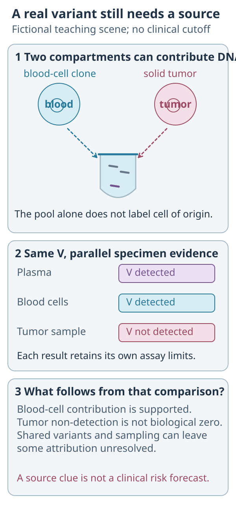
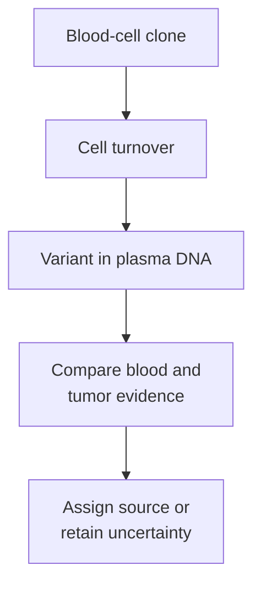

# CHIP (clonal hematopoiesis of indeterminate potential)

## In one sentence

Clonal hematopoiesis of indeterminate potential (CHIP) is a defined category of acquired mutations in blood-forming cells, without a detectable blood cancer.

## The intuition

Imagine a tree with one branch that grows unusually large. Its leaves share the branch's history. A blood-forming cell can likewise produce many descendants carrying the same acquired mutation. That family is a **clone**.

The analogy ends at cause: a larger clone is not automatically cancer, and a mutation's name does not tell us which tissue released it.

## How it works

Compare the same variant across compartments: a blood-cell match supports a contribution, while a tumor non-detection needs its own sampling and assay limits.

The [cfDNA and ctDNA diagram](/wiki/education/concepts/measurement/liquid-biopsy/cfdna-vs-ctdna) explains the difference between defining a source class and assigning an unknown fragment.

**Read the comparison:** The same V is detected in blood cells but not in the sampled tumor. Is every possible tumor contribution excluded?

**Answer:** No. The blood match supports a blood-cell contribution. Tumor non-detection remains limited by coverage, sensitivity, timing and the region sampled.

**Clonal hematopoiesis (CH)** is the broader phenomenon of blood-cell clones carrying acquired genetic changes. CHIP names one defined category within it. The National Cancer Institute's definition requires a mutation in a blood-cancer-associated gene at a [[wiki/education/concepts/measurement/sequencing-basics/variant-allele-fraction-and-cancer-cell-fraction|variant allele fraction (VAF)]] of at least 2%, without detectable hematologic cancer. VAF counts variant alleles among evaluated alleles; it is not automatically the percentage of cells.

A smaller blood-cell clone can still contribute a real mutation to plasma. Falling below CHIP's conventional threshold does not make that mutation tumor-derived or a sequencing error.

When cells turn over, they release [[wiki/education/concepts/measurement/liquid-biopsy/cfdna-vs-ctdna|cell-free DNA (cfDNA)]]. Some plasma variants therefore come from blood cells rather than the solid tumor. Genes can be mutated in both compartments. A familiar cancer-associated gene is insufficient proof of origin.

*The DNA change may be real while its attribution to a solid tumor is wrong.*

Matched white-blood-cell sequencing provides a useful comparison. Its gene coverage, molecule depth and detection rules matter. A clone below that test's sensitivity may remain unseen. A variant present in both blood and tumor needs careful interpretation; “subtract every blood match” is not a complete attribution method. Razavi and colleagues studied paired plasma, blood-cell and tumor sequencing, including an explicit ambiguous-source category.

CH becomes more common with age, but there is no age at which a plasma variant can simply be dismissed. Some cancer treatments can favor existing clones with particular DNA-damage-response mutations. Bolton and colleagues demonstrated therapy-associated selection; that does not mean every new detection was newly caused by treatment.

## Why it matters in cancer

This is a biological source of interference in plasma mutation interpretation. It matters when selecting tracking targets, interpreting resistance variants or assessing a low-level signal. A CHIP finding can also have separate health implications, but it is not itself a leukemia diagnosis or a solid-tumor treatment instruction.

## How it is measured

| Assay-card field | What to keep attached |
|---|---|
| Measures and how | Sequence blood-cell DNA, identify acquired variants, estimate VAF and interpret clinical context; compare with plasma and tumor when attributing a liquid-biopsy signal |
| Input and consumption | Blood cells from a blood draw; sequencing consumes extracted DNA. A tumor comparison uses separately obtained material |
| Time | Blood/plasma collection dates and treatment exposure; a later comparator may represent a changed clone |
| Output and units | Gene and variant, VAF as a fraction or percent, coverage and any classification qualifications |
| Thresholds | CHIP's conventional 2% VAF definition differs from the assay's detection limit and from broader CH |
| Controls and failure modes | Matched specimens, identity checks and error controls; limited coverage, shallow sampling, contamination or shared variants can leave source unresolved |
| Cannot tell you | Which lesion is shedding, whether a small clone will progress, or which cancer treatment benefits someone |
| Validation tier | The exact sequencing method and intended use determine research or clinical status; a CH attribution rule is not universal device approval |

## Common confusions

- **CH versus CHIP:** small clones outside the CHIP definition can still affect a plasma assay.
- **Blood origin versus sequencing noise:** a genuine blood-cell mutation can be irrelevant to the solid tumor.
- **Blood match versus perfect filter:** absence or presence needs interpretation under both assays' limits.
- **Acquired versus tumor-specific:** [[wiki/education/concepts/biology-basics/genetics/germline-vs-somatic|somatic]] means acquired; it does not mean malignant.

## Try it

A fictional plasma assay detects a variant. Sensitive matched blood-cell sequencing finds it at 0.8% VAF. Can the team call it CHIP, or assume it came from the solid tumor?

**Answer:** neither follows from these facts. The blood result supports a blood-cell contribution, even below the conventional CHIP threshold. Tumor evidence, shared variants and the methods' limits still matter. Keep origin and clinical classification separate.

## Explain it back

“Finding a real mutation in plasma does not prove tumor origin because ___.”

**One possible answer:** blood-cell clones also release DNA, and attribution depends on appropriate comparisons and detection limits.

## Takeaway

**First establish the source of a plasma variant; then ask what it means.**

## Related concepts

[[wiki/education/concepts/measurement/liquid-biopsy/tumor-informed-mrd-assay|Tumor-informed monitoring]], [[wiki/education/concepts/measurement/liquid-biopsy/fragmentomics-and-methylation|DNA-pattern measurements]], and [[wiki/education/concepts/measurement/liquid-biopsy/ctdna-imaging-discordance|blood–imaging discordance]].

## Sources and scope

Source check: October 10, 2026. General biology and source attribution; no clone-specific risk forecast or care recommendation. Expert and learner review remain pending.

- [NCI: CHIP definition](https://www.cancer.gov/publications/dictionaries/genetics-dictionary/def/chip) — formal category and VAF threshold.
- [Razavi et al. 2019: sources of plasma cfDNA variants](https://doi.org/10.1038/s41591-019-0652-7) — paired-compartment sequencing in metastatic cancers and non-cancer controls.
- [Bolton et al. 2020: therapy and clonal hematopoiesis](https://doi.org/10.1038/s41588-020-00710-0) — exposure-dependent selection of blood-cell clones.

<!-- BEGIN GENERATED USED IN -->
## Used in

- [Read the blood result before reading the trend](/wiki/education/guides/monitoring-residual-disease/01-read-the-blood-result)
- [Read blood measurements as a time series](/wiki/education/molecular-profiling/06-ctdna-and-mrd)
<!-- END GENERATED USED IN -->
