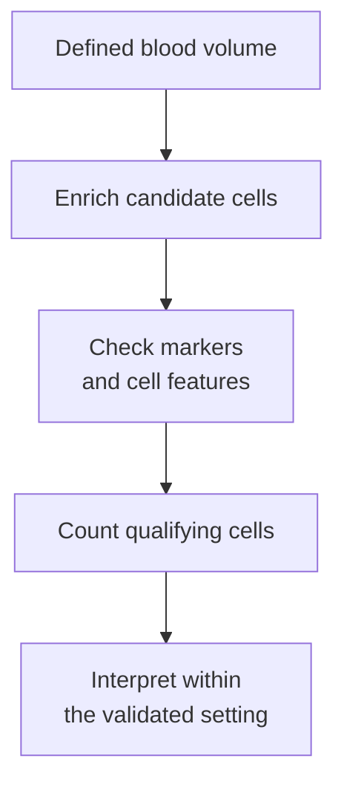

# Circulating tumor cells (CTCs)

## In one sentence

Circulating tumor cells (CTCs) are cells from a tumor that have entered the bloodstream, measured using assay-specific capture and identification rules.

## The intuition

If plasma DNA fragments are scraps from a building, circulating tumor cells are whole pieces of its machinery carried away. Examining a cell can reveal features that a DNA fragment cannot.

But a captured cell is not necessarily alive, able to form a metastasis or representative of every tumor cell. And a collection device selects which cells reach the analyst.

## How it works

Blood contains many ordinary blood cells and sometimes rare cells shed from a solid tumor. A circulating tumor-cell assay must find candidate cells, distinguish them from other events and apply a reproducible definition. This differs from measuring [[wiki/education/concepts/measurement/liquid-biopsy/cfdna-vs-ctdna|circulating tumor DNA (ctDNA)]] in plasma.

**Enrichment** concentrates candidate cells before identification. Some methods capture a surface protein. One established epithelial-cell method uses **epithelial cell adhesion molecule (EpCAM)**, then checks cell shape, a nucleus, cytokeratin proteins and absence of the white-blood-cell marker CD45. That is one operational definition, not a universal rule for all CTCs or all tumor types.

Other methods use physical properties, such as size or deformability, or remove blood cells rather than selecting a tumor marker. Each creates a different bias. A cell with little capture-marker expression can be missed; a size-based method can miss cells that resemble blood cells in size. Marker independence does not mean unbiased recovery.

*The count describes cells recovered and classified by this method.*

[[wiki/education/concepts/biology-basics/cells/epithelial-mesenchymal-transition|Epithelial–mesenchymal transitions]] can alter epithelial-marker expression. This is a reason to examine capture limits, not proof that a negative epithelial assay missed metastatic cells. Single markers and cell state do not establish invasive ability.

After isolation, a laboratory may examine cell proteins, sequence DNA or RNA, or attempt culture. These are additional assays with their own sample and validation requirements. Counting a fixed, stained cell does not demonstrate viability or provide a genome automatically.

## Why it matters in cancer

CTC counts can carry **[[wiki/education/concepts/evidence-and-statistics/biomarkers/prognostic-vs-predictive|prognostic]]** information: they can be associated with later outcomes in a defined population. Cristofanilli and colleagues studied 177 people with measurable metastatic breast cancer; their assay's higher-count group had worse outcomes. This is a cohort association, not an individual forecast.

**Clinical utility** asks a different question: does using the result to change care improve outcomes? In SWOG S0500, switching chemotherapy early for persistent high CTC counts did not improve overall survival in the randomized population. That result bounds one strategy; it neither validates every other CTC-guided decision nor rules out all possible uses.

## How it is measured

| Assay-card field | What to keep attached |
|---|---|
| Measures and how | Recover, identify and count qualifying cells using named enrichment and classification rules |
| Input and consumption | Whole blood of a specified volume; processing consumes the sample and may fix cells. Plasma ctDNA testing is a separate workflow |
| Time | Draw date relative to treatment plus allowable transport/processing interval; limits depend on tube and method |
| Output and units | Cells per stated blood volume; images or additional molecular measurements are separate outputs |
| Thresholds | The historical metastatic breast-cancer assay used ≥5 cells per 7.5 mL as a prognostic cutoff; this is not the minimum cell definition or a universal decision threshold |
| Controls and failures | Recovery controls, marker/staining controls and reproducible classification; rare sampling, marker bias, cell loss or ambiguous images can affect counts |
| Cannot tell you | Zero cancer after a negative draw, each cell's viability, lesion origin, metastatic potential or which treatment will help |
| Validation tier | Some enumeration devices have U.S. Food and Drug Administration (FDA) clearance for defined uses; other platforms remain research assays. Identify the exact device, population and intended use |

## Common confusions

- **CTC count versus DNA fraction:** cells per volume and plasma DNA fractions are different quantities.
- **Capture versus complete census:** marker- and physical-property methods each select a subset.
- **Cell in blood versus established metastasis:** circulation alone does not demonstrate a new tumor site.
- **Prognosis versus useful treatment rule:** risk association is not evidence that a particular response to the count helps.

## Try it

A fictional report finds zero qualifying cells in 7.5 mL of blood using epithelial-marker enrichment. Can the reader conclude that no tumor cells circulate anywhere, or that ctDNA must be negative?

**Answer:** no. The draw is finite and recovery depends on the method's rules. Other cells may be missed. DNA fragments are a separate analyte, so a CTC count does not determine a ctDNA result.

## Explain it back

“A CTC result is a count of ___, not a count of ___.”

**One possible answer:** cells recovered and classified in a defined blood sample, not all cancer cells or all metastatic seeds in the body.

## Takeaway

**Read the capture method and clinical setting beside every CTC count.**

## Related concepts

[[wiki/education/concepts/measurement/liquid-biopsy/ctdna-imaging-discordance|Blood–imaging discordance]], [[wiki/education/concepts/measurement/liquid-biopsy/fragmentomics-and-methylation|DNA-pattern measurements]], and [[wiki/education/concepts/measurement/computational-analysis/analytical-validity-clinical-validity-and-utility|validity and utility]].

## Sources and scope

Source check: October 10, 2026. General category and scoped historical assay/trial examples; no current treatment-selection recommendation. The exercise is fictional. Expert and learner review remain pending.

- [FDA K031588 decision summary](https://www.accessdata.fda.gov/cdrh_docs/reviews/K031588.pdf) — epithelial-cell identification, input and the original metastatic breast-cancer intended use.
- [Allard et al. 2004: enumeration performance](https://doi.org/10.1158/1078-0432.CCR-04-0378) — analytical and population-specific detection study.
- [Cristofanilli et al. 2004: CTCs and outcomes](https://doi.org/10.1056/NEJMoa040766) — metastatic breast-cancer prognostic study.
- [Smerage et al. 2014: SWOG S0500](https://doi.org/10.1200/JCO.2014.56.2561) — randomized early chemotherapy-switch strategy and overall survival.

<!-- BEGIN GENERATED USED IN -->
## Used in

- [Read the blood result before reading the trend](/wiki/education/guides/monitoring-residual-disease/01-read-the-blood-result)
- [Read blood measurements as a time series](/wiki/education/molecular-profiling/06-ctdna-and-mrd)
<!-- END GENERATED USED IN -->
