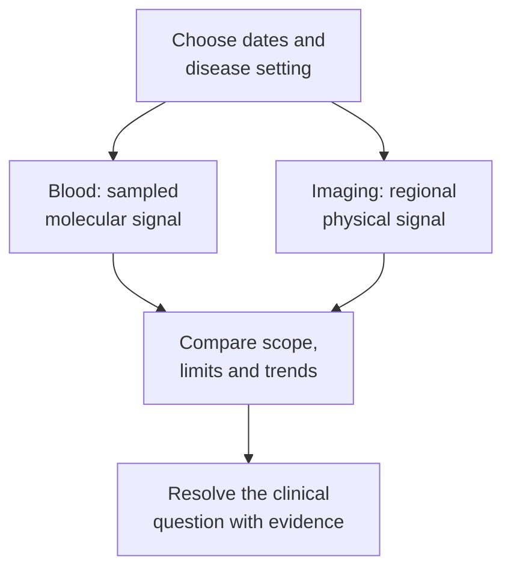

# ctDNA–imaging discordance

## In one sentence

Circulating tumor DNA–imaging discordance occurs when a blood DNA result and an imaging result appear to tell different stories about disease.

## The intuition

Picture a shoreline photograph beside a water sample. The photograph locates visible objects. The sample contains material carried into that small volume of water. Both can describe the same shoreline, yet they need not change together.

The analogy has limits: blood is not a complete collection of tumor debris, and imaging is not a direct census of viable cancer cells.

## How it works

An assay for [[wiki/education/concepts/measurement/liquid-biopsy/cfdna-vs-ctdna|circulating tumor DNA (ctDNA)]] evaluates tumor-associated features in a finite sample of [[wiki/education/concepts/measurement/liquid-biopsy/cfdna-vs-ctdna|cell-free DNA (cfDNA)]]. Lesions differ in how much DNA reaches the sampled circulation. Recovery, background DNA, targets and [[wiki/education/concepts/measurement/liquid-biopsy/ctdna-units|detection limits]] also affect the call. A negative result can coexist with disease that sheds little or lies below the sampled sensitivity.

Imaging measures a defined region through a specific physical signal. [[wiki/education/concepts/measurement/imaging/breast-mri|Magnetic resonance imaging (MRI)]] may measure contrast enhancement or lesion extent. Enhancement can reflect several tissue processes; residual abnormality need not be entirely viable tumor. Conversely, less enhancement does not establish that no invasive cancer remains.

*These signals overlap in what they reflect, but neither replaces the other automatically.*

Time matters. DNA release and clearance can change sooner than visible tissue structure. Diehl and colleagues estimated a ctDNA half-life of 114 minutes from early samples in **one colorectal-cancer subject after complete resection**. That is evidence of rapid clearance in that setting, not a universal half-life for all cfDNA or a blood-draw schedule for breast cancer.

The results can also share information. In Magbanua and colleagues' 2021 pilot study of 84 high-risk early breast cancers during neoadjuvant treatment, ctDNA and MRI-based functional tumor volume were correlated. Their agreement was incomplete; exploratory combined models did not establish a universal treatment-redirection rule.

## Why it matters in cancer

A mismatch is a question to investigate. Check dates, assay qualifications, the imaged region and the specific finding. A positive plasma variant also needs source attribution, including [[wiki/education/concepts/measurement/liquid-biopsy/chip|blood-cell clones]]. Discordance alone proves neither a false test nor occult metastatic disease.

## How it is measured

| Assay-card field | What to compare |
|---|---|
| Measures and how | Blood: detect selected molecular features. Imaging: acquire and interpret a regional signal using a named protocol |
| Input and consumption | Blood/plasma volume and recovered DNA; testing consumes an aliquot. Imaging does not consume tissue; contrast or tracer use depends on the modality |
| Time | Acquisition dates relative to treatment, surgery and each other; report date is not collection date |
| Output and units | Blood: qualifying call and defined concentration/fraction. Imaging: size, volume, uptake or qualitative finding; keep their units separate |
| Thresholds | Assay-specific detection/quantitation rules versus protocol- and setting-specific [response criteria](/wiki/education/concepts/measurement/imaging/response-criteria) |
| Controls and failures | Sample qualification, origin controls, comparable imaging technique; low shedding, finite input, artifacts or non-tumor signal can mislead |
| Cannot tell you | An exact cell count, lesion location from blood alone, or treatment benefit from agreement/disagreement |
| Validation tier | Review each test's intended use and evidence; validating their combination requires its own population and decision context |

**Finite-input arithmetic:** in a fictional conversion, assume 6.6 picograms per *diploid* human genome equivalent. Then 6.6 nanograms of recovered DNA represents 1,000 diploid mass equivalents, or 2,000 *haploid* equivalents using 3.3 picograms. Those are DNA-mass units, not 1,000 intact cells. Fragment recovery, locus coverage and a tumor's altered chromosome copy numbers affect usable target molecules. A tiny fraction does not guarantee a target entered the tested aliquot.

## Common confusions

- **Blood equals whole-body scan:** blood is a sample with unequal contributions from different sites.
- **Image equals viable-tumor count:** the measured signal depends on tissue and modality.
- **Concordant equals independent proof:** both tests may reflect the same underlying burden.
- **Discordant equals treatment instruction:** interpretation and [[wiki/education/concepts/measurement/computational-analysis/analytical-validity-clinical-validity-and-utility|clinical utility]] remain separate.

## Try it

A fictional person has no qualifying ctDNA signal after treatment. A breast MRI acquired that week still shows an abnormal region. Does the blood result establish that the region is only scar?

**Answer:** no. Low shedding or finite sampling could leave disease undetected; imaging can include tumor and non-tumor effects. The appropriate tissue or other clinical assessment answers a different question from the plasma assay.

## Explain it back

“Two results can differ without either being wrong because ___.”

**One possible answer:** they sample different material, regions, times and signals, with different limits.

## Takeaway

**Compare what each test actually measured before asking which story it supports.**

## Related concepts

[[wiki/education/concepts/measurement/liquid-biopsy/tumor-informed-mrd-assay|Tumor-informed monitoring]], [[wiki/education/concepts/measurement/liquid-biopsy/circulating-tumor-cells|circulating tumor cells]], and [[wiki/education/concepts/measurement/computational-analysis/multi-omic-integration|multi-omic integration]].

## Sources and scope

Source check: October 10, 2026. The arithmetic and practice scenario are fictional. No universal draw interval, lesion forecast or treatment rule. Expert and learner review remain pending.

- [FDA 2024 ctDNA guidance](https://www.fda.gov/media/183874/download) — assay, sampling and validation considerations for curative-intent solid-tumor drug development.
- [Diehl et al. 2008: circulating mutant DNA](https://doi.org/10.1038/nm.1789) — colorectal-cancer study; the early post-resection half-life estimate came from one subject.
- [Magbanua et al. 2021: ctDNA and MRI](https://doi.org/10.1038/s41523-021-00239-3) — defined early breast-cancer pilot cohort.
- [Razavi et al. 2019: plasma variant sources](https://doi.org/10.1038/s41591-019-0652-7) — blood-cell contributions and source attribution.

<!-- BEGIN GENERATED USED IN -->
## Used in

- [Read blood measurements as a time series](/wiki/education/molecular-profiling/06-ctdna-and-mrd)
- [Compare blood results with imaging](/wiki/education/molecular-profiling/ctdna-ppm-and-mri)
<!-- END GENERATED USED IN -->
