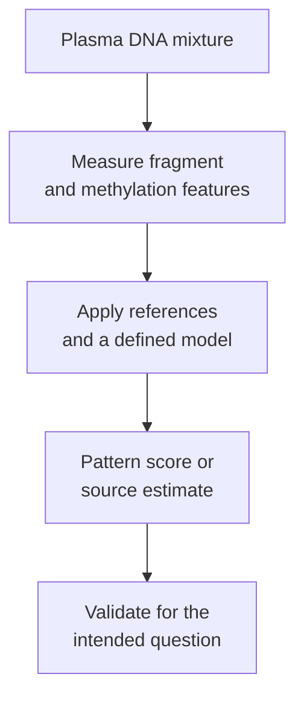

# Fragmentomics and methylation in cell-free DNA

## In one sentence

Fragmentomics and methylation profiling examine the shapes and chemical marks of cell-free DNA fragments to infer features of their source cells.

## The intuition

A torn page can carry clues beyond its words: where it tore and which passages were marked. Plasma DNA likewise carries patterns beyond individual mutations.

The analogy stops at certainty. No fragment has a printed “cancer” address. A model must interpret patterns across a mixture of sources, and its answer depends on the references and samples used to build it.

## How it works

[[wiki/education/concepts/measurement/liquid-biopsy/cfdna-vs-ctdna|Cell-free DNA (cfDNA)]] includes fragments from many cell types. **Fragmentomics** studies their lengths, breakpoints, end sequences and distributions across the genome. DNA wrapped around proteins can be protected differently from exposed DNA. A **nucleosome** is DNA wrapped around histone proteins; its positioning helps leave a footprint in recovered fragments. Snyder and colleagues tested this connection experimentally.

**[[wiki/education/concepts/biology-basics/genetics/epigenetics-and-methylation|DNA methylation]]** adds chemical marks to DNA bases without changing their sequence. Many assays examine marked cytosines next to guanine, called **CpG sites**. Methylation patterns can differ among normal cell types and in cancer. Some methods chemically convert DNA to distinguish marked from unmarked bases; others use different measurement technologies.

*Measuring a pattern and establishing its clinical meaning are separate steps.*

A model combines features with training data or a reference atlas. An atlas describes known cell types. **Deconvolution** estimates how much each reference contributes to a mixed sample. Moss and colleagues used cell-type methylation references to estimate cfDNA sources. Contributions from normal tissue injury can also change those patterns; inferred tissue origin alone is not proof of cancer.

A classifier instead assigns a score or category, such as a cancer-associated pattern. Cristiano and colleagues demonstrated a fragmentation-based classifier in defined cancer and healthy-control cohorts. That result cannot be transferred automatically to another population, collection protocol, assay version or intended use.

The measurement begins at the blood draw. Delayed separation can let blood cells break down and add cellular DNA. Tube chemistry, extraction and library preparation may also change recovered features. Van der Pol and colleagues found that collection and processing factors could affect genomic fragmentation patterns and fragment-end sequences even when overall size distributions appeared similar. “The size profile looks fine” is therefore an incomplete quality check.

## Why it matters in cancer

These features can complement mutation tracking, including when few informative mutations are sampled. They may help estimate contributing cell types or detect cancer-associated patterns. Neither purpose automatically establishes tumor location, stage, a resistance mechanism or benefit from acting on a result.

## How it is measured

| Assay-card field | What to inspect |
|---|---|
| Measures and how | Extract plasma DNA; measure selected fragment or methylation features; apply a specified reference/model and reporting rule |
| Input and consumption | Recorded blood/plasma volume and recovered DNA; analysis consumes material, usually without a tumor-tissue reference |
| Time and handling | Collection-to-separation interval, tube, storage and treatment timing; acceptable conditions are method-specific |
| Output and units | Fragment length in base pairs, feature proportions, methylated fraction at defined sites, estimated source fraction or a model score |
| Thresholds | Feature definitions and a fixed classifier cutoff for its validated population; a score is not necessarily a calibrated probability |
| Controls and failures | Process controls, reference mixtures and batch checks; added blood-cell DNA, recovery bias, missing atlas cell types or a shifted population can mislead |
| Cannot tell you | That every short fragment is malignant, that methylation alone proves diagnosis, or that a positive model guides an effective treatment |
| Validation tier | Research and clinical implementations differ. Identify the exact assay/intended use and distinguish analytical performance, clinical validity and decision utility |

## Common confusions

- **Shorter equals cancer:** length distributions overlap; patterns and context matter.
- **Methylation equals abnormality:** normal cells also have characteristic methylation.
- **Cell origin equals malignant identity:** tissue injury can contribute normal DNA from that organ.
- **One classifier equals all liquid biopsies:** models, reference sets and cutoffs differ.

## Try it

A fictional fragment classifier was trained on promptly processed plasma. New samples are transported under a different protocol. Their scores rise, while total DNA yield meets the laboratory's minimum. Does this prove more cancer-associated DNA?

**Answer:** no. Adequate yield does not show that the recovered features are comparable. Processing or source-mixture changes could shift the score. Validate the new conditions and investigate controls before assigning a biological explanation.

## Explain it back

“A DNA-pattern model needs more than a sample because ___.”

**One possible answer:** its interpretation depends on collection conditions, reference cell types, model version and the population in which the reporting rule was validated.

## Takeaway

**DNA patterns are useful clues whose meaning must be validated in context.**

## Related concepts

[[wiki/education/concepts/measurement/liquid-biopsy/chip|Blood-cell clones]], [[wiki/education/concepts/measurement/sequencing-basics/long-read-and-methylation-sequencing|long-read and methylation sequencing]], and [[wiki/education/concepts/measurement/computational-analysis/analytical-validity-clinical-validity-and-utility|validity and utility]].

## Sources and scope

Source check: October 10, 2026. Measurement principles and scoped experiments, not a screening endorsement. The exercise is fictional. Expert and learner review remain pending.

- [Snyder et al. 2016: nucleosome footprints](https://doi.org/10.1016/j.cell.2015.11.050) — fragment protection and source-cell inference.
- [Moss et al. 2018: methylation atlas](https://doi.org/10.1038/s41467-018-07466-6) — reference-based estimates of cfDNA contributors.
- [Cristiano et al. 2019: genome-wide fragmentation](https://doi.org/10.1038/s41586-019-1272-6) — classifier proof of principle in defined cohorts.
- [Van der Pol et al. 2022: preanalytical variables](https://doi.org/10.1093/clinchem/hvac029) — feature-dependent effects of collection and processing.
- [NCI cfDNA collection and processing practices](https://dctd.cancer.gov/data-tools-biospecimens/biospecimens-biobanks/resources/best-practices/bebp/bebp-cfdna.pdf) — blood-cell contamination and specimen handling.

<!-- BEGIN GENERATED USED IN -->
## Used in

- [Read the blood result before reading the trend](/wiki/education/guides/monitoring-residual-disease/01-read-the-blood-result)
- [Read blood measurements as a time series](/wiki/education/molecular-profiling/06-ctdna-and-mrd)
<!-- END GENERATED USED IN -->
