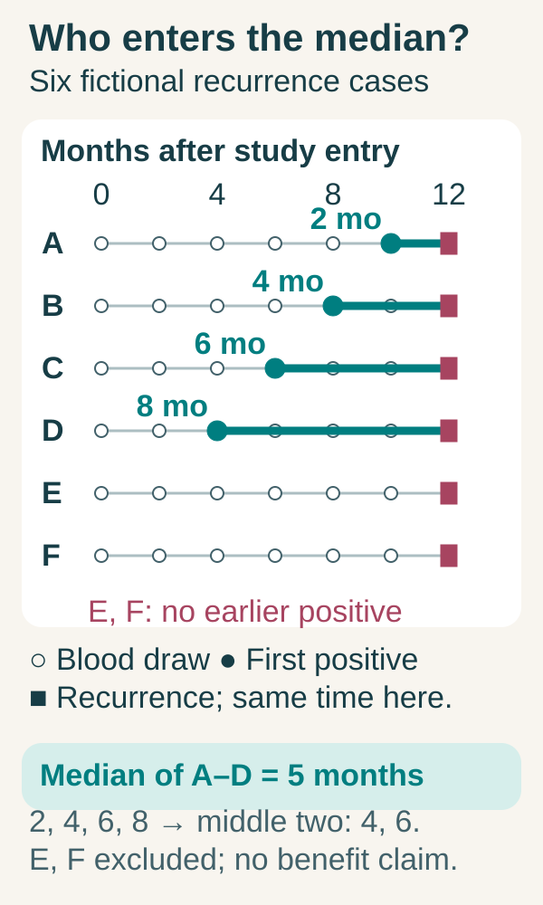

# Measured lead time in blood monitoring

## In one sentence

Measured lead time is the interval between a defined earlier test signal and a defined later clinical event, among people and time points for which that interval can be estimated.

## The intuition

Two alarms can ring at different times. The gap between them is meaningful only if you know what triggered each alarm and how often anyone checked. A monthly molecular test and an occasional scan do not run on identical clocks.

This analogy has limits: the first positive sample may occur after the biological signal first became detectable, and acting on the alarm can change what happens next.

## How it works

A [circulating tumor DNA (ctDNA)](/wiki/education/concepts/measurement/liquid-biopsy/cfdna-vs-ctdna) study might define lead time as:

**date of confirmed clinical recurrence − date of first qualifying positive blood sample.**

That definition still needs rules: does “clinical recurrence” mean imaging, pathology or symptoms? Is the blood date collection, laboratory reporting or confirmation? Was testing blinded, or did a positive result trigger an extra scan? Was treatment started after the signal?

Blood sampling is intermittent. A negative draw at month 3 and a first positive at month 6 do not identify the biological onset: the earlier draw may have missed a signal, and changes can occur between visits. Scans are also intermittent. The observed gap depends on both schedules and is not a direct stopwatch measurement of biological emergence.

The **denominator** is equally important. A median calculated only among people with both an earlier positive signal and later recurrence describes that selected group. It excludes recurrence without prior detection. People who test positive but have not recurred by the study cutoff do not have a completed interval; their follow-up is [censored](/wiki/education/concepts/evidence-and-statistics/endpoints/survival-endpoints), rather than proving either zero or infinite lead time. Missing samples, assay failures, exclusions and competing events need explicit handling.

When estimating outcomes after a positive result, people must have survived and remained observable long enough to enter that group. Specify any landmark and time origin, and avoid treating future positivity as a characteristic known at study entry.

## Why it matters in cancer

An earlier signal can create a research opportunity. It does not show that a useful intervention exists or that life is extended. [Lead-time bias](/wiki/education/concepts/evidence-and-statistics/reasoning-tools/lead-time-bias) explains why measuring survival from an earlier detection date can exaggerate benefit. Compare clinical strategies and outcomes using suitable common clocks.

Do not rank assays from unrelated lead-time medians. Cohort, recurrence sites, sampling frequency, confirmation rules and follow-up can all change them.

## How it is measured

| Assay-card item | Scope to keep attached |
|---|---|
| Measures / how | Difference between two prespecified event dates, after the assay's qualifying rule |
| Input and cost | Serial blood tests and clinical follow-up; draws, scans and finite specimens |
| Output / units | Days or months; evaluable count, distribution and uncertainty |
| Thresholds | Positive/confirmation rules and clinical-event definition |
| Failure modes | Missing visits, triggered scans, selection, inadequate follow-up and altered course after intervention |
| Cannot tell | Added survival, personal recurrence date or a cross-assay sensitivity ranking |
| Validation | Prospective schedule, defined population, complete denominator and appropriate censoring analysis |

## Common confusions

- A ten-month median is not ten extra months of life.
- No prior positive result is a detection failure for that defined surveillance question, not a zero-month observation silently added to a selected median.
- A laboratory reporting delay matters when the question concerns actionable time.

## Try it

*All six fictional cases recur at month 12. Open dots show scheduled blood draws every two months; filled teal dots show first qualifying positives. A–D have completed earlier-positive intervals of 2, 4, 6 and 8 months. E and F have no earlier positive. The selected median is (4 + 6) ÷ 2 = 5 months among four cases; it excludes the two detection failures. These numbers are invented teaching data, not a study estimate or future prediction.*

**Read the illustration:** Which two rows are left out of the five-month median, and does the highlighted gap locate biological onset?

**Answer:** E and F are left out because neither has an earlier qualifying positive. The highlighted intervals start at observed blood draws; intermittent sampling cannot locate the biological onset. This selected median establishes neither improved outcomes nor benefit from treating on the signal.

In a fictional cohort, six people recur. Four have prior positive blood tests, with gaps of 2, 4, 6 and 8 months. Two recur without a prior positive test. What does the five-month median describe?

**Answer:** Only the four people with measurable earlier-positive-to-recurrence intervals. The two without prior detection must be reported separately; a five-month median does not mean every recurrence was detected five months early.

## Explain it back

What dates, schedule and denominator would you ask for beside a lead-time headline?

## Takeaway

Lead time measures a conditional timing gap. Clinical benefit is a separate question.

## Related concepts

- [lead time bias](/wiki/education/concepts/evidence-and-statistics/reasoning-tools/lead-time-bias)
- [mrd](/wiki/education/concepts/measurement/liquid-biopsy/mrd)

## Sources and scope

Source check: October 10, 2026. Fictional cohort; expert and learner review remain pending.

- [García-Murillas et al. 2019](https://doi.org/10.1001/jamaoncol.2019.1838) — serial surveillance, relapse association and a defined study population.
- [Turner et al. 2023 c-TRAK TN](https://doi.org/10.1016/j.annonc.2022.11.005) — detection and intervention feasibility under a specific surveillance schedule.
- [FDA 2024 circulating tumor DNA (ctDNA) drug-development guidance](https://www.fda.gov/media/183874/download) — prospective sampling and distinction between detection and strategy benefit.
- [NCI explanation of screening statistics](https://www.cancer.gov/about-cancer/screening/research/what-screening-statistics-mean) — clocks and lead-time bias.

<!-- BEGIN GENERATED USED IN -->
## Used in

- [Write the exact claim before judging it](/wiki/education/guides/judging-a-test-or-vendor-claim/01-write-the-exact-claim)
- [Ask what a result should change](/wiki/education/guides/monitoring-residual-disease/03-ask-what-a-result-should-change)
- [Understand blood tests and imaging after treatment](/wiki/education/guides/monitoring-residual-disease/index)
<!-- END GENERATED USED IN -->
