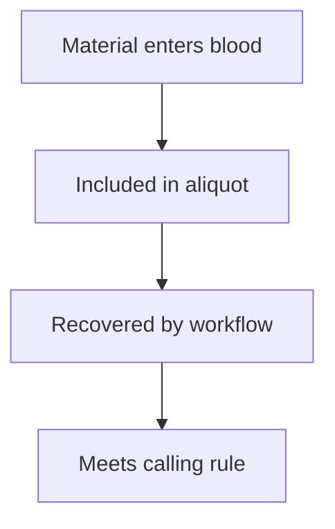

# Blood sampling and detection limits

## In one sentence

A blood assay can detect only qualifying material that reaches the sample and survives its workflow; an analytical detection limit does not remove those sampling limits.

## The intuition

A very sensitive microphone cannot record a voice that never reaches it. Blood testing has a similar chain: tumor material must enter the circulation, be included in the tube, survive processing and satisfy the detector's rule.

The analogy has limits. DNA fragments are finite molecules, and a call often combines multiple features. Sampling uncertainty and technical error are separate, interacting problems.

## How it works

For [circulating tumor DNA (ctDNA)](/wiki/education/concepts/measurement/liquid-biopsy/cfdna-vs-ctdna), at least four gates matter:

**Biological availability:** tumors differ in how much material reaches peripheral blood. Burden, site, treatment and timing can affect availability. A highly sensitive assay cannot infer a complete body inventory from plasma.

**Finite sampling:** the analyzed plasma aliquot contains only some circulating molecules. Very rare features can be absent by chance. For a deliberately simplified model, suppose an evaluated aliquot has an average of one target molecule, independently randomly distributed. A Poisson model gives a probability of no target molecules of exp(−1), about 37%. This is a mathematical illustration, not a clinical false-negative rate. Real assays track different features, face losses and use more complex calling rules.

**Recovery and representation:** extraction, library construction and sequencing retain or observe some starting molecules. Amplifying one molecule into many reads does not create independent original tumor molecules. Multiple [tracking targets](/wiki/education/concepts/measurement/liquid-biopsy/tumor-informed-mrd-assay) can add opportunities to detect signal, but their number alone does not establish complete recovery or clinical sensitivity.

**Analytical discrimination:** errors and background must be separated from true signal. [Limit of detection (LoD)](/wiki/education/concepts/evidence-and-statistics/biomarkers/limits-of-detection-and-quantitation) describes detection probability under specified conditions. A nominal LoD from high-input validation material may not apply to a low-input clinical sample. A sample that fails quality criteria should not be silently treated as negative.

## Why it matters in cancer

Analytical detection capability differs from **clinical sensitivity**: the proportion of people with a defined clinical condition who test positive under a specified schedule and follow-up. Site mix, missed draws and target availability affect that denominator. Negative results require those limits; a positive result still requires origin and clinical interpretation.

## How it is measured

| Assay-card item | Scope to keep attached |
|---|---|
| Measures / how | Qualifying molecular signals in the analyzed aliquot |
| Input and cost | Draw volume, plasma analyzed, recovered DNA and independent molecular coverage; finite material and draw burden |
| Output / units | Detection call and any validated concentration or fraction |
| Thresholds | LoD with detection probability, input and feature/calling conditions |
| Failure modes | Low shedding, chance absence, handling losses, poor recovery, background or target mismatch |
| Cannot tell | Whether every tumor site was sampled or a negative person is cured |
| Validation | Clinical-material confirmation, input-range testing, representative targets and outcome-based evaluation |

## Common confusions

- Read depth is not the same as independent molecule count.
- Larger input can help sampling but does not guarantee detectable shedding or remove noise.
- Repeated draws sample different times; their errors are not automatically independent.

## Try it

A fictional laboratory has a validated 95%-detection claim at a specified concentration with 30 units of input. A patient sample supplies only 5 units. Can the laboratory attach the same 95% claim without supporting data?

**Answer:** No. The lower input changes molecular opportunities and may change detection performance. The sample needs an appropriate validated claim, qualification or failure classification.

## Explain it back

Why can a detector with excellent laboratory performance still miss a clinically present tumor?

## Takeaway

Follow material from the body to the call; every gate has a scope.

## Related concepts

- [limits of detection and quantitation](/wiki/education/concepts/evidence-and-statistics/biomarkers/limits-of-detection-and-quantitation)
- [ctdna units](/wiki/education/concepts/measurement/liquid-biopsy/ctdna-units)

## Sources and scope

Source check: October 10, 2026. Poisson example and input quantities are fictional; expert and learner review remain pending.

- [FDA 2024 circulating tumor DNA (ctDNA) drug-development guidance](https://www.fda.gov/media/183874/download) — shedding, sampling, input and complete-workflow validation.
- [Newman et al. 2016](https://doi.org/10.1038/nbt.3520) — molecular recovery, input and error-suppression limits in a defined sequencing method.
- [CLSI harmonized terminology](https://htd.clsi.org/listterms.asp?button=Submit) — specified detection probability and distinction from clinical sensitivity.

<!-- BEGIN GENERATED USED IN -->
## Used in

- [Read the blood result before reading the trend](/wiki/education/guides/monitoring-residual-disease/01-read-the-blood-result)
- [Understand blood tests and imaging after treatment](/wiki/education/guides/monitoring-residual-disease/index)
- [Read blood measurements as a time series](/wiki/education/molecular-profiling/06-ctdna-and-mrd)
<!-- END GENERATED USED IN -->
