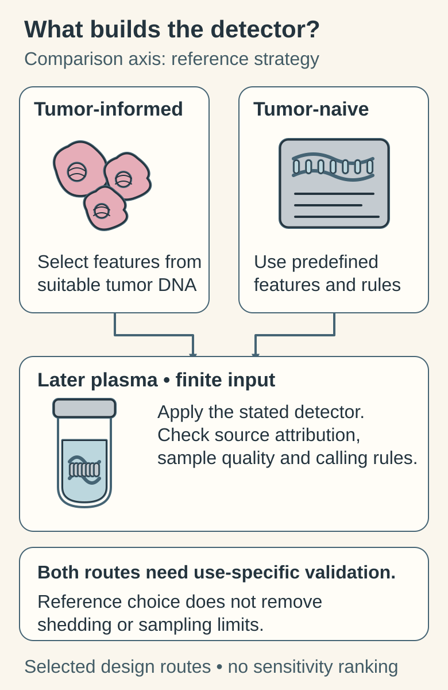

# Tumor-informed versus tumor-naive residual-disease assays

## In one sentence

A tumor-informed molecular residual disease assay uses features identified in a tumor sample to look for a qualifying tumor signal in later blood samples.

## The intuition

A tumor-informed approach starts with a reference description, then looks for matching traces. A tumor-naive approach applies a previously designed detector without building that patient's tumor reference first. Think “known fingerprint” versus “specified screening features.”

The analogy does not rank accuracy. A fingerprint can be poorly sampled, and a broader detector can be well validated. Performance belongs to the actual method and intended use.

## How it works

For [molecular residual disease (MRD)](/wiki/education/concepts/measurement/liquid-biopsy/mrd) monitoring with [circulating tumor DNA (ctDNA)](/wiki/education/concepts/measurement/liquid-biopsy/cfdna-vs-ctdna), a tumor-informed mutation assay sequences tumor material to select features for later tracking in plasma. Matched normal material may help distinguish [inherited from tumor-acquired variants](/wiki/education/concepts/biology-basics/genetics/germline-vs-somatic) and blood-cell-derived signals. The assay's design determines how many features are tracked and what combination qualifies as positive.

A **tumor-naive** assay does not require a patient-specific tumor reference to construct its detector. It may examine a fixed variant panel, [methylation or fragment features](/wiki/education/concepts/measurement/liquid-biopsy/fragmentomics-and-methylation), or combinations. “Tumor-naive,” “tumor-agnostic” and “tissue-free” are method labels that need definition: they do not establish that a test detects every cancer or never uses clinical context.

*One axis, two reference routes: tumor-selected features versus predefined features and rules. Both meet finite plasma input, background attribution and assay-specific calling requirements. This is a design comparison, not a sensitivity hierarchy. [FDA 2024, section IV](https://www.fda.gov/media/183874/download).*

| Question | Tumor-informed | Tumor-naive |
|---|---|---|
| Starting reference | Features from this patient's sampled tumor | Predefined features and classifier/reference population |
| Initial material | Suitable tumor material; sometimes matched normal | No tumor sample needed for personalized detector construction |
| Important limits | Reference quality, trackable features and representativeness of selected targets | Coverage, background discrimination and classifier transfer |
| Shared limits | Finite blood input, shedding, specimen handling and validated calling rules | The same biological and sampling constraints still apply |

Amplification and sequencing methods can be combined. Neither category is a fixed technological sensitivity tier. More targets may provide more opportunities for detection, but specificity, molecule recovery and the interpretation rule still matter. A fixed tracking panel should not be assumed to discover every newly emerging resistance variant.

## Worked comparison: read the input contract

These **fictional research methods** have stated rules; they do not represent their whole categories.

| Method | Detector construction | Current material |
|---|---|---|
| A | Select tumor variants, then track that fixed list | Suitable tumor DNA unavailable |
| B | Apply a predefined, validated feature set | Qualifying plasma available |

Which workflow can start, and can either discover a variant outside its feature list?

**Answer:** B can start as specified; A cannot build its required reference yet. Reference-build failure is not a negative plasma result. Neither list establishes detection outside its scope. Inspect feature scope, background rules and intended-use validation. The [negative-result example](/wiki/education/molecular-profiling/06-ctdna-and-mrd#a-worked-negative-result) explains the sampling boundary.

## Why it matters in cancer

A comparison must align specimen timing, assay version, evaluable patients and outcome. A percentage of positive samples in different cohorts is not a head-to-head comparison. Nor does successful detection establish that acting on it improves health.

## How it is measured

| Assay-card item | Scope to keep attached |
|---|---|
| Measures / how | Qualifying tumor-associated plasma features using a reference-dependent or predefined method |
| Input and cost | Initial tissue/reference work when required, then blood and a consumed plasma aliquot |
| Output / units | Positive/negative plus assay-defined concentration or fraction, if reported |
| Thresholds | Feature-level and combined calling rules under stated inputs |
| Failure modes | Unbuildable reference, lost/unrepresented targets, low shedding, poor input or background |
| Cannot tell | Universal superiority, all new variants, lesion location or intervention benefit |
| Validation | Complete workflow, actual target designs, clinical population and sampling schedule |

## Common confusions

- “Personalized” does not mean a clinical decision has been individually validated.
- A blood-cell-origin filter and a tumor reference solve related but distinct problems.
- A negative result has [sampling limits](/wiki/education/concepts/measurement/liquid-biopsy/limit-of-detection-and-sampling) in both categories.

## Try it

Two fictional studies report 90% and 75% detection. The first tested people before treatment, the second after surgery. Can the higher percentage establish the better assay?

**Answer:** No. Disease burden, timing, case mix, missing samples and outcome definitions differ. A suitable comparison would align these conditions and ideally evaluate the same samples with prespecified rules.

## Explain it back

What information does a tumor reference add, and which blood-sampling limits remain?

**One possible answer:** it supplies selected features from a sampled tumor. It cannot create missing plasma molecules or remove shedding, background, recovery and calling-rule limits.

## Takeaway

Describe the reference strategy, then inspect performance in the actual setting.

## Related concepts

- [mrd](/wiki/education/concepts/measurement/liquid-biopsy/mrd)
- [fragmentomics and methylation](/wiki/education/concepts/measurement/liquid-biopsy/fragmentomics-and-methylation)

## Sources and scope

Source check: October 10, 2026. Fictional comparison; expert and learner review remain pending.

- [FDA 2024 circulating tumor DNA (ctDNA) drug-development guidance](https://www.fda.gov/media/183874/download) — tumor-informed/tumor-naive design and complete-workflow validation.
- [García-Murillas et al. 2019](https://doi.org/10.1001/jamaoncol.2019.1838) — a defined tumor-informed breast-cancer surveillance study, not a category-wide performance ranking.
- [Razavi et al. 2019](https://doi.org/10.1038/s41591-019-0652-7) — plasma variant attribution with matched blood-cell and tumor material.

<!-- BEGIN GENERATED USED IN -->
## Used in

- [Compare related ideas](/wiki/education/comparisons/index)
- [Read the blood result before reading the trend](/wiki/education/guides/monitoring-residual-disease/01-read-the-blood-result)
- [Understand blood tests and imaging after treatment](/wiki/education/guides/monitoring-residual-disease/index)
- [Read blood measurements as a time series](/wiki/education/molecular-profiling/06-ctdna-and-mrd)
<!-- END GENERATED USED IN -->
