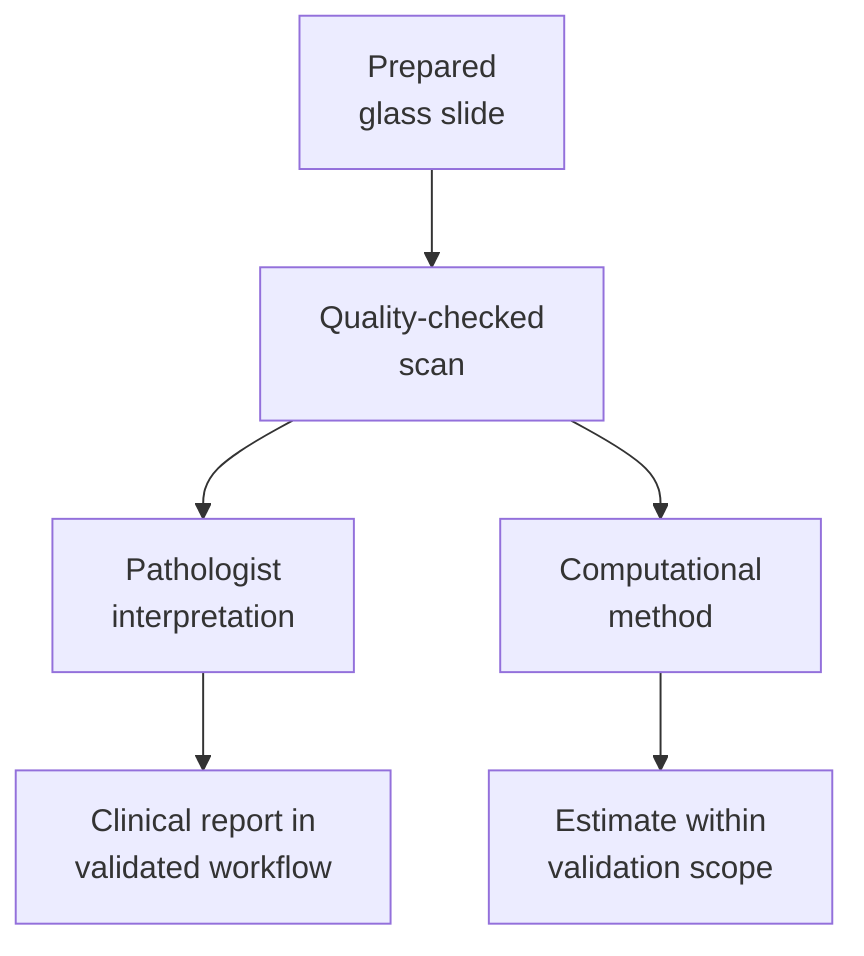

# Digital pathology: distinguish a scan from an inference

## In one sentence

Digital pathology converts prepared slides into images for viewing and analysis; a scanned image, a computational estimate and a validated clinical interpretation are different outputs.

## The intuition

A high-quality photograph of a map lets someone inspect the map remotely. Software might then estimate building counts or classify neighborhoods. The photograph and the estimates are different products. Digital pathology follows that distinction: acquiring pixels preserves visible information, while interpreting those pixels requires another method. The analogy stops at image quality, because small missed cellular details can matter diagnostically.

## How it works

**Whole-slide imaging (WSI)** uses a scanner to acquire a digital representation of the prepared glass slide. The workflow includes optics, focus, color capture, file handling, display and a viewing application. “Whole slide” does not mean every cell in the original tissue block or body; the image covers the scanned section and captured areas.

A pathologist can navigate the image and interpret morphology within a validated diagnostic workflow. A computational method may instead segment objects, meaning mark their boundaries, count selected cells, estimate areas or generate a model score. Its output depends on the algorithm's defined task and the images on which it was developed and evaluated.

A further model might predict molecular features from appearance. Such a prediction is not a direct RNA or protein assay. The model needs reference measurements and testing in suitable independent data to support its claim. Reliable viewing of a scanned slide does not validate every algorithm run on that image.

## Why it matters in cancer

Images can support remote review, teaching and repeated analysis without cutting another section from the block, when the required slide already exists. This helps preserve [[wiki/education/concepts/measurement/specimens/tissue-is-non-renewable|finite tissue]]. Nevertheless, an existing image may omit another depth, stain or region needed for a new question.

An algorithm trained on one set of stains, scanners or populations may behave differently elsewhere. **Generalizability** asks whether performance carries into the intended new setting. A convincing overlay or a precise-looking decimal does not settle that question. The [FDA digital pathology research program](https://www.fda.gov/medical-devices/medical-device-regulatory-science-research-programs-conducted-osel/digital-pathology-program-research-digital-pathology-medical-devices) explicitly distinguishes technical image performance from clinical performance and identifies generalizability as a research need.

## How it is measured

| Assay-card field | What to retain |
|---|---|
| Measures | Visible slide information; a separate algorithm measures or estimates a defined feature |
| How | Scan → quality check → view or run defined analysis → interpret within its evidence scope |
| Input and tissue cost | A prepared slide; scanning itself generally uses no additional tissue section |
| Output and units | Image pixels/resolution, selected cell counts or areas, or named model scores with their definitions |
| Thresholds | Quality criteria and model cutoffs depend on the scanner, task and intended use |
| Failure modes | Missed tissue, poor focus, folds, stain/color variation, compression or incorrect cell boundaries |
| Cannot show alone | Unscanned tissue, directly measured molecular expression or validated treatment benefit |
| Validation context | Diagnostic WSI validation covers the intended workflow; each computational clinical claim requires suitable additional evidence |

## Common confusions

- A digital slide is not an automatically generated diagnosis.
- A validated scanner workflow does not validate every downstream artificial-intelligence model.
- A heat map marks a method's output; its biological interpretation depends on the method.
- Reanalysis can reuse pixels, but it cannot reveal a tissue region that was never scanned.

## Try it

A fictional H&E scan passes image-quality checks. Research software labels a region “high predicted RNA signal.” A learner reports that the gene was measured at high expression in that region. What changed improperly?

**Answer:** A prediction became a direct measurement. The result should remain a research estimate with its model, reference data and validation scope. Measuring RNA would require an appropriate molecular assay; the good scan does not supply that assay.

## Explain it back

What are the three layers to retain? **One answer:** The acquired image, the method that interprets or estimates from it, and evidence that the resulting interpretation is valid for its intended use.

## Takeaway

Keep pixels, computational estimates and clinical interpretations separate, even when they appear in one viewer.

## Related concepts

- [[wiki/education/concepts/measurement/pathology-readouts/immunohistochemistry|A separately measured protein stain]]
- [[wiki/education/concepts/measurement/proteins-and-spatial/cell-segmentation|How software assigns cell boundaries]]

## Sources and scope

Source check: October 10, 2026. General digital measurement teaching; expert and learner review remain pending.

- [CAP: validating WSI for diagnostic purposes, 2021 update](https://www.cap.org/cap-guidelines/validating-whole-slide-imaging-for-diagnostic-purposes-in-pathology/) — intended clinical applications and diagnostic-workflow validation; published in print in 2022.
- [FDA: digital pathology research program](https://www.fda.gov/medical-devices/medical-device-regulatory-science-research-programs-conducted-osel/digital-pathology-program-research-digital-pathology-medical-devices) — technical performance, image quality, computational metrics and generalizability boundaries.

<!-- BEGIN GENERATED USED IN -->
## Used in

- [Read a tumor report without skipping its limits](/wiki/education/reading-a-tumor/index)
<!-- END GENERATED USED IN -->
