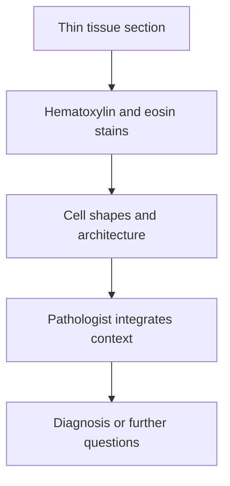

# H&E morphology: reading cells in their tissue setting

## In one sentence

Hematoxylin and eosin staining makes cell shapes and tissue architecture visible, supporting pathology interpretation without directly identifying every protein or gene activity.

## The intuition

A street map shows buildings, roads and their arrangement. It does not tell you every activity inside each building. Hematoxylin and eosin (**H&E**) provides a similar view of cells and their surroundings. The analogy has a limit: a pathologist can infer important biological features from appearance, but those inferences use expert interpretation and context rather than a complete molecular inventory.

## How it works

A thin tissue section is stained and examined by light microscopy, or scanned for a suitable [[wiki/education/concepts/measurement/pathology-readouts/digital-pathology|digital workflow]]. Hematoxylin highlights nuclei and other structures rich in nucleic acids in blue-purple tones. Eosin colors cytoplasm and many extracellular components in pink-red tones. These are broad chemical stains: blue is not a readout of a particular DNA sequence, and pink is not a measurement of one named protein.

**Morphology** means form and structure. The reader examines cell shape, nuclei, groupings, spaces, tissue boundaries and features such as necrosis, or cell death. The arrangement matters: similar-looking cells in different relationships to surrounding tissue can have different diagnostic implications.

For a breast lesion, assessing [[wiki/education/concepts/breast-cancer/anatomy-and-histology/myoepithelial-cells-and-basement-membrane|duct boundaries and their supporting layers]] can help distinguish in-situ from invasive growth where the relevant interface is represented. Difficult questions may need additional stains and clinical information. The color of one pixel or the size of one nucleus cannot make the whole diagnosis.

## Why it matters in cancer

H&E helps establish what tissue and cell populations are actually present before another assay is interpreted. It can reveal that a chosen region contains mostly scar or necrosis, helping explain a weak molecular signal. It also supports [[wiki/education/concepts/breast-cancer/grade-and-stage/histologic-grade|histologic grading]], which describes selected features of tumor appearance and is different from stage, the extent of disease.

A nearby section used for another assay may contain a different mixture because the tissue changes with depth. Spatial correspondence should therefore be checked rather than assumed from a shared block name.

## How it is measured

| Assay-card field | What to retain |
|---|---|
| Measures | Appearance and organization of cells in a represented section |
| How | Prepare section → stain → inspect slide → integrate relevant information |
| Input and tissue cost | A tissue section; cutting the section uses finite material |
| Output and units | Descriptive findings and diagnoses; named counts or distances only under specified methods |
| Thresholds | Diagnostic criteria and scoring methods depend on the feature and tissue; no universal color cutoff defines cancer |
| Failure modes | Poor fixation, folds, tears, staining variation or absent relevant interface |
| Cannot show alone | Exact gene expression, a named protein's abundance or all tissue outside the section |
| Validation context | Clinical interpretation differs from a research image classifier or unvalidated molecular prediction |

## Common confusions

- A nucleus appearing blue does not mean a gene is “on.”
- A large or irregular nucleus is one feature; context determines its diagnostic meaning.
- H&E and [[wiki/education/concepts/measurement/pathology-readouts/immunohistochemistry|immunohistochemistry]] answer overlapping but different questions.
- Predicting an RNA profile from H&E is computational inference, not directly sequencing that section's RNA.

## Try it

A fictional H&E slide shows tumor nests surrounded by pink material. A learner says, “The pink stain proves that the tumor expresses receptor R.” What test distinction was missed?

**Answer:** Eosin broadly colors tissue components. It does not identify receptor R specifically. A properly validated named-protein assay, interpreted in the correct cells, would address that question; its result still would not establish drug benefit by itself.

## Explain it back

What does H&E add before molecular testing? **One answer:** It helps establish the tissue's structure and represented cells, giving molecular results a sample context.

## Takeaway

H&E makes tissue organization readable; specific molecular claims require their own measurements and validation.

## Related concepts

- [[wiki/education/concepts/measurement/specimens/core-needle-biopsy|Architecture within a small sample]]
- [[wiki/education/concepts/measurement/pathology-readouts/stil-scoring|A defined immune-cell scoring method]]

## Sources and scope

Source check: October 10, 2026. General morphology teaching; expert and learner review remain pending.

- [Fischer et al., 2008: hematoxylin and eosin staining of tissue and cell sections](https://pubmed.ncbi.nlm.nih.gov/21356829/) — primary staining protocol and broad stain chemistry.
- [NCI: pathology reports](https://www.cancer.gov/about-cancer/diagnosis-staging/diagnosis/pathology-reports-fact-sheet) — morphology, architecture and integrated diagnosis.

<!-- BEGIN GENERATED USED IN -->
## Used in

- [Read a tumor report without skipping its limits](/wiki/education/reading-a-tumor/index)
<!-- END GENERATED USED IN -->
