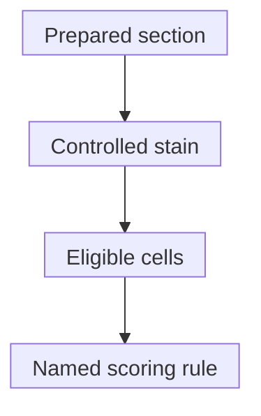

# Immunohistochemistry: protein staining in tissue

## In one sentence

Immunohistochemistry uses antibodies to visualize selected proteins in tissue while preserving information about the stained cells and their location.

## The intuition

A labeled highlighter marks one feature on a tissue map. You can see which cells are marked and where the mark sits. That is the useful idea behind immunohistochemistry. An antibody stain is not a perfect highlighter: binding specificity, tissue preparation and background must be checked.

## How it works

**Immunohistochemistry (IHC)** combines [antibody binding](/wiki/education/concepts/therapeutics/antibody-based/monoclonal-antibodies) with a visible signal, often a colored product. The laboratory prepares a tissue section, makes the target accessible under a specified protocol, applies antibodies and develops the signal. A pathologist interprets staining alongside cell shape and tissue organization.

A nuclear stain and a membrane stain answer different questions. Keep the scored cell population, location, intensity and distribution together. [Immunofluorescence](/wiki/education/concepts/measurement/proteins-and-spatial/multiplex-immunofluorescence) uses fluorescent labels. More markers can add context, but antibody performance and cell-boundary assignment still need validation.

*The score follows a specified assay and cell-selection rule; a visible stain does not validate every clinical claim.*

### Two scores combine different information

*In the same invented 100-cell set, 50% positive counts stained cells while H-score 110 weights their intensity; Allred remains a separate categorical scale.*

An **H-score** weights each intensity category by its percentage of eligible cells: `1 × weak% + 2 × moderate% + 3 × strong%`. Unstained cells contribute zero. Under this convention the scale is **0–300**, not 0–100%. It is an index, not a protein molecule count.

Historically used for breast hormone-receptor staining, an **Allred score** adds a proportion category to an intensity score. The conventional proportion bins are 0 for no positive cells, 1 for less than 1%, 2 for 1–10%, 3 for 11–33%, 4 for 34–66% and 5 for at least 67%. Intensity contributes 0 for absent staining, or 1/2/3 for weak/moderate/strong staining. Possible totals are **0 and 2–8**. Name the convention; a composite score does not replace marker-specific interpretation.

## Why it matters in cancer

IHC supports diagnosis and selected biomarker assessments. It can test whether a proposed protein lies on malignant cells or normal neighbors. [HER2](/wiki/education/concepts/breast-cancer/receptors-and-subtypes/her2) and hormone-receptor tests have their own reporting rules; a generic H-score cannot replace them. A surface-directed medicine needs an accessible target, which tissue-wide protein abundance cannot establish alone.

## Worked example

A fictional bulk protein assay detects a receptor. Tissue staining shows it mainly on blood-vessel cells, with little staining on malignant cells. Both results can be correct. The first found protein in the mixture; the second identified where the signal sits. Neither alone quantifies how a proposed medicine will behave in a patient.

## How it is measured

| Assay-card field | What to retain |
|---|---|
| Input and tissue cost | Tissue/block, fixation and section; staining consumes finite material |
| Method | Antibody clone, retrieval/detection system, scored cells and compartment |
| Output and units | Percentage positive, intensity, location and named score with its scale |
| Controls | Expected-positive tissue, relevant internal controls and background assessment |
| Limits | Poor preservation, nonspecific binding, few eligible cells, heterogeneity or scoring variation |
| Intended use | Assay/scoring-system validation; research measurement and clinical selection are separate |

There is no universal IHC positivity threshold. Current breast-biomarker reporting retains percentage and intensity even when optional composite scores are supplied.

## Common confusions

- A negative clinical category need not mean literally zero protein molecules.
- Research staining does not automatically replace a validated treatment-selection assay.
- Stained protein is not necessarily active, accessible or essential for survival.
- Equal H-scores can hide different intensity distributions.

## Try it

In a fictional 100-cell sample, 50 are unstained, 10 weak, 20 moderate and 20 strong. What are its H-score and positive percentage? Separately, what is the conventional Allred score for 30% positive cells with uniformly moderate staining?

**Answer:** H-score = `10 + 2×20 + 3×20 = 110`; **50%** are positive. In the separate Allred example, proportion category 3 plus intensity 2 gives **5**. Neither fictional result supplies a treatment threshold or benefit prediction.

## Explain it back

“I need the cell population and scoring method because ___.” One answer: “110 is an intensity-weighted index, while 50% counts positive cells; neither tells me how many protein molecules each cell carries.”

## Takeaway

**Read the location, denominator, scoring convention and validation scope before interpreting the number.**

## Related concepts

- [Analytical validity, clinical validity and utility](/wiki/education/concepts/measurement/computational-analysis/analytical-validity-clinical-validity-and-utility)
- [Why an RNA signal cannot replace staining](/wiki/education/concepts/measurement/transcriptomics/bulk-rna-seq)
- [Scoring immune cells in stroma](/wiki/education/concepts/measurement/pathology-readouts/stil-scoring)

## Sources and scope

Source check: October 10, 2026. Measurement teaching; expert and learner review remain pending.

- [NCI: immunohistochemistry](https://www.cancer.gov/publications/dictionaries/cancer-terms/def/immunohistochemistry) — antibody-based tissue detection.
- [CAP IHC analytic-validation update, 2024](https://www.cap.org/cap-guidelines/principles-of-analytic-validation-of-immunohistochemical-assays/) — assay/scoring combinations and specimen conditions.
- [CAP archived breast-biomarker protocol, 2018, Tables 2–3](https://documents.cap.org/protocols/cp-breast-18biomarker-1201.pdf) — checked indexed tables support scoring arithmetic; historical positivity labels are not taught as current generic cutoffs.
- [CAP breast-biomarker protocol v1.6.2.0, September 2026](https://www.cap.org/wp-content/uploads/2026/09/Breast.Bmk_1.6.2.0.REL_CAPCP.pdf?download=true) — selected reporting fields and Note B; composite scores remain optional.

<!-- BEGIN GENERATED USED IN -->
## Used in

- [Aiming a drug at a surface target](/wiki/education/guides/aiming-a-drug-at-a-surface-target/index)
- [Choose a target with a usable safety window](/wiki/education/guides/engineered-cell-therapy/02-choosing-a-target)
- [Match each measurement to its claim](/wiki/education/local-treatment-modalities/05-tissue-and-sample-budget)
- [Ask whether protein is present, placed and active](/wiki/education/molecular-profiling/03-protein-expression-and-activation)
- [Add the geography of cells and signals](/wiki/education/molecular-profiling/04-spatial-biology)
- [Choose the comparison before interpreting the signal](/wiki/education/multi-omics-foundations/07-comparisons-and-evidence)
- [Read an immune map without overreading it](/wiki/education/reading-a-tumor/immune-hot-vs-cold)
- [What does multi-omics tell us about a tumor?](/wiki/education/reading-a-tumor/omics-and-multi-omics)
- [Separate the address from the killing mechanism](/wiki/education/targeted-therapy-modalities/01-mechanism)
<!-- END GENERATED USED IN -->
