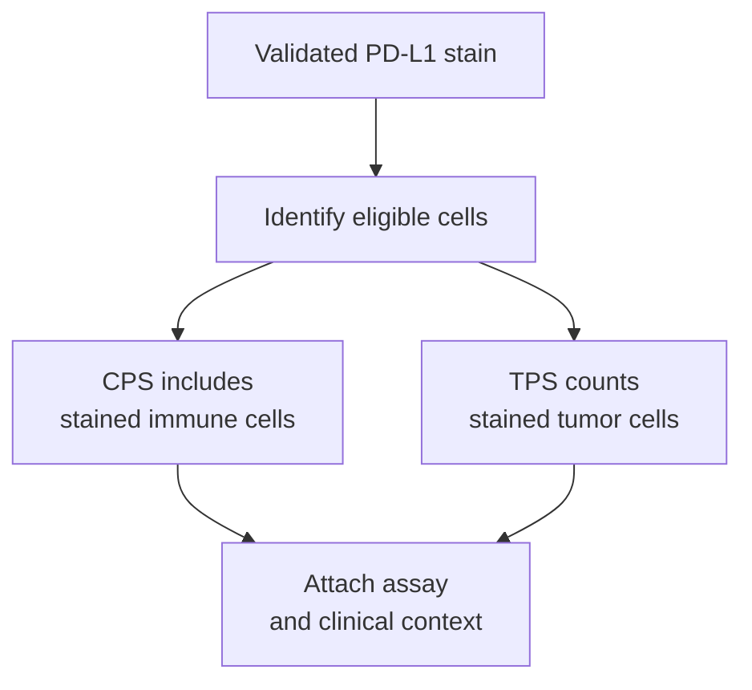
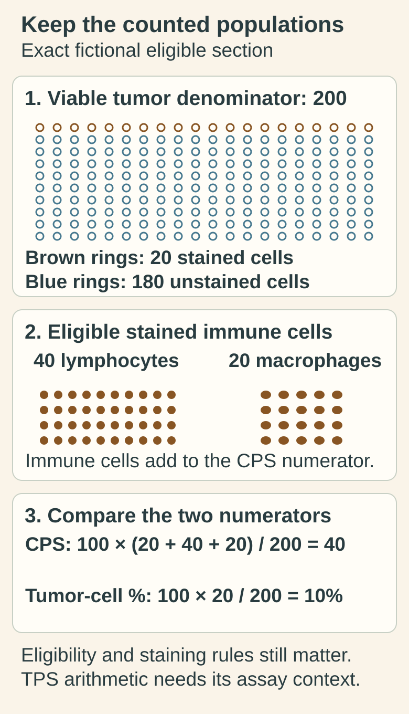

# PD-L1 scoring: keep CPS and TPS denominators straight

## In one sentence

PD-L1 scoring measures defined staining patterns using an assay-specific algorithm; combined positive score and tumor proportion score count different cells and are not interchangeable.

## The intuition

Two classroom surveys can give different answers: one counts students; another includes selected staff but divides by student enrollment. PD-L1 scores similarly depend on the numerator and denominator. Unlike a simple headcount, the assay also defines which stained cells and locations qualify.

## How it works

**Programmed death-ligand 1 (PD-L1)** is a protein assessed by [[wiki/education/concepts/measurement/pathology-readouts/immunohistochemistry|immunohistochemistry (IHC)]]. A pathologist identifies eligible cells and staining under the specified method. A score is meaningful only with its antibody assay, preparation, algorithm and disease context.

**Combined positive score (CPS)** is calculated as:

`100 × (PD-L1-staining tumor cells + PD-L1-staining eligible lymphocytes + PD-L1-staining eligible macrophages) / all viable tumor cells`

For the 22C3 breast assay manual used here, tumor cells qualify with convincing partial or complete membrane staining. Eligible lymphocytes and macrophages may have membrane and/or cytoplasmic staining within invasive tumor nests or directly associated supporting stroma. Not every stained immune cell anywhere on the slide belongs in the numerator. Neutrophils, nonviable cells and cells associated only with benign or in-situ tissue are among the exclusions. The denominator contains viable invasive tumor cells, including unstained ones; immune cells are excluded from it. Raw arithmetic can exceed 100, but **reported CPS is capped at 100**.

**Tumor proportion score (TPS)** is the percentage of viable tumor cells with qualifying partial or complete membrane staining. It excludes immune cells from its numerator. The [FDA assay document](https://www.accessdata.fda.gov/cdrh_docs/pdf15/P150013S016B.pdf) describes this algorithm in a non-small-cell lung cancer context; it does not make TPS a substitute for breast CPS.

## Why it matters in cancer

A clinical cutoff belongs to a defined assay, population and treatment setting. **[[wiki/education/concepts/breast-cancer/receptors-and-subtypes/tnbc|Triple-negative breast cancer (TNBC)]]** is one example: CPS ≥10 has a defined advanced-TNBC efficacy and label context. It is not a universal trial-enrollment rule or an early-TNBC threshold. KEYNOTE-355 enrolled advanced-TNBC participants regardless of tumor PD-L1 expression and analyzed specified score populations. KEYNOTE-522 also enrolled early-TNBC participants regardless of PD-L1 expression. The [pinned FDA 2026 label](https://www.accessdata.fda.gov/drugsatfda_docs/label/2026/125514s194lbl.pdf), section 14.20, supplies those trial contexts; this page does not list every current treatment option.

## How it is measured

| Assay-card field | What to retain |
|---|---|
| Measures | Eligible staining under a named scoring algorithm |
| How | Prepare tissue → stain with controls → assess adequacy → identify/count eligible cells → score |
| Input and tissue cost | A formalin-fixed tissue section for the specified workflow; further sections use finite tissue |
| Output and units | CPS, a capped score, or TPS, a tumor-cell percentage |
| Thresholds | Assay/population-specific; the cited TNBC 22C3 manual requires at least 100 viable tumor cells for evaluation |
| Failure modes | Inadequate cells, poor staining controls, wrong cell attribution, necrosis or heterogeneous sampling |
| Cannot show alone | A complete immune state, guaranteed individual benefit or eligibility in another setting |
| Validation context | Antibody clone, platform, scoring method, specimen and intended clinical use must match the supporting evidence |

## Common confusions

- CPS is not the percentage of all cells that stain and is not the percentage of tumor cells alone.
- CPS 100 does not imply every tumor cell is positive.
- The same cutoff cannot be transferred between CPS, TPS or another immune-cell algorithm.
- A low score is not a complete description of tumor immunity or a universal exclusion from immunotherapy.

## Try it

*The exact original fictional counts yield CPS 40 and a tumor-cell percentage of 10%. Tumor inventories include 180 unstained cells; immune cells add only to the CPS numerator. These are grouped counting cartoons, not slide coordinates. Eligibility, controls and assay/indication rules remain necessary, and TPS arithmetic applies only under its own rules.*

[Open the light diagram](./images/pd-l1-eligible-cells-and-tumor-denominator-v1-light.svg) · [Open the dark diagram](./images/pd-l1-eligible-cells-and-tumor-denominator-v1-dark.svg)

A fictional eligible section contains 200 viable invasive tumor cells. Twenty tumor cells stain; 40 eligible lymphocytes and 20 eligible macrophages also stain. What are CPS and the illustrative tumor-cell percentage?

**Answer:** CPS = `100 × (20 + 40 + 20) / 200 = 40`. The tumor-cell percentage is `100 × 20 / 200 = 10%`, corresponding to TPS arithmetic if those cells satisfy its assay rules. These different values do not authorize switching algorithms or choosing treatment. All counts are fictional.

## Explain it back

Why can CPS exceed the tumor-cell staining percentage? **One answer:** It includes selected stained immune cells in the numerator while retaining viable tumor cells as the denominator.

## Takeaway

Keep the eligible cells, denominator, assay and clinical setting attached to every PD-L1 score.

## Related concepts

- [[wiki/education/concepts/measurement/specimens/core-needle-biopsy|Sampling and representativeness]]
- [[wiki/education/concepts/breast-cancer/receptors-and-subtypes/tnbc|What TNBC defines]]

## Sources and scope

Source check: October 10, 2026. Scoring education, not a treatment-selection instruction; expert and learner review remain pending.

- [22C3 TNBC interpretation manual, EU CE-IVD](https://www.agilent.com/cs/library/usermanuals/public/29440-d67159-pdl1-ihc-22C3-pharmdx-tnbc-interpretation-manual-eu.pdf) — pp.18, 24–26: adequacy, cell eligibility, denominator and CPS cap; p.31: trial score distribution. This technical manual is not a US authorization document.
- [FDA: 22C3 assay SSED, P150013/S016 (2019)](https://www.accessdata.fda.gov/cdrh_docs/pdf15/P150013S016B.pdf) — p.2 TPS definition in its specified disease context.
- [Cortés et al., 2022: KEYNOTE-355 overall survival](https://pubmed.ncbi.nlm.nih.gov/35857659/) — advanced-TNBC trial and prespecified analysis populations.
- [FDA: pembrolizumab label, supplement 194 (2026)](https://www.accessdata.fda.gov/drugsatfda_docs/label/2026/125514s194lbl.pdf) — early/advanced TNBC trial context, without an exhaustive regimen inventory here.

<!-- BEGIN GENERATED USED IN -->
## Used in

- [Build the next question](/wiki/education/guides/reading-pathology-and-surgery-results/03-build-the-next-question)
- [Ask whether protein is present, placed and active](/wiki/education/molecular-profiling/03-protein-expression-and-activation)
<!-- END GENERATED USED IN -->
