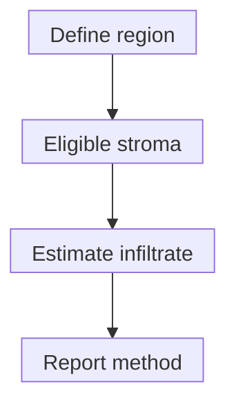

# Stromal TIL scoring: what the percentage counts

## In one sentence

A stromal tumor-infiltrating lymphocyte score estimates the percentage of eligible tumor-associated stromal area occupied by mononuclear inflammatory cells.

## The intuition

Before using a percentage, ask what counts as the whole. A stromal score uses the relevant supporting-tissue area as its denominator. It does not use every cell in the biopsy. Think of shading a proportion of a map, rather than counting how many people stand on it. The map is only a tissue sample, not a census of the entire tumor.

## How it works

**Stromal tumor-infiltrating lymphocytes (sTILs)** are assessed in tumor-associated [stroma](/wiki/education/concepts/biology-basics/cells/epithelium-and-stroma), the supporting tissue around malignant structures. Under the International TILs Working Group breast-tumor method, a pathologist uses **hematoxylin and eosin (H&E)** staining to estimate the infiltrate within a defined region.

The numerator reflects the area occupied by mononuclear inflammatory cells, including [lymphocytes](/wiki/education/concepts/immunology/tumor-immunology/tumor-infiltrating-lymphocytes) and [plasma cells](/wiki/education/concepts/immunology/antibodies-and-b-cells/b-cells-and-plasma-cells). It is not a count of all immune-cell types or a direct count of [CD8 T cells](/wiki/education/concepts/immunology/t-cells/cd4-vs-cd8).

For pretreatment invasive breast tumors, the defined stromal region lies within the invasive-tumor borders. Normal structures, in-situ disease, necrosis, crush damage and biopsy-site changes require the method's exclusions. After preoperative treatment, residual-disease guidance defines the relevant residual tumor bed. A scar with scattered malignant cells presents a different regional question from an untreated mass. Keep the setting and its method explicit.

Assessment is trained and semiquantitative. Evaluate the defined region overall rather than choosing only its hottest spot. A core biopsy, surgical specimen and lymph-node sample can supply different tissue contexts. Applying one breast-tumor scoring rule to another context needs justification.

*Region selection comes before the percentage; changing the eligible area changes the question.*

## Why it matters in cancer

sTILs describe an immune feature of sampled tissue. Study-specific associations can inform research and prognosis. A score alone does not prove tumor-specific recognition, access to each malignant nest or benefit from a particular immunotherapy. Those are separate measurements and validation questions.

## Worked example

In a fictional section, mononuclear inflammatory cells occupy about 30% of the eligible stromal area. The result is an sTIL score of about 30% under that assessment. It does **not** say that 30% of all cells are lymphocytes, that 30% of cancer cells are being killed or that 30% of cells are CD8 T cells. The invented value teaches the denominator; it is not a treatment cutoff.

## How it is measured

| Assay-card field | What to retain |
|---|---|
| Input | Section/block, specimen type, sampled site and treatment context; finite tissue |
| Region | Eligible stromal area and setting-specific inclusion/exclusion rules |
| Output and units | Continuous estimated percentage of that area occupied by the defined infiltrate |
| Method | H&E assessment, observer/calibration and regional sampling; identify computational estimates |
| Limits | Artifacts, sparse stroma, heterogeneity, observer variation and an unrepresentative sample |
| Validation | Measurement reproducibility and intended clinical use are different questions |

Additional stains can identify subtypes and location, but change the measurement rather than quietly changing its denominator.

## Common confusions

- Stromal TILs and lymphocytes inside malignant nests refer to different locations.
- Percent stromal area, percent positive nuclei and cells per square millimeter are different units.
- Bulk immune [ribonucleic acid (RNA)](/wiki/education/concepts/measurement/transcriptomics/bulk-rna-seq) abundance is not a microscopy-based sTIL score.
- A high score is not a permanent “hot tumor” label or a universal immunotherapy rule.

## Try it

For a fictional area map, region A contains 4 units of eligible stroma and 0.4 units of infiltrate; region B contains 1 unit and 0.6 units. What is the pooled-area fraction? Is it the simple average of 10% and 60%?

**Answer:** `(0.4+0.6)/(4+1) = 20%`. The unweighted mean is **35%**, giving unequal regions equal weight. These invented areas illustrate the denominator. They are **not** a mandated pixel-measurement workflow for actual semiquantitative scoring, nor independent patient observations.

## Explain it back

“An sTIL score of 30% means ___, not ___.” One answer: “about 30% of the eligible stroma is occupied by the defined infiltrate, not that 30% of all tumor cells are immune cells.”

## Takeaway

**Keep the tissue setting, eligible stromal region and assessment method beside every sTIL percentage.**

## Related concepts

- [Protein staining and cell identity](/wiki/education/concepts/measurement/pathology-readouts/immunohistochemistry)
- [Prognostic versus predictive evidence](/wiki/education/concepts/evidence-and-statistics/biomarkers/prognostic-vs-predictive)
- [Hot, excluded and cold patterns](/wiki/education/concepts/immunology/tumor-immunology/hot-excluded-cold-tumor)

## Sources and scope

Source check: October 10, 2026. Setting-specific measurement teaching, not a therapy-selection rule. Expert and learner review remain pending.

- [Salgado et al., 2015: Working Group recommendations](https://tilsinbreastcancer.org/wp-content/uploads/2017/11/Salgado-et-al.-Annals-of-Oncology-2015.pdf) — Table 2 and adjacent passages on eligible regions, exclusions and overall assessment.
- [Dieci et al., 2018: updated recommendations](https://pubmed.ncbi.nlm.nih.gov/29024776/) and the [residual-disease supplement](https://tilsinbreastcancer.org/wp-content/uploads/2017/10/Suppl-File-3-Recommendations-for-assessing-tumor-infiltrating-lymphocytes-TILs-in-RD.pdf) — selected residual-bed and compartment guidance; no universal benefit threshold.

<!-- BEGIN GENERATED USED IN -->
## Used in

- [Match each measurement to its claim](/wiki/education/local-treatment-modalities/05-tissue-and-sample-budget)
- [Add the geography of cells and signals](/wiki/education/molecular-profiling/04-spatial-biology)
- [Separate immune presence from tumor recognition](/wiki/education/multi-omics-foundations/06-immune-presence-and-recognition)
- [Read an immune map without overreading it](/wiki/education/reading-a-tumor/immune-hot-vs-cold)
- [Understand multi-omics, one question at a time](/wiki/education/reading-a-tumor/omics-and-multi-omics)
<!-- END GENERATED USED IN -->
