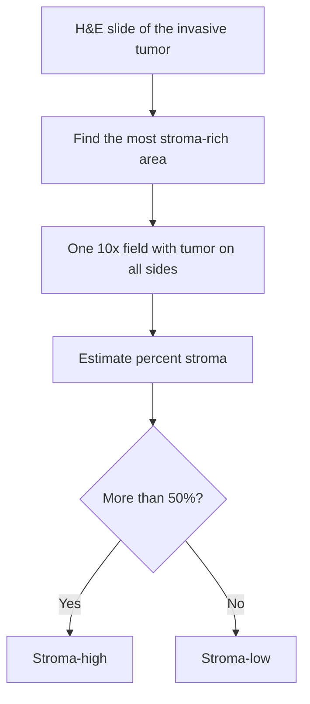

# Tumor-stroma ratio

## In one sentence

The tumor-stroma ratio is a pathologist's estimate, on a routine slide, of how much of a tumor area is supporting tissue rather than cancer cells; more than 50% stroma is called stroma-high.

## The intuition

Look at a neighborhood from the air and ask how much is buildings and how much is the streets and yards between them. The tumor-stroma ratio asks the same about a tumor: how much is cancer cells, and how much is the [stroma](/wiki/education/concepts/biology-basics/cells/epithelium-and-stroma) of fibroblasts, collagen and vessels around them. The analogy breaks because stroma is active. It can feed, shield and steer the cancer cells it surrounds.

## How it works

The standard method uses a hematoxylin and eosin (H&E) slide, the routine pink-and-purple stain.

1. Scan the slide at low power and find the area of invasive tumor with the most stroma.
2. Choose one microscope field at 10× that has cancer cells on all four sides.
3. Estimate the percentage of that field that is stroma, in steps of 10%.
4. Call the tumor **stroma-high** above 50% and **stroma-low** at 50% or below.

The score takes a minute or two and needs no extra stain. Two observers usually agree well; one triple-negative breast cancer study reported a kappa of 0.74 ([Moorman 2012](https://pubmed.ncbi.nlm.nih.gov/22264965/)). Kappa measures agreement beyond chance, where 1 is perfect.

*The score comes from the most stroma-rich field, not an average of the slide.*

## Why it matters in cancer

A stroma-high tumor has, on average, a worse outlook. This is among the few tissue-architecture measures tested prospectively.

- **Colon cancer.** The prospective UNITED study scored 1,388 patients with stage II or III disease at 27 centers. Three-year disease-free survival was 70% with stroma-high tumors and 83% with stroma-low (hazard ratio 1.49, 95% CI 1.17–1.90). Overall survival did not differ significantly ([Polack 2024](https://pubmed.ncbi.nlm.nih.gov/38613913/)).
- **Triple-negative breast cancer (TNBC).** In 124 patients, five-year relapse-free rates were 85% for stroma-low and 45% for stroma-high tumors (hazard ratio 2.39, 95% CI 1.07–5.29) ([Moorman 2012](https://pubmed.ncbi.nlm.nih.gov/22264965/)). In an earlier series of 574 early breast cancers, the triple-negative subgroup had rates of 81% versus 56% ([de Kruijf 2011](https://pubmed.ncbi.nlm.nih.gov/20361254/)). A separate cohort confirmed the direction ([Dekker 2013](https://pubmed.ncbi.nlm.nih.gov/23709090/)).

The ratio is **prognostic**: it tracks outcome. It has not been shown to be [predictive](/wiki/education/concepts/evidence-and-statistics/biomarkers/prognostic-vs-predictive), meaning no trial has shown that a stroma-high result should change which treatment is given. It is not part of breast cancer guidelines, and a 2018 review noted that prospective validation in breast cancer was still missing ([Kramer 2018](https://pubmed.ncbi.nlm.nih.gov/30302588/)).

## Common confusions

- **Stroma amount is not the stromal tumor-infiltrating lymphocyte (TIL) score.** The [sTIL score](/wiki/education/concepts/measurement/pathology-readouts/stil-scoring) asks how much of the stroma is filled with immune cells. The tumor-stroma ratio asks how much stroma there is.
- **Stroma-high does not mean immune-excluded.** A thick stroma can hold many lymphocytes or none. [T-cell exclusion](/wiki/education/concepts/immunology/tumor-immunology/t-cell-exclusion-mechanisms) is a separate reading.
- **The 50% cutoff belongs to the manual method.** An automated version in colon cancer needed a cutoff of 77% to give comparable groups ([Heilijgers 2026](https://pubmed.ncbi.nlm.nih.gov/41468683/)). A threshold does not carry over when the method changes.
- **Treatment changes the picture.** Chemotherapy leaves scar-like fibrosis where tumor used to be. The ratio was developed on untreated tumors and is not validated on tissue removed after preoperative treatment.
- **It is not tumor cellularity.** Cellularity estimates the cancer-cell share of a whole tumor bed and feeds the residual cancer burden score. The tumor-stroma ratio reads one chosen field.

## How it is measured

| Field | What to keep with the result |
|---|---|
| Input | H&E slide of the invasive tumor; specimen type and whether treatment came first |
| Region | The single most stroma-rich 10× field with tumor on all sides |
| Output | Percent stroma in 10% steps, then stroma-high or stroma-low |
| Method | Pathologist's eye, or software with its own cutoff |
| Limits | Field choice, necrosis and mucin, post-treatment fibrosis |

## In Diana's case

Her tissue was removed after preoperative treatment, where this score is not validated. The [review of validated spatial indicators](/wiki/research/reviews/2026-11-validated-spatial-indicators) covers which measures do apply.

## Try it

A fictional untreated tumor has fields that read 30%, 40% and 70% stroma. What is the score, and is it the average?

**Answer:** 70%, stroma-high. The method takes the most stroma-rich eligible field. The average, about 47%, would have called it stroma-low. The values are invented to show the rule.

## Explain it back

"Stroma-high means ___, and it tells me about ___, not ___." One answer: "more than half of the chosen field is supporting tissue; it tells me about average outlook, not about which drug will work."

## Takeaway

**The tumor-stroma ratio is a quick, reproducible prognostic reading on a routine slide, validated prospectively in colon cancer and retrospectively in breast cancer, with no role yet in choosing treatment.**

## Related concepts

- [Epithelium and stroma](/wiki/education/concepts/biology-basics/cells/epithelium-and-stroma)
- [Cancer-associated fibroblasts and stroma](/wiki/education/concepts/cancer-biology/tumor-microenvironment/cancer-associated-fibroblasts-and-stroma)
- [Extracellular matrix](/wiki/education/concepts/cancer-biology/tumor-microenvironment/extracellular-matrix)
- [Stromal TIL scoring](/wiki/education/concepts/measurement/pathology-readouts/stil-scoring)
- [Spatial proximity metrics](/wiki/education/concepts/measurement/proteins-and-spatial/spatial-proximity-metrics)

## Sources and scope

Source-checked November 9, 2026, against PubMed abstracts. Measurement teaching, not a treatment-selection rule. Expert and learner review pending.

1. [Polack and colleagues, ESMO Open 2024](https://pubmed.ncbi.nlm.nih.gov/38613913/) — the prospective UNITED validation study in colon cancer.
2. [de Kruijf and colleagues, Breast Cancer Research and Treatment 2011](https://pubmed.ncbi.nlm.nih.gov/20361254/) — 574 early breast cancers.
3. [Moorman and colleagues, European Journal of Surgical Oncology 2012](https://pubmed.ncbi.nlm.nih.gov/22264965/) — 124 triple-negative breast cancers.
4. [Dekker and colleagues, Breast Cancer Research and Treatment 2013](https://pubmed.ncbi.nlm.nih.gov/23709090/) — validation in node-negative premenopausal breast cancer.
5. [Kramer and colleagues, Breast Cancer Research and Treatment 2018](https://pubmed.ncbi.nlm.nih.gov/30302588/) — review of the breast cancer evidence.

Also cited: [Heilijgers 2026](https://pubmed.ncbi.nlm.nih.gov/41468683/).

<!-- BEGIN GENERATED USED IN -->
## Used in

Browse the [concept index](/wiki/education/concepts/index) for related learning paths.
<!-- END GENERATED USED IN -->
