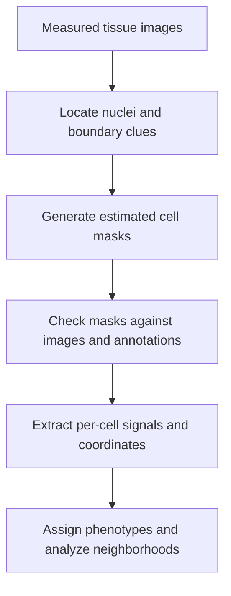
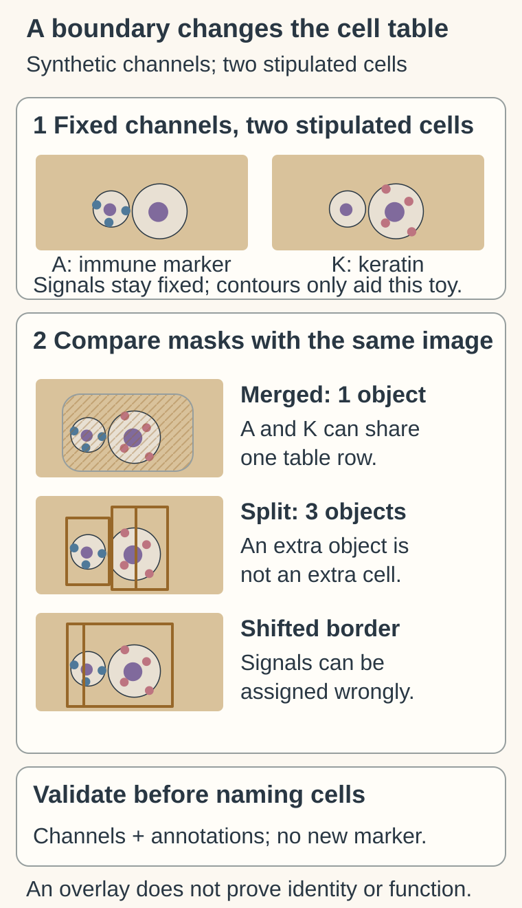

# Cell segmentation

## In one sentence

Cell segmentation assigns image pixels to estimated cell regions so measurements can be summarized for individual cells.

## The intuition

Imagine drawing property boundaries on an aerial photograph before assigning a tree to an address. If a boundary covers two homes, the resulting household record mixes their features.

Cell segmentation has the same assignment problem. Its boundary is an estimate from the available image signals. A two-dimensional tissue section may contain only part of a cell; the mask is not a complete three-dimensional outline of the living cell.

## How it works

An analysis starts with images containing clues to cell locations and borders. Nuclear stains often help find cell centers. Membrane or cytoplasmic stains can help estimate whole-cell boundaries. Traditional image rules, trained classifiers and deep-learning models offer different approaches. Their suitability depends on the tissue, staining and image quality.

The output is a **mask**: a labeled image identifying which pixels belong to each estimated object. **Detection** asks whether an object was found. **Segmentation** asks which pixels belong to it. **Phenotyping** later classifies the object using its measured features. Finding a nucleus does not automatically provide a reliable whole-cell boundary.

Mask quality must be checked before using per-cell biology. **Merging** combines neighboring cells into one object. **Splitting** divides one cell into several. Missing cells and displaced borders can distort counts, marker combinations and spatial relations. Inspecting masks overlaid on the original channels helps expose these errors.

Manual annotations from representative, held-out images provide a reference for validation. One overlap measure, **intersection over union**, divides the area shared by a predicted mask and reference mask by the area covered by either mask, counting the overlap once. Its value ranges from zero to one. That score alone can hide missed objects or mergers, so validation should also examine object counts and characteristic errors.

## Why it matters in cancer

[Multiplex immunofluorescence (mIF)](/wiki/education/concepts/measurement/proteins-and-spatial/multiplex-immunofluorescence) and [imaging mass cytometry (IMC)](/wiki/education/concepts/measurement/proteins-and-spatial/imaging-mass-cytometry) often convert marker images into cell tables. Segmentation is the bridge between a measured image and a statement about an individual cell.

Crowded tumors, small lymphocytes and irregular cancer cells can challenge a model. A method validated on one tissue or stain may need additional evaluation on another. Accurate coordinates do not compensate for an incorrect boundary. A downstream association can be reproducible while still inheriting a systematic assignment error.

## Analysis card

| Field | What to record |
|---|---|
| Input and tissue cost | Existing image channels and scale information; computation consumes no additional tissue. Upstream staining or imaging may already have consumed material. |
| Output and units | Labeled masks and object counts; estimated cell area in square micrometers when calibrated; coordinates and distances in micrometers; overlap scores without units. Per-cell marker values are derived from measured images. |
| Controls | Original-image overlays, representative manual annotations, held-out images, checks by cell type and region, and recorded software, model and settings. |
| Thresholds | Error tolerances established for the downstream task. A cell-count task and a rare-coexpression task can require different checks. |
| Failure modes | Merged, split or missing cells; weak boundary stains; misaligned channels; debris; stain or tissue differences from the model's development data. |
| What it cannot tell you | New molecular signals, complete cell outlines outside the section, receptor specificity, biological interaction or killing. |
| Validation context | An image-analysis component validated for a defined tissue, acquisition and task. Published benchmark accuracy is not guaranteed performance on every new specimen. |

## Worked example

The channels and two stipulated cells stay fixed while the estimated masks merge them, split one, or shift a border. The resulting table can mix markers or miscount objects. The pale contours are aids in this synthetic example, not validated cell boundaries. In real images, compare masks with original channels and representative annotations before interpreting cell identity or coexpression.

The [official image-quality guidance](https://www.10xgenomics.com/support/software/tenx-explorer/latest/tutorials/checking-data-quality) illustrates comparing segmentation with original channels; the toy above does not reproduce a platform validation.

In a fictional image, one mask contains a small T cell and an adjacent cancer cell. The cell table reports both an immune marker and cytokeratin in one object. Is that a new hybrid cell?

**Answer:** First inspect the original channels and boundary overlay. A merged mask can create false coexpression. Correcting that mask may show two neighboring cells instead; their proximity still does not prove immune recognition.

**Read the split overlay:** It reports three objects for the two stipulated cells. Did another cell appear?

**Answer:** No. The masks changed the object table, not the original image. Compare channels and representative annotations before using the count or marker combinations.

## Common confusions

- **A mask is not a measurement of a new marker:** it assigns existing signals to estimated regions.
- **Nuclear segmentation is not whole-cell segmentation:** cytoplasmic or membrane signals may lie outside a nuclear mask.
- **Segmentation is not phenotyping:** boundaries and biological labels are different analysis steps.
- **A general model is not universally validated:** tissue and staining changes require performance checks.

## Related concepts

- [Hot, excluded and cold tumors](/wiki/education/concepts/immunology/tumor-immunology/hot-excluded-cold-tumor)
- [Stromal tumor-infiltrating lymphocyte scoring](/wiki/education/concepts/measurement/pathology-readouts/stil-scoring)
- [Analytical validity, clinical validity and utility](/wiki/education/concepts/measurement/computational-analysis/analytical-validity-clinical-validity-and-utility)

## Sources and scope

Source-checked October 9, 2026. Image-analysis principles and a fictional boundary example; expert and learner review pending.

- [Greenwald et al., 2022: whole-cell tissue segmentation with Mesmer](https://pmc.ncbi.nlm.nih.gov/articles/PMC9010346/). Primary model and annotation study; performance is bounded by its tested data and comparisons.
- [Stringer et al., 2021: Cellpose](https://www.nature.com/articles/s41592-020-01018-x). Primary generalist segmentation method; local validation remains necessary.
- [Windhager et al., 2023: multiplex image processing and analysis](https://www.nature.com/articles/s41596-023-00881-0). Primary protocol including visual segmentation-quality assessment before downstream analysis.

<!-- BEGIN GENERATED USED IN -->
## Used in

- [Measure each part of a T-cell response](/wiki/education/reading-a-tumor/measuring-t-cell-engagement)
- [What does multi-omics tell us about a tumor?](/wiki/education/reading-a-tumor/omics-and-multi-omics)
<!-- END GENERATED USED IN -->
