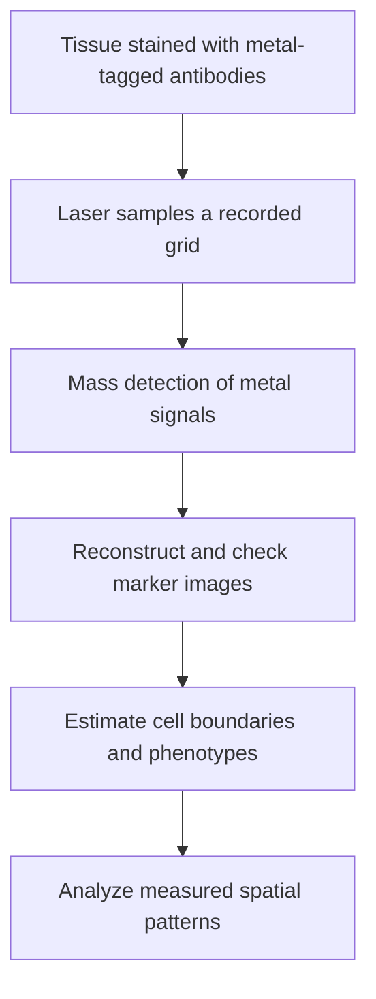

# Imaging mass cytometry

## In one sentence

Imaging mass cytometry maps selected tissue markers by laser-sampling a section stained with metal-tagged antibodies and detecting their metal signals.

## The intuition

Think of different metal tags as barcode colors that a specialized detector can distinguish. A scanner samples a tissue grid and rebuilds one marker map for each tag.

The analogy stops at two important details. The machine detects ions rather than colored light, and laser sampling removes material from the scanned region. The maps also inherit the limitations of the selected antibodies and analysis.

## How it works

*Keep the recorded tissue address attached to each metal-tag channel. These invented maps illustrate destructive spatial sampling; suspension measurements lose the original arrangement. The chosen panel and estimated cell borders still limit interpretation.*

A laboratory stains a compatible tissue section using a panel of [antibodies](/wiki/education/concepts/immunology/antibodies-and-b-cells/antibody-structure) carrying distinguishable metal-isotope tags. The panel selects what can be measured. A laser removes small areas in sequence, preserving their recorded coordinates. The sampled material enters a mass cytometer, where it is ionized and the metal signals are separated by mass.

The measured coordinates and signals become image channels. **Imaging mass cytometry (IMC)** can therefore retain tissue geography. **Suspension mass cytometry** measures prepared cells individually after they have been removed from their original arrangement. The shared detection principle does not make every mass-cytometry experiment spatial.

Channel interference is reduced compared with many fluorescence panels, but it is not absent. Isotope impurities, oxide formation and instrument effects can move signal into another channel. Appropriate controls and correction within the method's valid range reduce false marker assignments.

[Cell segmentation](/wiki/education/concepts/measurement/proteins-and-spatial/cell-segmentation) then assigns image regions to estimated cells. Per-cell marker signals and neighborhood summaries depend on those boundaries, phenotype rules and the choice of field. A measurement with fine coordinates can still assign a marker to the wrong neighbor.

## Why it matters in cancer

IMC supports research on mixed cancer, stromal and immune populations in tissue. Multiple marker maps can reveal arrangements that a bulk measurement hides. These maps can help formulate hypotheses about exclusion, local cell states or treatment-associated changes.

The assay does not establish those interactions causally. Neighboring cells may share a region without recognizing each other. A fixed-section marker pattern does not demonstrate live-cell killing or establish which treatment will help an individual.

## Assay card

| Field | What to record |
|---|---|
| Input and tissue cost | A compatible tissue section and validated panel; laser ablation consumes the scanned region. Field selection and available section area constrain sampling. |
| Output and units | Metal-signal images; per-pixel or per-cell channel values; derived cell counts, densities per square millimeter and distances in micrometers. Signals are not automatically absolute protein-molecule counts. |
| Controls | Antibody validation and titration, suitable positive and negative material, channel-interference controls, instrument checks, reference samples and cell-boundary overlays. |
| Thresholds | Explicit marker, phenotype and spatial-analysis rules for the workflow; no universal immune-response cutoff. |
| Failure modes | Channel interference, weak staining, ablation or acquisition artifacts, unrepresentative fields, incorrect boundaries and inconsistent analysis batches. |
| What it cannot tell you | Unmeasured proteins, original living-cell dynamics, antigen specificity, actual killing or patient benefit. |
| Validation context | A specified panel and analysis pipeline need technical validation. Published platform studies do not validate every clinical claim made from a new panel. |

## Worked example

A fictional panel reports a rare double-positive cell population. One marker is extremely bright in a neighboring mass channel. What should be checked before calling the population a new cell state?

**Answer:** Inspect channel interference, staining controls and cell-boundary overlays. A technical signal contribution or merged boundary could create apparent coexpression. A convincing corrected pattern would still require biological interpretation.

## Common confusions

- **Mass cytometry is not always spatial:** the imaging workflow retains recorded coordinates; suspension analysis does not.
- **Metal tags do not eliminate spillover:** interference has different sources from fluorescence overlap.
- **IMC is not untargeted proteomics:** it detects selected tagged markers, not every protein or peptide in tissue.
- **Spatial proximity is not functional interaction:** measured arrangement and demonstrated recognition are separate claims.

## Related concepts

- [Multiplex immunofluorescence](/wiki/education/concepts/measurement/proteins-and-spatial/multiplex-immunofluorescence)
- [Immunopeptidomics](/wiki/education/concepts/measurement/proteins-and-spatial/immunopeptidomics)
- [Functional cytotoxicity assays](/wiki/education/concepts/measurement/immune-monitoring/functional-cytotoxicity-assays)

## Sources and scope

Source-checked October 9, 2026. Platform principles and a fictional artifact check; expert and learner review pending.

- [Giesen et al., 2014: multiplexed tumor-tissue imaging by mass cytometry](https://www.nature.com/articles/nmeth.2869). Primary imaging-platform study.
- [Chevrier et al., 2018: signal-spillover compensation in suspension and imaging mass cytometry](https://pubmed.ncbi.nlm.nih.gov/29605184/). Primary study documenting interference and correction limits.
- [Windhager et al., 2023: an end-to-end multiplex image-analysis workflow](https://www.nature.com/articles/s41596-023-00881-0). Primary protocol connecting image checks, segmentation, phenotypes and spatial analysis.

<!-- BEGIN GENERATED USED IN -->
## Used in

- [Measure each part of a T-cell response](/wiki/education/reading-a-tumor/measuring-t-cell-engagement)
- [What does multi-omics tell us about a tumor?](/wiki/education/reading-a-tumor/omics-and-multi-omics)
<!-- END GENERATED USED IN -->
