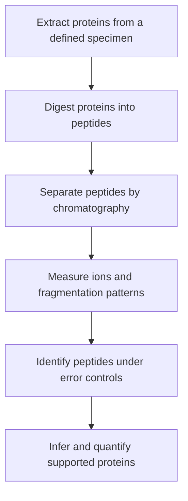

# Mass spectrometry proteomics

## In one sentence

Mass spectrometry proteomics identifies and measures protein-derived molecules through their mass-to-charge and fragmentation signatures, with conclusions limited by sample preparation, identification and quantification rules.

## The intuition

Think of recognizing a book from distinctive sentences after its pages have been cut apart. Protein-derived peptides can identify their source, but shared sentences may belong to several editions. The analogy stops at measurement: the instrument detects charged molecules and their fragments, while software evaluates possible identities and abundance.

## How it works

In common **bottom-up proteomics**, proteins are extracted and cut into **peptides**, short amino-acid chains, using an enzyme. **Liquid chromatography (LC)** separates the peptide mixture. A mass spectrometer measures ions by **mass-to-charge ratio**, and **tandem mass spectrometry (MS/MS)** fragments selected ions to obtain additional sequence evidence.

Software compares observed patterns with candidate peptide sequences and applies identification rules. Protein inference combines peptide evidence: a peptide unique to a protein can be more informative than one shared by several proteins or forms. Bottom-up evidence does not automatically show that an intact, functional protein molecule was present.

Quantification can use relative ion intensities or labels comparing samples. A targeted assay measures selected peptides with predefined performance checks. Calibrated standards can support stated amounts, but extraction, digestion and sample-matrix effects still need validation. A peptide standard alone does not guarantee recovery of every original protein molecule.

An estimated **false discovery rate (FDR)** describes the expected proportion of incorrect identifications in a defined accepted set under the method's assumptions. Peptide, spectrum and protein levels require their own reporting. An acceptable set-level FDR does not guarantee every individual identification.

## Why it matters in cancer

Protein measurements can test whether an RNA-level difference has a corresponding product-level signal. Integrated breast-cancer proteogenomic work demonstrates that transcript, protein and phosphorylation measurements add different information.

A bulk extract mixes malignant cells and neighbors and loses their original coordinates. Protein abundance per mass of extract cannot become surface receptors per cancer cell. [Immunohistochemistry](../pathology-readouts/immunohistochemistry.md) can add localization; [immunopeptidomics](immunopeptidomics.md) instead studies peptides recovered from antigen-presentation complexes. Those naturally presented peptides are different evidence from peptides made by laboratory digestion.

## Assay card

| Field | What to retain |
|---|---|
| Measures and method | Protein-derived peptide identity and abundance after extraction, digestion, separation and ion measurement |
| Input and tissue cost | A defined tissue or cell extract; compatible [fresh-frozen](/about/Terminology#fresh-frozen) or [formalin-fixed, paraffin-embedded (FFPE)](/about/Terminology#ffpe) workflows exist, with method-specific input requirements; extraction consumes material and destroys its spatial arrangement |
| Output and units | Peptide/protein identifiers, normalized intensity or ratios; calibrated assays may report amounts such as femtomoles per microgram of input protein |
| Thresholds | Identification FDR, analyte-specific detection and quantification limits, missing-value rules and calibrated range; no universal abundance cutoff for treatment |
| Failure modes | Incomplete extraction or digestion, shared peptides, interference, missing low-abundance analytes and inconsistent preparation |
| Limits | No automatic intact-form, location, accessibility, cell-of-origin or dependency conclusion |
| Validation context | Broad discovery and targeted clinical measurement have different requirements; check fit for the stated specimen, analyte and use |

## Common confusions

- **Peptide versus intact protein:** digestion removes information about complete molecular structure.
- **Not detected versus absent:** the molecule may be below sensitivity or outside the measured set.
- **Relative ratio versus absolute amount:** ratios need a denominator; amounts require calibration.

## Try it

A fictional bulk assay reports twice as much receptor-derived peptide per microgram of extract. Does it show twice as many accessible receptors on each cancer cell?

**Answer:** No. Cell mixture, location and the quantified peptide's relation to receptor forms remain unresolved. A suitable cell-specific surface measurement addresses a different question.

## Related concepts

- [Phosphoproteomics](phosphoproteomics.md): measuring a specific kind of protein modification.
- [Immunopeptidomics](immunopeptidomics.md): measuring recovered antigen-presentation peptides.

## Sources

Source check: October 9, 2026. Expert and learner review remain pending. Examples are fictional.

- [Carr et al., fit-for-purpose targeted peptide measurements (2014)](https://pmc.ncbi.nlm.nih.gov/articles/PMC3945918/).
- [Elias and Gygi, target-decoy identification confidence (2007)](https://doi.org/10.1038/nmeth1019).
- [Mertins et al., breast-cancer proteogenomics (2016)](https://doi.org/10.1038/nature18003).
- [Sprung et al., method-specific FFPE and frozen-tissue proteomic comparison (2009)](https://pmc.ncbi.nlm.nih.gov/articles/PMC2722776/).

<!-- BEGIN GENERATED USED IN -->
## Used in

- [Ask whether protein is present, placed and active](/wiki/education/molecular-profiling/03-protein-expression-and-activation)
- [Understand multi-omics, one question at a time](/wiki/education/reading-a-tumor/omics-and-multi-omics)
<!-- END GENERATED USED IN -->
