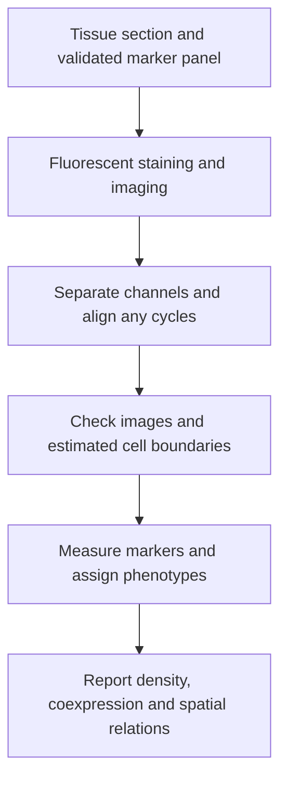

# Multiplex immunofluorescence

## In one sentence

Multiplex immunofluorescence uses fluorescent stains to map several selected molecular markers in the same tissue section.

## The intuition

Imagine a neighborhood map with separate layers for homes, schools and parks. Overlaying the layers lets you ask what shares a location and what lies nearby. Multiplex immunofluorescence (mIF) creates selected marker layers in tissue.

The analogy has a limit: these layers are measured light signals, not perfectly labeled objects. Antibody specificity, image alignment and cell boundaries must be checked before describing a cell or its neighbors.

## How it works

[Antibodies](/wiki/education/concepts/immunology/antibodies-and-b-cells/antibody-structure) recognize selected molecular targets. Fluorescent detection may be directly attached to an antibody or added through another reagent or amplification step. A microscope records the marker channels and a nuclear stain in the tissue section.

Some panels record several colors together. **Cyclic** methods repeat staining and imaging, removing or inactivating signals between rounds, then align the images. Thus “multiplex” does not require every marker to be recorded at once. Repeated processing can affect signal or tissue retention; staining order and image registration need validation.

[Cell segmentation](/wiki/education/concepts/measurement/proteins-and-spatial/cell-segmentation) estimates boundaries. Analysis measures signals inside each boundary, assigns cell phenotypes using explicit rules and calculates spatial features. A cell phenotype is a classification based on the measured panel. It is not a full account of everything that cell expresses or does.

Density might be cells per square millimeter of a specified region. A fraction needs its denominator: all segmented cells, a cell subset or an anatomical compartment. A distance in micrometers must state whether it uses cell centers, boundaries or another definition. Different choices can change a neighborhood result.

## Why it matters in cancer

mIF can help distinguish immune cells inside cancer-containing regions from cells confined to surrounding stroma. It can examine marker combinations and local organization that bulk measurements average away. A selected section and field remain samples of a heterogeneous tumor.

These observations can support biological hypotheses or context-specific biomarker research. A close immune–cancer pair does not demonstrate receptor engagement or killing. Predicting treatment benefit requires separate clinical validation for the particular assay and population.

## Assay card

| Field | What to record |
|---|---|
| Input and tissue cost | A compatible fixed or frozen tissue section; staining uses material and may involve repeated processing. Section requirements depend on the panel. It does not preserve viable cells for a killing assay. |
| Output and units | Marker images; fluorescence intensity in assay-dependent units; cell counts, cells per square millimeter, cell fractions and defined distances in micrometers. |
| Controls | Marker-positive and marker-negative material, comparison with validated single-marker staining, channel or spectral controls, background assessment, cycle alignment and boundary overlays. |
| Thresholds | Panel-specific marker and phenotype rules, locked before the intended comparison and tested for reproducibility. |
| Failure modes | Autofluorescence, overlapping signals, nonspecific antibodies, staining-order effects, tissue loss, alignment errors and incorrect cell boundaries. |
| What it cannot tell you | All proteins, live-cell behavior, antigen specificity, actual killing or universal treatment eligibility. |
| Validation context | Validation is specific to the panel, staining, imaging, analysis and intended use. Reproducibility of a research panel is not universal clinical validity. |

## Worked example

A fictional image labels a T cell next to a cancer cell. Their estimated centers are close, but their boundaries do not touch. Has the image shown immune recognition?

**Answer:** It shows proximity under a defined distance rule. Even visible contact would not establish receptor specificity or successful killing. Check the boundaries and connect the question to a suitable functional experiment.

## Common confusions

- **Several markers need not mean simultaneous imaging:** cyclic workflows build a registered set of layers.
- **Same section is not same cell:** segmentation and phenotype rules determine cell assignment.
- **More markers do not repair a weak marker:** each panel component needs validation.
- **Virtual mIF is a prediction:** a computationally inferred marker map is different evidence from performed staining.

## Related concepts

- [Imaging mass cytometry](/wiki/education/concepts/measurement/proteins-and-spatial/imaging-mass-cytometry)
- [Hot, excluded and cold tumors](/wiki/education/concepts/immunology/tumor-immunology/hot-excluded-cold-tumor)
- [Analytical validity, clinical validity and utility](/wiki/education/concepts/measurement/computational-analysis/analytical-validity-clinical-validity-and-utility)

## Sources and scope

Source-checked October 9, 2026. Spatial measurement principles and a fictional image example; expert and learner review pending.

- [Lin et al., 2018: highly multiplexed tissue imaging with t-CyCIF](https://elifesciences.org/articles/31657). Primary cyclic fluorescence method; documents registration, staining-order and tissue-retention considerations.
- [Taube et al., 2021: MITRE multiplex immunofluorescence reproducibility study](https://pubmed.ncbi.nlm.nih.gov/34266881/). Primary multisite validation of a specified panel and workflow, not every mIF assay.
- [Radtke et al., 2020: IBEX multiplex optical imaging](https://pubmed.ncbi.nlm.nih.gov/33376221/). Primary iterative fluorescence method with specimen-specific preparation and image-registration requirements.

<!-- BEGIN GENERATED USED IN -->
## Used in

- [Read an immune map without overreading it](/wiki/education/reading-a-tumor/immune-hot-vs-cold)
- [Measure each part of a T-cell response](/wiki/education/reading-a-tumor/measuring-t-cell-engagement)
- [What does multi-omics tell us about a tumor?](/wiki/education/reading-a-tumor/omics-and-multi-omics)
<!-- END GENERATED USED IN -->
