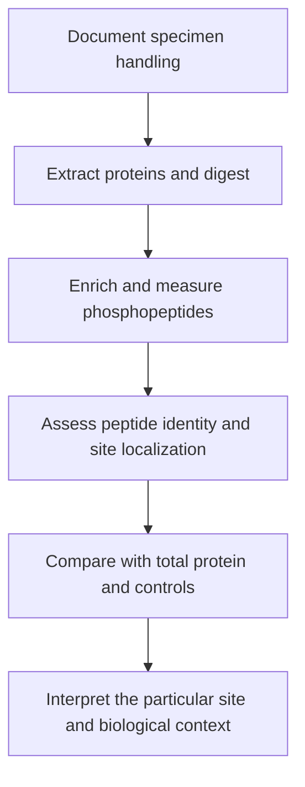
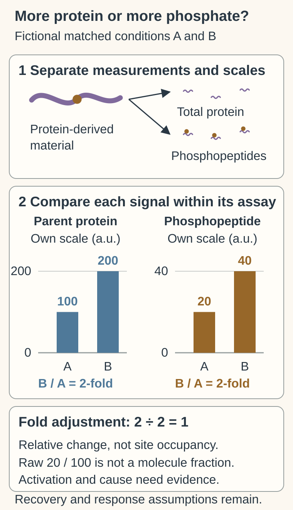

# Phosphoproteomics

## In one sentence

Phosphoproteomics measures phosphorylated protein-derived molecules and their modification sites to study signaling states, while requiring separate evidence for protein amount, site function and pathway dependence.

## The intuition

Imagine tools carrying colored tags that change how they are used. Counting tagged tools can reflect how many tools exist, how often they carry a tag, or both. Phosphorylation is more specific than a colored tag: the exact amino-acid position can change a protein's behavior in different ways.

## How it works

**Phosphorylation** adds a phosphate group at a protein site. **Kinases** transfer phosphate groups; **phosphatases** remove them. A particular modification may activate, inhibit or alter interactions and location. A larger signal is not a universal sign of greater activity.

A common mass-spectrometry workflow extracts proteins, digests them into peptides and enriches **phosphopeptides**, peptides carrying phosphate groups. Chromatography and tandem mass spectrometry identify and quantify supported molecules. Enrichment changes what is recovered, so the phosphopeptide sample is not an unbiased count of all original proteins.

**Site localization** asks which amino acid carries the modification. It is distinct from identifying the peptide sequence. If several positions fit the evidence, the exact regulatory site remains uncertain. Report localization confidence separately from peptide-identification confidence.

A phosphopeptide intensity reflects both the amount of its source protein and the modified fraction, plus recovery and instrument effects. **Occupancy** is the fraction of molecules modified at a specified site. A raw intensity or fold change is not automatically occupancy. Comparing with suitable total-protein measurements helps interpret changes, but direct occupancy estimation requires additional method-specific evidence and assumptions.

## Why it matters in cancer

Phosphoproteomics can examine signaling changes that DNA sequence or RNA abundance misses. Collections of supported sites can inform a pathway hypothesis. They do not directly measure the whole pathway's rate, prove the tumor depends on it, or establish benefit from a drug.

Specimen timing is particularly important. **Ischemia**, loss of blood supply, can change signaling after tissue removal. A primary study in ovarian tumor tissue and breast-cancer xenografts found handling-related phosphorylation changes even while global protein amounts were comparatively stable. Record collection and preservation conditions before interpreting a stress signal as the tumor's original state.

## Assay card

| Field | What to retain |
|---|---|
| Measures and method | Enriched phosphorylated peptides, identified sites and quantitative comparisons |
| Input and tissue cost | A protein extract with recorded collection and preservation; preparation consumes material, and enrichment may require additional input beyond the companion total-protein assay |
| Output and units | Phosphopeptide/site identifiers, localization scores and relative intensities or ratios; occupancy percentages only when specifically supported |
| Thresholds | Separate identification error controls, site-localization criteria and quantitative limits for the exact workflow |
| Failure modes | Handling-induced changes, incomplete recovery, ambiguous sites, low signal and unmeasured parent-protein changes |
| Limits | No automatic activation, enzyme-of-origin, dependency or drug-benefit conclusion |
| Validation context | Check reproducibility, timing controls and site-specific evidence; broad discovery does not create a validated clinical selection rule |

## Common confusions

- **More phosphopeptide versus greater occupancy:** there may simply be more source protein.
- **A site versus a pathway:** a pathway contains many interacting components and feedback effects.
- **Inferred kinase versus measured causality:** a pattern can suggest a kinase without proving it caused the changes.

## Try it

The fictional total-protein and phosphopeptide measurements each rise twofold, on their own assay scales. Dividing those fold changes gives a relative adjustment of one. Dividing raw signal 20 by 100 would not establish 20% of protein molecules carrying the site: recovery and response factors, localization and occupancy evidence remain separate. No activation or kinase-causality conclusion follows.

A fictional matched experiment shows twofold higher phosphopeptide signal and twofold higher parent-protein signal. Has it demonstrated doubled activation?

**Answer:** No. The phosphopeptide-to-protein ratio is unchanged under that comparison model. Site function, recovery and occupancy still need suitable evidence; whole-pathway activity and dependence remain separate questions.

## Related concepts

- [Mass spectrometry proteomics](mass-spectrometry-proteomics.md): peptide identity and amount.
- [Ligands and receptors](../../biology-basics/signaling/ligand-and-receptor.md): signals and their receiving proteins.

## Sources

Source check: October 9, 2026. Expert and learner review remain pending. Examples are fictional.

- [Beausoleil et al., phosphorylation-site localization (2006)](https://doi.org/10.1038/nbt1240).
- [Wu et al., interpreting phosphorylation with protein-expression changes (2011)](https://pmc.ncbi.nlm.nih.gov/articles/PMC3149096/).
- [Mertins et al., tissue ischemia and phosphorylation changes (2014)](https://pubmed.ncbi.nlm.nih.gov/24719451/).
- [Mertins et al., breast-cancer proteogenomics (2016)](https://doi.org/10.1038/nature18003).

<!-- BEGIN GENERATED USED IN -->
## Used in

- [Ask whether protein is present, placed and active](/wiki/education/molecular-profiling/03-protein-expression-and-activation)
- [Understand multi-omics, one question at a time](/wiki/education/reading-a-tumor/omics-and-multi-omics)
<!-- END GENERATED USED IN -->
