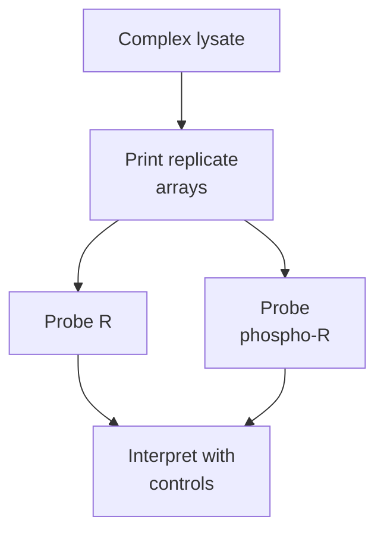

# Reverse-phase protein arrays (RPPA)

## In one sentence

A reverse-phase protein array prints complex sample lysates onto a surface and probes them with an antibody to measure a selected protein epitope.

## The intuition

Imagine placing a drop of each mixed soup on a card, then testing all drops for one ingredient. Each spot represents a sample mixture, not a purified ingredient. The analogy stops at detection: an antibody recognizes a molecular **epitope**, a particular feature on a protein, and that antibody's performance shapes the result.

## How it works

A laboratory extracts proteins from a defined specimen into a **lysate**, the mixture released from disrupted cells. Dilutions and replicate spots are printed onto a surface. The original method immobilized the sample's protein mixture, then applied a detecting antibody. This is the “reverse” arrangement relative to arrays that immobilize capture probes. [Paweletz 2001](https://home.ccr.cancer.gov/ncifdaproteomics/pdf/reverse_phase_prostate.pdf).

A typical array is probed for one selected epitope. Separate replicate arrays receive different antibodies to build a panel. An antibody may recognize a total protein, a particular form, or a specified [phosphorylation site](/wiki/education/concepts/biology-basics/signaling/phosphorylation). The spot's address identifies the printed sample; it is not the original coordinate of a cell in tissue.

*Each spot contains the sample mixture. Separate antibody probes ask separate marker questions.*

Antibody specificity is central because the readout does not separate proteins by size. Validation can include reducing the proposed target with **RNA interference**, then checking whether the signal falls. Comparison with a size-resolving method can investigate competing signals. Primary experiments demonstrated different performance among antibodies against the same target; a catalog label alone is insufficient. [Mannsperger 2010](https://pubmed.ncbi.nlm.nih.gov/21182776/).

Dilution curves, background controls, reference samples and protein-loading normalization help determine the usable range. Relative antibody intensity is not automatically an absolute protein amount. Signals from two different antibodies also cannot be compared as though their scales were identical.

A higher phosphosite signal could reflect more source protein, a larger modified fraction, preparation effects or combinations of these. **Site occupancy** is the fraction modified at a specified position; raw RPPA intensity is not automatically occupancy or enzymatic activity. [Phosphoproteomics](/wiki/education/concepts/measurement/proteins-and-spatial/phosphoproteomics) explains this distinction.

## Why it matters in cancer

RPPA can compare selected protein and phosphosite signals across specimens. Those measurements can inform a pathway hypothesis. They do not provide a complete account of “what is signaling,” show which cancer cells contributed, or prove drug dependence.

Collection timing matters. A primary study of human ovarian tumors and breast-cancer xenografts found phosphorylation changes during post-removal **ischemia**, loss of blood supply. Such handling effects can alter a stress-pathway interpretation. That experiment supports recording preservation conditions; it does not specify a universal safe delay. [Mertins 2014](https://pubmed.ncbi.nlm.nih.gov/24719451/).

## Assay card

| Field | What to retain |
|---|---|
| Measures and how | Selected antibody-recognized epitopes: extract lysate, print dilutions, probe replicate arrays, quantify signal and normalize with controls |
| Input and tissue cost | Assay-compatible cell/tissue lysate; extraction consumes material and destroys tissue arrangement. Microdissection can define the sampled region, but does not preserve coordinates within its lysate; fixation/input compatibility needs validation |
| Output and units | Antibody/epitope identifiers and relative or normalized signal; calibrated amounts only when specifically supported; retain normalization and reference |
| Thresholds | Antibody-specific validated signal range, dilution behavior, background and report criteria; no universal activation or treatment cutoff |
| Failure modes | Cross-reactivity, loading differences, saturated/weak signal, cell mixture, handling-induced modification changes and batch effects |
| Limits | No automatic intact-form, spatial map, whole-pathway activity, cell-specific surface amount, dependency or clinical-benefit conclusion |
| Validation tier | Primarily a research profiling method; clinical claims require evidence for the complete assay, antibody panel, specimen and intended use. Laboratory accreditation alone does not validate a selection rule |

## Common confusions

- **Spot versus protein:** a spot usually contains a complex sample lysate.
- **Array position versus tissue position:** printing preserves sample identity, not cellular geography.
- **Phosphosite signal versus pathway dependence:** a selected state measurement does not establish what sustains the tumor.

## Try it

A fictional phospho-R signal doubles, but total R and sample loading were not evaluated. Can the report call this doubled R activity?

**Answer:** No. Check loading, source-protein abundance, antibody performance, handling and the particular site's function. The observed signal increase is narrower than an activity claim.

## Explain it back

What is printed, and what does the antibody select?

**One possible answer:** A mixed sample lysate is printed; the antibody detects its validated epitope.

## Takeaway

**Read RPPA as selected antibody measurements from printed mixtures, with separate evidence for location, function and dependence.**

## Related concepts

- [Targeted proteomics and quantification limits](/wiki/education/concepts/measurement/proteins-and-spatial/targeted-proteomics-and-loq).
- [Spatial transcriptomics](/wiki/education/concepts/measurement/proteins-and-spatial/spatial-transcriptomics).

## Sources and scope

Source check: October 10, 2026. Examples are fictional. Expert and learner review remain pending. Early prostate-tissue and antibody-validation experiments establish method principles, not current drug-selection rules.

- [Paweletz et al., original reverse-phase protein microarray method (2001), NCI-hosted primary PDF](https://home.ccr.cancer.gov/ncifdaproteomics/pdf/reverse_phase_prostate.pdf).
- [Mannsperger et al., antibody-specific validation using RNA interference (2010)](https://pubmed.ncbi.nlm.nih.gov/21182776/).
- [Mertins et al., handling-related phosphorylation changes (2014)](https://pubmed.ncbi.nlm.nih.gov/24719451/).

<!-- BEGIN GENERATED USED IN -->
## Used in

- [Ask whether protein is present, placed and active](/wiki/education/molecular-profiling/03-protein-expression-and-activation)
- [What does multi-omics tell us about a tumor?](/wiki/education/reading-a-tumor/omics-and-multi-omics)
<!-- END GENERATED USED IN -->
