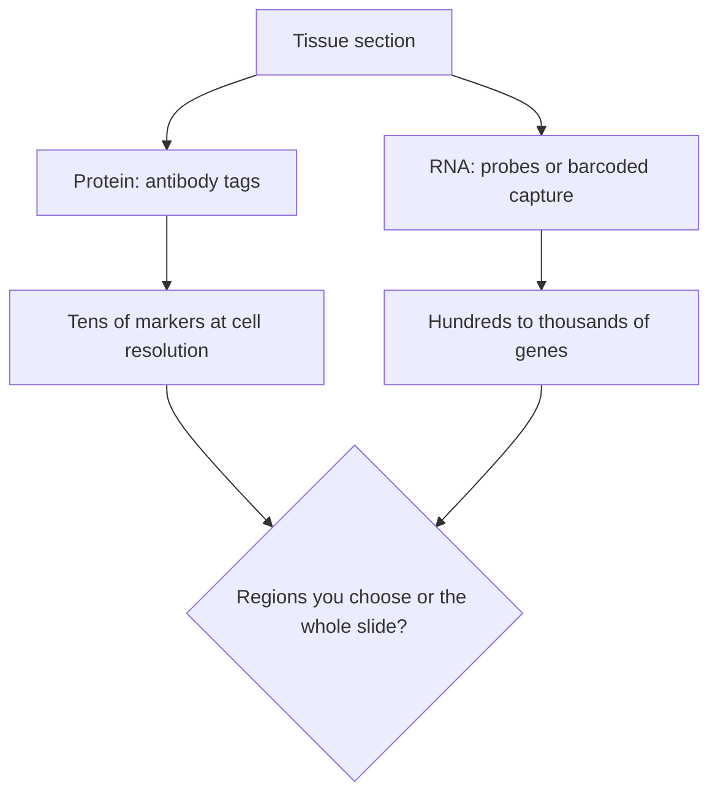

# Spatial protein versus spatial RNA methods

## In one sentence

Spatial methods measure molecules while keeping their place in a tissue section; protein methods read tens of antibody-tagged markers, RNA methods read hundreds to thousands of genes, and each trades resolution, area and tissue.

## What they share

Every spatial method starts from a thin tissue section, often a formalin-fixed one, and keeps the position of what it measures. That lets you ask where immune cells sit relative to cancer cells, which a ground-up sample cannot. All of them also:

- describe one section, not the whole tumor;
- need [cell segmentation](/wiki/education/concepts/measurement/proteins-and-spatial/cell-segmentation) to turn signals into cells, and inherit its errors;
- use up tissue that cannot be regrown (see [tissue is non-renewable](/wiki/education/concepts/measurement/specimens/tissue-is-non-renewable));
- show neighbors, not proof that neighbors interact.

## The axis on which they differ: protein or RNA

**Spatial protein methods** label proteins with antibodies. The tag can be a fluorescent dye read in repeated staining cycles ([multiplex immunofluorescence](/wiki/education/concepts/measurement/proteins-and-spatial/multiplex-immunofluorescence)) or a metal read by mass ([imaging mass cytometry](/wiki/education/concepts/measurement/proteins-and-spatial/imaging-mass-cytometry)). Proteins are what drugs and immune cells actually bind, so a protein map answers "is the target there, on which cells?" Each marker needs a validated antibody, which keeps panels to tens of markers.

**Spatial RNA methods** read messenger RNA with probes or barcoded capture ([spatial transcriptomics](/wiki/education/concepts/measurement/proteins-and-spatial/spatial-transcriptomics)). Probes are easy to design, so panels reach hundreds or thousands of genes. RNA is one step removed from protein: a gene can be transcribed without its protein reaching the cell surface.

*Protein or RNA is the first choice. Whether to read chosen regions or the whole slide cuts across both.*

## A second choice: chosen regions or the whole slide

**Region-of-interest profiling** (digital spatial profiling) counts tags released only from areas a person draws, such as tumor versus immune-rich stroma. In the method paper, one region held 1 to about 5,000 cells, and panels reached 44 proteins or 1,412 genes ([Merritt 2020](https://pubmed.ncbi.nlm.nih.gov/32393914/)). It gives one readout per region, not a map of cells, and the result depends on who chose the regions and why. **Whole-slide or field imaging** maps every cell in the imaged area, so you can find borders and neighborhoods you did not know to look for.

## Side by side

| Method | Reads | Markers per run (example) | Resolution | Tissue and area |
|---|---|---|---|---|
| [Cyclic multiplex immunofluorescence](/wiki/education/concepts/measurement/proteins-and-spatial/multiplex-immunofluorescence) | Protein | Up to 60 on formalin-fixed sections, with standard microscopes ([Lin 2018](https://pubmed.ncbi.nlm.nih.gov/29993362/)) | Single cell | Whole slides possible; many cycles take time |
| [Imaging mass cytometry](/wiki/education/concepts/measurement/proteins-and-spatial/imaging-mass-cytometry) and ion-beam imaging | Protein | 32 proteins in breast cancer ([Giesen 2014](https://pubmed.ncbi.nlm.nih.gov/24584193/)); 36 in 41 triple-negative tumors ([Keren 2018](https://pubmed.ncbi.nlm.nih.gov/30193111/)) | Below one cell | Small fields; in imaging mass cytometry a laser vaporizes the area it reads |
| Region-of-interest profiling | Protein or RNA | 44 proteins or 1,412 genes ([Merritt 2020](https://pubmed.ncbi.nlm.nih.gov/32393914/)) | One value per drawn region | Many regions per slide; you choose them |
| Sequencing-based RNA capture | RNA | Whole transcriptome, shown in human breast cancer ([Ståhl 2016](https://pubmed.ncbi.nlm.nih.gov/27365449/)) | Capture spots that can span several cells | Large area; spots are mixtures |
| Imaging-based RNA | RNA | 100 to 1,000 genes in single cells ([Chen 2015](https://pubmed.ncbi.nlm.nih.gov/25858977/)) | Single molecules, assigned to cells | Targeted panel only |

Panel sizes are from the cited method papers; current instruments often go further, so check the method section of the study you are reading.

## When each wins

- **Spatial protein** wins when the question is about a drug target or checkpoint protein on particular cells, or about cell types defined by surface markers. In 41 triple-negative tumors, protein imaging separated "mixed" from "compartmentalized" immune patterns, and the pattern was associated with survival ([Keren 2018](https://pubmed.ncbi.nlm.nih.gov/30193111/)). That is an association in one cohort, not a treatment test.
- **Spatial RNA** wins for discovery: many genes, cell states and pathways at once, when you do not yet know which markers matter.
- **Region-of-interest profiling** wins when you want to compare predefined compartments across many samples.
- **Whole-slide mapping** wins when borders, neighborhoods or rare cells are the question.

**Mental model:** protein shows what a cell is wearing, RNA shows what it is writing; regions are snapshots you chose, whole slides are maps.

Once cells are mapped, [spatial proximity metrics](/wiki/education/concepts/measurement/proteins-and-spatial/spatial-proximity-metrics) turn the map into numbers such as the share of T cells within 20 micrometers of a cancer cell.

## Common confusions

- **"Spatial means single-cell."** Region readouts and many capture spots pool several cells.
- **"More markers is better."** A 40-marker panel that lacks the drug's target answers less than a 6-marker panel that has it.
- **"RNA in the section means protein on the cell."** It does not; check protein for a targeting question.
- **"Cells next to each other are interacting."** Proximity is a hypothesis to test.
- **"Multiplex spatial results are clinical tests."** These are mostly research tools. The [programmed death-ligand 1 (PD-L1)](/wiki/education/concepts/measurement/pathology-readouts/pd-l1-scoring) and receptor tests used to choose treatment are single-marker [immunohistochemistry](/wiki/education/concepts/measurement/pathology-readouts/immunohistochemistry).

## Try it

A team has one spare section and wants to know whether a drug's protein target sits on cancer cells near T cells. Which method fits, and what would not answer it?

**Answer:** A spatial protein method with antibodies for the target, a cancer-cell marker and a T-cell marker, imaged over the tumor. A region-of-interest RNA profile would show whether the gene is transcribed in drawn regions, but not which cells carry the protein.

## Explain it back

"I would choose a protein method when ___, an RNA method when ___, and region profiling when ___."

**One possible answer:** "the question is about a target or marker on specific cells; I need many genes or do not know which matter; I want to compare compartments I can define in advance."

## Takeaway

**Pick protein or RNA by the molecule your question is about, then pick regions or whole slides by whether you already know where to look.**

## Related concepts

- [Spatial transcriptomics](/wiki/education/concepts/measurement/proteins-and-spatial/spatial-transcriptomics)
- [Multiplex immunofluorescence](/wiki/education/concepts/measurement/proteins-and-spatial/multiplex-immunofluorescence)
- [Imaging mass cytometry](/wiki/education/concepts/measurement/proteins-and-spatial/imaging-mass-cytometry)
- [Bulk, single-cell and spatial RNA](/wiki/education/concepts/measurement/transcriptomics/bulk-vs-single-cell-vs-spatial-rna)
- [Cell segmentation](/wiki/education/concepts/measurement/proteins-and-spatial/cell-segmentation)

## Sources and scope

Source-checked November 8, 2026 against primary abstracts. Marker counts describe the cited studies, not current instrument limits. Expert and learner review pending.

1. [Lin and colleagues, eLife 2018](https://pubmed.ncbi.nlm.nih.gov/29993362/) — tissue cyclic immunofluorescence, up to 60-plex on formalin-fixed sections.
2. [Giesen and colleagues, Nature Methods 2014](https://pubmed.ncbi.nlm.nih.gov/24584193/) — imaging mass cytometry, 32 proteins at subcellular resolution in breast cancer.
3. [Keren and colleagues, Cell 2018](https://pubmed.ncbi.nlm.nih.gov/30193111/) — ion-beam imaging of 36 proteins in 41 triple-negative breast cancers.
4. [Merritt and colleagues, Nature Biotechnology 2020](https://pubmed.ncbi.nlm.nih.gov/32393914/) — region-of-interest digital spatial profiling.
5. [Ståhl and colleagues, Science 2016](https://pubmed.ncbi.nlm.nih.gov/27365449/) and [Chen and colleagues, Science 2015](https://pubmed.ncbi.nlm.nih.gov/25858977/) — sequencing-based capture and imaging-based RNA methods.

<!-- BEGIN GENERATED USED IN -->
## Used in

- [Compare related ideas](/wiki/education/comparisons/index)
- [Read an immune map without overreading it](/wiki/education/guides/how-the-immune-system-fights-cancer/04-read-an-immune-map)
- [Add geography and immune context](/wiki/education/guides/what-multi-omics-tells-us/07-map-cells-and-immune-context)
<!-- END GENERATED USED IN -->
