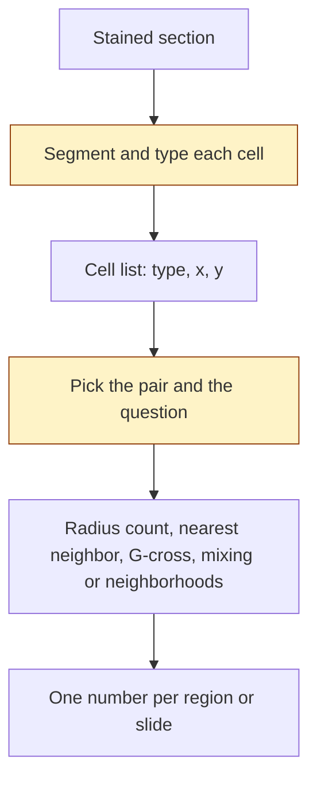

# Spatial proximity metrics: distance, mixing and neighborhoods

## In one sentence

Spatial proximity metrics turn a map of cells into numbers that describe how close two cell types sit, such as the share of T cells within 20 micrometers of a cancer cell.

## The intuition

Counting people in a stadium tells you attendance. It does not tell you whether the two sets of fans are seated together or on opposite sides. A density score is the attendance figure. A proximity metric asks who is sitting next to whom. The analogy breaks in one place: a tissue section is a single thin slice, so it shows one row of seats, not the whole stadium.

## How it works

Every proximity metric starts from the same input: a list of cells, each with a type and an x–y position. That list comes from staining a section, imaging it and [assigning pixels to cells](/wiki/education/concepts/measurement/proteins-and-spatial/cell-segmentation). The metrics then differ in the question they ask.

| Metric | Question | Example definition |
|---|---|---|
| Compartment density | How many cells of type A are in tumor nests versus stroma? | CD8 T cells per square millimeter of tumor epithelium |
| Radius count | How many A cells lie within a set distance of a B cell? | CD8 T cells within 20 µm of a cancer cell |
| Nearest-neighbor distance | How far is each A cell from its closest B cell? | Median distance from a T cell to the nearest cancer cell |
| G-cross function | What fraction of A cells have a B cell within distance r, across a range of r? | Area under the curve from 0 to 20 µm |
| Mixing or colocalization score | Do A and B share the same territory? | Immune–tumor contacts divided by immune–immune contacts; the Morisita-Horn index |
| Cellular neighborhoods | Which recurring groups of neighbors does the tissue contain? | Each cell's ten nearest neighbors, clustered into neighborhood types |

A micrometer (µm) is a thousandth of a millimeter. A lymphocyte is about 7–10 µm across, so "within 20 µm" means within roughly two cell widths: close enough to touch or nearly touch.

*The two amber steps hold most of the hidden choices: how cells were called, and which region, pair and radius the analyst picked.*

## Why it matters in cancer

Location carries information that counts miss. T cells kill by contact, so T cells held in [stroma](/wiki/education/concepts/biology-basics/cells/epithelium-and-stroma) away from cancer cells behave differently from T cells among them (see [T-cell exclusion](/wiki/education/concepts/immunology/tumor-immunology/t-cell-exclusion-mechanisms)).

- **Colorectal cancer.** A G-cross score for tumor cells having a T cell within 20 µm predicted cancer-specific survival in 983 patients (adjusted hazard ratio 0.33, 95% CI 0.20–0.52) and again in a separate 246 (0.15, 0.05–0.45), independent of T-cell density ([Elomaa 2022](https://pubmed.ncbi.nlm.nih.gov/35449453/)).
- **Melanoma on anti-PD-1 drugs.** Responders had more CD8 T cells within 20 µm of a melanoma cell, in 27 patients on anti-PD-1 alone and 34 on combination therapy ([Gide 2020](https://pubmed.ncbi.nlm.nih.gov/32002281/)).
- **Breast cancer.** Immune–cancer colocalization on routine slides tracked with survival in 486 women and again in 516 from other hospitals ([Maley 2015](https://pubmed.ncbi.nlm.nih.gov/26395345/)). In 1,467 patients, a CD8 proximity measure was associated with recurrence-free survival more strongly than the CD8 count ([Walker 2025](https://pubmed.ncbi.nlm.nih.gov/41091832/)).
- **Triple-negative breast cancer (TNBC).** In 41 tumors, a mixing score separated "mixed" from "compartmentalized" tumors, and the pattern tracked with survival ([Keren 2018](https://pubmed.ncbi.nlm.nih.gov/30193111/)).

These are associations in groups of patients. No distance-based metric has a locked threshold that was then confirmed in a prospective trial, and none is an approved test. The compartment-based [stromal tumor-infiltrating lymphocyte (TIL) score](/wiki/education/concepts/measurement/pathology-readouts/stil-scoring) is far better validated than any distance metric.

## Worked example

A fictional region holds 200 CD8 T cells. Sixty of them lie within 20 µm of a cancer cell. The radius count is 60 cells, or 30% of the CD8 T cells. Now move the analysis box 2 millimeters into the stroma, where there are 300 CD8 T cells and only 15 near a cancer cell: 5%. Same tumor, same stain, same radius. The number changed because the region changed. These values are invented to show the dependence on region.

## How it is measured

| Field | What to ask |
|---|---|
| Input | Which section, and was it a biopsy or a resection? |
| Cell calls | Which markers define each cell type, and how was segmentation checked? |
| Region | Whole slide, or regions someone chose? Who chose them, and by what rule? |
| Metric | Which pair of cell types, which radius, and counted from which cell's point of view? |
| Threshold | Was the cutoff set before looking at outcomes, or picked to fit this cohort? |
| Validation | Has the same definition been tested in a second, independent group? |

Reproducibility across laboratories has been tested for one measure: in a six-site study, the proximity of the checkpoint protein PD-1 to its partner, programmed death-ligand 1 (PD-L1), agreed between sites with an R² of 0.82 ([Taube 2021](https://pubmed.ncbi.nlm.nih.gov/34266881/)). That shows the measurement can be repeated. It does not show that the measurement predicts anything.

## Common confusions

- **Proximity is not interaction.** Two cells 15 µm apart may be ignoring each other. A T cell beside a cancer cell may be exhausted.
- **"CD8 near tumor" and "tumor near CD8" are different numbers.** One asks what share of T cells have a cancer-cell neighbor; the other asks what share of cancer cells have a T-cell neighbor.
- **A radius is a choice.** Studies use 10, 20 or 30 µm. Results at one radius do not transfer to another.
- **A cutoff found in one cohort is not a test.** Most published thresholds were chosen to separate the patients in that study.
- **A section is two-dimensional.** Cells that look far apart may touch above or below the slice, and structures that look separate can be joined ([Lin 2023](https://pubmed.ncbi.nlm.nih.gov/36669472/)).
- **Segmentation errors create false neighbors.** Signal that spills from one cell into the next makes cells look like a type they are not.

## In Diana's case

The [immune-context question](/wiki/questions/is-tumor-hot) and the [review of validated spatial indicators](/wiki/research/reviews/2026-11-validated-spatial-indicators) track how these measures apply to her tissue.

## Try it

A report says "CD8 T cells were 3.2 times closer to tumor cells after treatment." Name three things you need before you can interpret it.

**Answer:** the regions compared in each sample and how they were chosen; whether the two samples were the same kind of specimen; and whether the metric and radius were fixed in advance. A fourth: how much the number varies between two sections of the same block.

## Explain it back

"A proximity metric tells me ___, but not ___." One answer: "how close two cell types sit in this section, but not whether they are interacting or what will happen to the patient."

## Takeaway

**A proximity number is only as good as its cell calls, its region and its pre-set definition, and none has yet been validated as a clinical test.**

## Related concepts

- [Spatial protein versus spatial RNA methods](/wiki/education/concepts/measurement/proteins-and-spatial/spatial-methods-compared)
- [Hot, excluded and cold patterns](/wiki/education/concepts/immunology/tumor-immunology/hot-excluded-cold-tumor)
- [Stromal TIL scoring](/wiki/education/concepts/measurement/pathology-readouts/stil-scoring)
- [Tumor-stroma ratio](/wiki/education/concepts/measurement/pathology-readouts/tumor-stroma-ratio)
- [Analytical validity, clinical validity and utility](/wiki/education/concepts/measurement/computational-analysis/analytical-validity-clinical-validity-and-utility)
- [Prognostic versus predictive evidence](/wiki/education/concepts/evidence-and-statistics/biomarkers/prognostic-vs-predictive)

## Sources and scope

Source-checked November 9, 2026, against PubMed abstracts. Cohort sizes and effect sizes are as reported in each abstract. Measurement teaching, not a treatment-selection rule. Expert and learner review pending.

1. [Page and colleagues, Journal of Pathology 2023](https://pubmed.ncbi.nlm.nih.gov/37608771/) — International Immuno-Oncology Biomarker Working Group report on spatial analysis methods.
2. [Elomaa and colleagues, British Journal of Cancer 2022](https://pubmed.ncbi.nlm.nih.gov/35449453/) — G-cross proximity score in colorectal cancer, with a validation cohort.
3. [Gide and colleagues, Oncoimmunology 2020](https://pubmed.ncbi.nlm.nih.gov/32002281/) — CD8 T cells within 20 µm of melanoma cells and anti-PD-1 response.
4. [Maley and colleagues, Breast Cancer Research 2015](https://pubmed.ncbi.nlm.nih.gov/26395345/) — Morisita-Horn colocalization in breast cancer.
5. [Keren and colleagues, Cell 2018](https://pubmed.ncbi.nlm.nih.gov/30193111/) — mixing score in 41 triple-negative tumors.
6. [Taube and colleagues, Journal for ImmunoTherapy of Cancer 2021](https://pubmed.ncbi.nlm.nih.gov/34266881/) — multi-site reproducibility of multiplex immunofluorescence.

Also cited: [Walker 2025](https://pubmed.ncbi.nlm.nih.gov/41091832/) and [Lin 2023](https://pubmed.ncbi.nlm.nih.gov/36669472/).

<!-- BEGIN GENERATED USED IN -->
## Used in

Browse the [concept index](/wiki/education/concepts/index) for related learning paths.
<!-- END GENERATED USED IN -->
