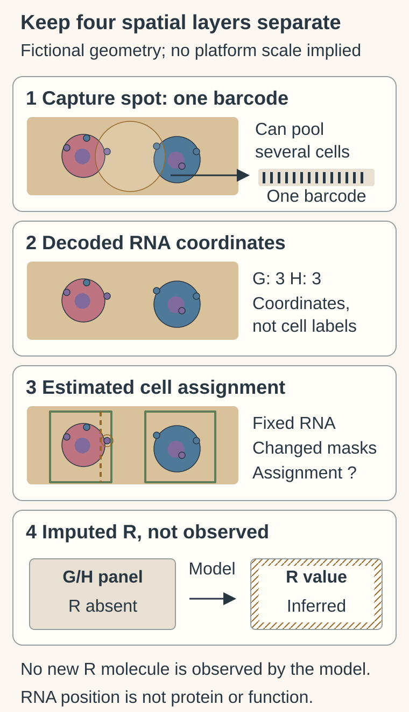
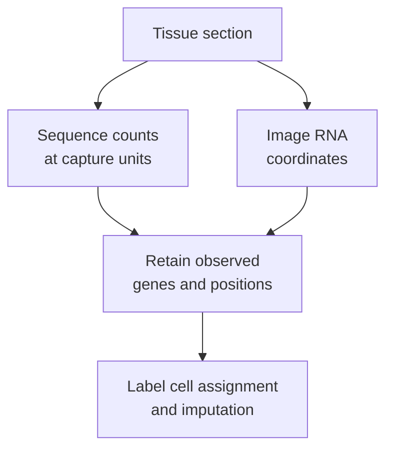

# Spatial transcriptomics

## In one sentence

Spatial transcriptomics measures selected or broadly captured RNA together with tissue coordinates, with resolution and gene coverage determined by the assay and analysis.

## The intuition

A list of people at a gathering differs from a map of where they stood. Spatial transcriptomics adds location to RNA observations. The analogy has limits: a capture location can contain several cells, and assigning molecules to a cell can require computational boundary estimates.

## How it works

The capture spot is one positional barcode, not one cell. The separate imaging scene has six decoded G/H coordinates. Alternative estimated boundaries can change whether a coordinate is assigned. Gene R is absent from the observed panel; its hatched model value is not another detected molecule. All tissue, spot and boundary geometry is schematic, without a current-platform size claim.

For a concrete assignment example, [Xenium’s official segmentation documentation](https://www.10xgenomics.com/support/software/xenium-onboard-analysis/latest/algorithms-overview/segmentation) distinguishes masks, display polygons and transcript assignment. Its implementation details do not define every spatial platform.

[Ribonucleic acid (RNA)](/wiki/education/concepts/biology-basics/molecules/rna-and-mrna) measurements are linked to positions in a tissue section. Two broad strategies recover different kinds of evidence:

| Strategy | Observation | Resolution boundary |
|---|---|---|
| Sequencing-based capture | Sequence counts assigned to positional barcodes | A spot, bin or other capture unit is not automatically one cell |
| Imaging-based detection | Probe-identified RNA signals decoded at image coordinates | Molecule coordinates and estimated cell boundaries are separate outputs |

An early sequencing-based method placed sections on arrays of positionally barcoded primers. RNA-derived sequence evidence could then be related to the tissue image. Later capture geometries vary. Smaller bins do not automatically supply complete single-cell profiles: capture efficiency and assignment still matter. [Ståhl 2016](https://pubmed.ncbi.nlm.nih.gov/27365449/).

Imaging-based methods use probes and repeated imaging or in-place decoding to identify RNA signals. **Multiplexed error-robust fluorescence in situ hybridization (MERFISH)** is one primary example. Its targeted gene set is defined by probe design; a map of many genes is not a measurement of every transcript. [Chen 2015](https://pubmed.ncbi.nlm.nih.gov/25858977/).

*Observed positions, assigned cells and imputed expression are different layers of the result.*

[**Cell segmentation**](/wiki/education/concepts/measurement/proteins-and-spatial/cell-segmentation) estimates boundaries and assigns observations to cells. Nuclear outlines alone may not define complete cell boundaries. Overlapping signals, crowded tissue and imperfect boundaries can misassign molecules. Primary segmentation work tested methods using particular imaging datasets and boundary information; its performance is not a guarantee for every specimen. [Petukhov 2022](https://pubmed.ncbi.nlm.nih.gov/34650268/).

**Imputation** estimates information that was not directly measured at that location. A model may align a dissociated [single-cell reference](/wiki/education/concepts/measurement/transcriptomics/single-cell-and-single-nucleus-rna-seq) to spatial data, or estimate unmeasured genes from available features. Tangram demonstrated such integration in mouse-brain data. Its estimates are model outputs, not new RNA molecules observed by the spatial assay. [Biancalani 2021](https://pubmed.ncbi.nlm.nih.gov/34711971/).

## Why it matters in cancer

Spatial RNA can examine tumor regions, immune-cell neighborhoods and boundaries that dissociated data lose. It describes the measured section, not the whole tumor. Adjacent sections share regional context but do not contain precisely the same cells.

A mixed capture spot expressing epithelial and immune genes need not represent a cell with both identities. Nearby cells do not automatically interact. RNA position also does not establish surface protein, target accessibility, pathway dependence or treatment benefit.

## Assay card

| Field | What to retain |
|---|---|
| Measures and how | RNA with coordinates: prepare section, capture or probe RNA, sequence/image, decode, register positions and report assignment rules |
| Input and tissue cost | Protocol-compatible frozen or fixed tissue sections; sectioning and molecular preparation consume allocated material, and some workflows alter/destroy the assayed section; rescoring existing data consumes no new tissue |
| Output and units | Gene counts per specified spot/bin or assigned cell; decoded molecule coordinates, often in micrometers; retain physical dimensions, normalization and observed-versus-imputed labels |
| Thresholds | Assay-specific gene/probe coverage, capture/decoding quality, background and segmentation criteria; no universal “high expression” or neighborhood cutoff |
| Failure modes | Poor RNA, incomplete probe coverage, low capture, image-registration errors, inaccurate segmentation, spillover and unsuitable reference models |
| Limits | No automatic single-cell identity, complete transcriptome, whole-tumor representation, proven interaction or clinical selection rule |
| Validation tier | Many workflows are research methods; check analytical and intended-use clinical validation for the exact assay/model. Resolution claims and regulatory status are separate questions |

## Common confusions

- **Capture unit versus cell:** geometry and cell assignment require separate reporting.
- **RNA coordinate versus assigned cell:** a precise molecule position can coexist with uncertain boundaries.
- **Measured versus imputed:** an attractive map may include both; retain the distinction for each gene.

## Try it

A fictional map displays gene R inside segmented cancer cells. R was absent from the probe panel and supplied by a reference model. Can it be described as directly measured R in those cells?

**Answer:** No. Label R as imputed and report the reference, model and validation. A suitable direct RNA assay would answer the measurement question; neither map alone establishes protein function.

## Explain it back

What three labels help you read a spatial result?

**One possible answer:** The observed genes, the capture/assignment unit, and whether a displayed value was measured or inferred.

## Takeaway

**Keep RNA measurement, spatial unit and computational inference visible when reading a tissue map.**

## Related concepts

- [H&E morphology](/wiki/education/concepts/measurement/pathology-readouts/h-and-e-morphology): tissue appearance supplies a different evidence layer.
- [Digital pathology](/wiki/education/concepts/measurement/pathology-readouts/digital-pathology): scans, estimates and interpretation.

## Sources and scope

Source check: October 10, 2026. Examples are fictional. Expert and learner review remain pending. The cited methods establish distinct measurement and analysis principles; they do not validate every current platform or clinical claim.

- [Ståhl et al., original spatial capture/sequencing method (2016)](https://pubmed.ncbi.nlm.nih.gov/27365449/).
- [Chen et al., multiplexed RNA imaging with MERFISH (2015)](https://pubmed.ncbi.nlm.nih.gov/25858977/).
- [Petukhov et al., imaging-based cell segmentation (2022; online 2021)](https://pubmed.ncbi.nlm.nih.gov/34650268/).
- [Biancalani et al., Tangram spatial alignment and reconstruction (2021)](https://pubmed.ncbi.nlm.nih.gov/34711971/).

<!-- BEGIN GENERATED USED IN -->
## Used in

- [Add the geography of cells and signals](/wiki/education/molecular-profiling/04-spatial-biology)
- [Understand multi-omics, one question at a time](/wiki/education/reading-a-tumor/omics-and-multi-omics)
<!-- END GENERATED USED IN -->
