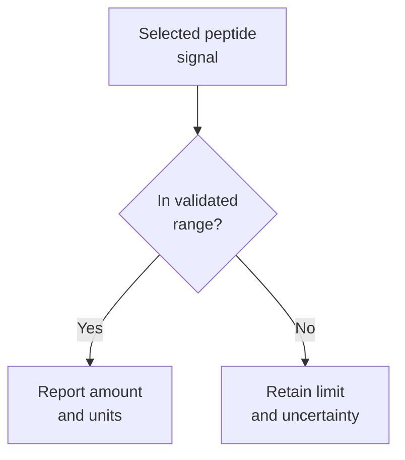

# Targeted proteomics and limits of quantification

## In one sentence

Targeted proteomics measures selected protein-derived peptides, with reliable amounts limited to the assay’s validated quantification range.

## The intuition

Recognizing a faint voice is easier than measuring its loudness accurately. A targeted protein assay makes a similar distinction between detecting a signal and reporting a dependable amount. The analogy has limits: performance is established with calibration and repeated measurements in the relevant specimen matrix, not by a listener's judgment.

## How it works

In common targeted [mass spectrometry (MS) proteomics](/wiki/education/concepts/measurement/proteins-and-spatial/mass-spectrometry-proteomics), extracted proteins are digested into [peptides](/wiki/education/concepts/biology-basics/molecules/protein-and-peptide). The instrument monitors selected peptide ions and their fragments. **Multiple reaction monitoring (MRM)** follows predefined precursor-to-fragment transitions; other targeted approaches collect different fragmentation information. Identity, interference and quantitative performance need checking for each peptide. [Carr 2014](https://pubmed.ncbi.nlm.nih.gov/24443746/).

A selected peptide is a proxy for its source protein. It may be shared by several protein forms, and digestion does not preserve the complete molecule. Measuring that peptide cannot automatically identify an intact receptor or count accessible copies on a cancer cell.

A **stable-isotope internal standard** is a distinguishable labeled molecule measured alongside the sample. Calibration relates the measured response to known amounts. The **matrix** is the rest of the specimen, which can affect recovery and ion measurement. Multilaboratory plasma experiments evaluated recovery, reproducibility and quantitative limits using common materials and protocols; their findings do not transfer unchanged to every tissue or analyte. [Addona 2009](https://pubmed.ncbi.nlm.nih.gov/19561596/).

The stage at which a standard is added matters. A peptide added after digestion can help control subsequent measurement but cannot retroactively correct failed extraction or digestion. Peptide identity, recovery and protein-form differences limit interpretation even when the measured peptide ratio is precise. [Peptide-standard recommendations](https://pmc.ncbi.nlm.nih.gov/articles/PMC4830481/).

*Detection and reliable quantification are different claims about the same analyte.*

The **limit of detection (LOD)** concerns distinguishing signal from background under stated error criteria. The **lower limit of quantification (LLOQ)** is the lower boundary at which quantitative performance meets defined criteria, such as precision and bias. An upper boundary also limits the usable range. These limits depend on the analyte, matrix and complete workflow. “Detected below LOQ” can be meaningful without supporting a reliable numerical amount. Neither it nor “not detected” means biological zero. [Carr 2014](https://pubmed.ncbi.nlm.nih.gov/24443746/).

## Why it matters in cancer

Targeted measurements can follow up a nominated protein or compare samples reproducibly. A denominator such as total extract protein describes that mixture, not receptors per malignant cell. Measuring a [phosphorylated peptide](/wiki/education/concepts/measurement/proteins-and-spatial/phosphoproteomics) also requires separate interpretation of source-protein abundance, modification fraction and site function.

A quantitative result is a measurement claim. Tumor dependence and clinical benefit need additional evidence.

## Assay card

| Field | What to retain |
|---|---|
| Measures and how | Selected peptide amounts: extract, digest, measure specified ions/fragments with controls, calibrate and assess analyte performance |
| Input and tissue cost | Validated tissue, cell or fluid matrix; extraction and digestion consume material; required mass/volume and compatibility with fixation are assay-specific |
| Output and units | Peptide identity, amount or ratio; examples include femtomoles per microgram of total extracted protein or concentration per volume; retain the denominator and peptide-to-protein inference |
| Thresholds | Analyte-specific LOD, LLOQ, upper quantification limit, bias/precision acceptance and reportable range; no universal LOQ or treatment threshold |
| Failure modes | Incomplete recovery/digestion, shared peptides, interference, unstable standards, matrix effects and signal outside the validated range |
| Limits | No automatic intact-form, location, cell-of-origin, surface-accessibility, occupancy or drug-dependence conclusion |
| Validation tier | Fit-for-purpose research tiers describe analytical characterization; they do not themselves confer clinical approval. Clinical use needs validation of the exact assay, specimen and intended decision |

## Common confusions

- **LOD versus LOQ:** recognizing a signal does not guarantee accurate quantification.
- **Precision versus accuracy:** repeated agreement can coexist with systematic bias.
- **Peptide amount versus protein function:** sequence fragments answer a narrower question.

## Try it

A fictional assay detects receptor-derived peptide R below its LLOQ. A summary changes this to “R is absent.” What should it say?

**Answer:** Retain “detected below the validated quantification limit,” with the relevant limit and units. The result supports detection under that assay's rules, but not a dependable amount or biological absence.

## Explain it back

Why does an isotope-labeled peptide added after digestion leave uncertainty?

**One possible answer:** It cannot measure material already lost before the standard was added.

## Takeaway

**Keep the analyte, calibration range and denominator attached to every reported protein amount.**

## Related concepts

- [Protein structure and domains](/wiki/education/concepts/biology-basics/molecules/protein-structure-and-domains).
- [Immunohistochemistry](/wiki/education/concepts/measurement/pathology-readouts/immunohistochemistry): a different measurement of protein and location.

## Sources and scope

Source check: October 10, 2026. Examples are fictional. Expert and learner review remain pending. Plasma-method results illustrate validation; they do not establish tumor-specific clinical cutoffs.

- [Carr et al., fit-for-purpose targeted peptide measurements (2014)](https://pubmed.ncbi.nlm.nih.gov/24443746/).
- [Addona et al., multilaboratory plasma MRM assessment (2009)](https://pubmed.ncbi.nlm.nih.gov/19561596/).
- [Hoofnagle et al., peptide standards, calibration and protein-inference limitations (2016)](https://pmc.ncbi.nlm.nih.gov/articles/PMC4830481/).

<!-- BEGIN GENERATED USED IN -->
## Used in

- [Ask whether protein is present, placed and active](/wiki/education/molecular-profiling/03-protein-expression-and-activation)
- [What does multi-omics tell us about a tumor?](/wiki/education/reading-a-tumor/omics-and-multi-omics)
<!-- END GENERATED USED IN -->
