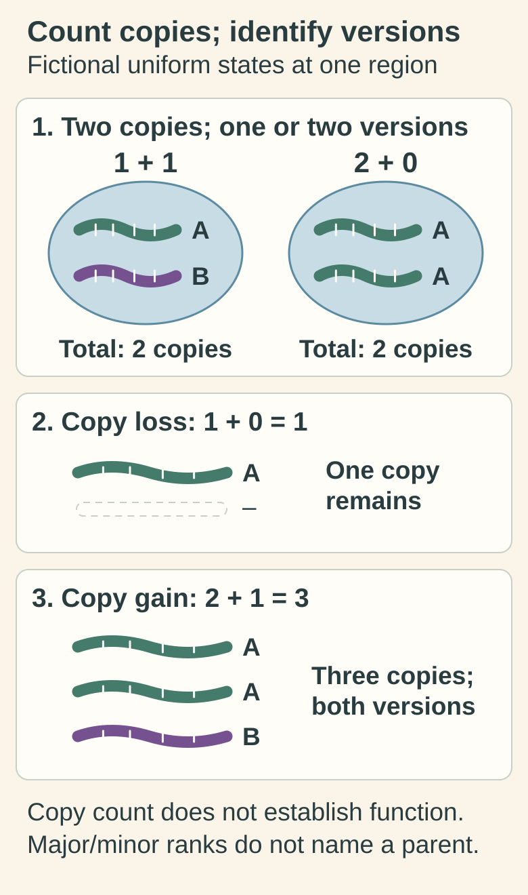

# Copy number and loss of heterozygosity (LOH)

## In one sentence

Copy number counts copies of a genetic region, while loss of heterozygosity means a cell population no longer retains both previously distinguishable sequence versions.

## The intuition

Imagine a shelf containing two editions of a book. Counting books tells you how many copies exist; checking editions tells you whether both versions remain. Two books can be two different editions or two copies of one edition. The analogy cannot tell you whether either edition works: DNA count and sequence-version identity are separate from biological function.

## How it works

An [allele](/wiki/education/concepts/biology-basics/genetics/allele-and-zygosity) is a sequence version. At an informative location, a normal sample might carry distinguishable versions A and B. **Total copy number** counts the region's copies; **allele-specific copy number** estimates the contributions of its distinguishable versions.

The following states describe an idealized, uniform cancer-cell population at that region. A and B are arbitrary version labels, not known functional states.

| Copies of A and B | Total copies | Interpretation |
|---|---|---|
| 1 + 1 | 2 | Both versions retained, ordinary diploid state |
| 1 + 0 | 1 | Deletion with loss of heterozygosity (LOH) |
| 2 + 0 | 2 | Copy-neutral LOH: two copies, but only one original version |
| 2 + 1 | 3 | Copy gain with both versions retained |

Thus **LOH is not synonymous with deletion**. Copy-neutral LOH can follow loss of one version and duplication of the other, or recombination-related events. Conversely, a total-copy gain does not necessarily erase either version. Allele-aware primary methods distinguish these states. [Shen and Seshan 2016](https://pmc.ncbi.nlm.nih.gov/articles/PMC5027494/).

Reports often use **major** and **minor** copy counts: the larger and smaller estimated allelic contributions. A minor count of zero supports an LOH state under that model. Those labels do not automatically identify maternal or paternal origin, or assign a particular mutation to a copy. **Phasing** asks which sequence changes lie on the same chromosome copy and needs suitable evidence.

Local copy count differs from **ploidy**, the average genome-copy context. Tumor and normal cells also mix. Relative signal alone can fit different purity-and-ploidy combinations; apparent fractional counts may reflect mixture or subclonal states rather than a fraction of a chromosome in every cell. [Carter 2012](https://pmc.ncbi.nlm.nih.gov/articles/PMC4383288/).

*Two copies can retain two versions or two copies of one version. These are idealized modeled region states: copy-neutral LOH preserves total copies without proving gene inactivity, and major/minor counts do not identify a parent.*

[Open the light diagram](./images/copy-count-and-version-states-v1-light.svg) · [Open the dark diagram](./images/copy-count-and-version-states-v1-dark.svg)

## How it is measured

Allele-aware methods combine relative [DNA (deoxyribonucleic acid)](/wiki/education/concepts/biology-basics/molecules/dna) coverage with the balance at informative heterozygous sites, group the genome into segments and fit copy states. A suitable matched normal helps identify original versions and control measurement biases. A total-copy profile alone cannot distinguish 1 + 1 from 2 + 0. If both normal copies have the same sequence at a site, that site alone is uninformative for version loss.

## Why it matters in cancer

Copy changes can influence gene dosage and the [variant allele fraction](/wiki/education/concepts/measurement/sequencing-basics/variant-allele-fraction-and-cancer-cell-fraction). LOH can remove a functional version while retaining an altered one, but the copy call does not establish which version remains or whether useful [ribonucleic acid (RNA)](/wiki/education/concepts/biology-basics/molecules/rna-and-mrna) or [protein](/wiki/education/concepts/biology-basics/molecules/protein-and-peptide) survives. Copy gain is not automatically increased expression, dependency or a drug-response prediction.

## Assay card

| Field | What to retain |
|---|---|
| Measures and method | Relative coverage and allelic balance, segmented and modeled into copy states |
| Input and tissue cost | Tumor DNA and, where required, suitable normal DNA; extraction consumes an aliquot. Adequate existing data can be reanalyzed without new tissue |
| Output and units | Total/major/minor copies, segments, LOH calls, purity/ploidy fits and uncertainty |
| Thresholds | Caller-specific informative-site, depth, segmentation and fit criteria; no universal amplification or functional-loss cutoff |
| Failure modes | Low tumor content, few informative sites, mapping or capture biases and multiple plausible copy fits |
| Limits and validation | Research-method validation does not automatically validate every clinical assay. Copy states do not establish phase, current protein function or treatment benefit |

## Common confusions

- **Two copies versus two versions:** copy-neutral LOH retains the count while losing diversity.
- **LOH versus gene shutdown:** the retained version may still function; sequence and downstream evidence matter.
- **One segment versus every cell:** a bulk-sample fit can conceal subpopulations and unsampled lesions.

## Try it

A fictional normal sample has A and B. An adequate allele-aware tumor model supports two A copies and no B copies. Has the gene been deleted or proven inactive?

**Answer:** Neither. This is copy-neutral LOH under the model. The region still has two copies. Identify the retained sequence and test any proposed functional consequence separately.

## Explain it back

“Total copies tell me ______; allele-specific copies add ______; function still requires ______.”

One answer: “how many; which versions remain; appropriate sequence, expression or functional evidence.”

## Takeaway

**Count copies, identify versions and test function as three distinct questions.**

## Related concepts

- [Alleles and zygosity](/wiki/education/concepts/biology-basics/genetics/allele-and-zygosity): version identity and combinations.
- [Genomic scars](/wiki/education/concepts/cancer-biology/genome-instability-and-repair/genomic-scars): historical chromosome patterns and method-specific scores.
- [Human leukocyte antigen (HLA) loss of heterozygosity](/wiki/education/concepts/measurement/sequencing-basics/hla-loh): a specialized antigen-presentation locus question.

## Sources and scope

Source check: October 10, 2026. General copy-state education; examples are fictional. Expert and learner review remain pending. No gene-function or treatment-sensitivity conclusion is inferred.

- [Shen and Seshan 2016: FACETS, allele-specific copy-number analysis including copy-neutral LOH](https://pmc.ncbi.nlm.nih.gov/articles/PMC5027494/).
- [Carter and colleagues 2012: ABSOLUTE, purity/ploidy ambiguity and absolute copy inference](https://pmc.ncbi.nlm.nih.gov/articles/PMC4383288/).
- [NHGRI LOH glossary: narration lists gene conversion and mitotic recombination](https://www.genome.gov/genetics-glossary/Loss-of-Heterozygosity-LOH).

<!-- BEGIN GENERATED USED IN -->
## Used in

- [Read a DNA assay as a coverage-and-confidence claim](/wiki/education/molecular-profiling/01-dna-the-blueprint)
- [Separate DNA copies from cancer-cell fractions](/wiki/education/multi-omics-foundations/04-copies-alleles-and-clones)
- [Test a copy-aware clone model](/wiki/education/multi-omics-foundations/08-test-a-copy-aware-clone-model)
<!-- END GENERATED USED IN -->
