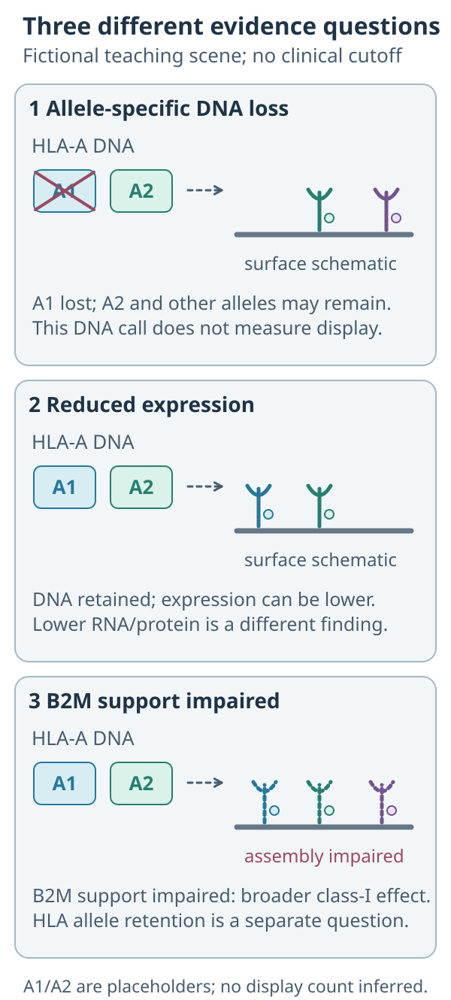

# HLA loss of heterozygosity

## In one sentence

Loss of heterozygosity at a class-I human leukocyte antigen locus removes one previously present inherited allele from a tumor-cell population, which can narrow the peptides those cells present.

## The intuition

Imagine a cell using several different display cases. Losing one kind can remove some displays while leaving others usable. The analogy has a boundary: [human leukocyte antigen (HLA)](/wiki/education/concepts/immunology/antigen-presentation/hla) molecules bind particular peptides, short protein fragments. Their function depends on actual sequence, processing and surface expression, rather than a shelf count alone.

## How it works

An [allele](/wiki/education/concepts/biology-basics/genetics/allele-and-zygosity) is an inherited sequence version. A person may carry two different versions at a class-I HLA locus, such as HLA-A. **Loss of heterozygosity (LOH)** means that the tumor cells no longer retain both versions. Total DNA copy count alone cannot establish which version remains.

Allele-aware analysis compares tumor sequence evidence with a suitable [matched normal](/wiki/education/concepts/measurement/sequencing-basics/tumor-normal-vs-tumor-only-sequencing). HLA regions are highly variable, so a generic reference alignment can obscure the distinction. The original LOHHLA method used patient-specific HLA sequences together with estimated tumor purity, the malignant-cell proportion, and ploidy, the chromosome-copy context. Its primary study was in lung cancer, not a prevalence estimate for every breast cancer. [McGranahan 2017](https://pmc.ncbi.nlm.nih.gov/articles/PMC5720478/).

A loss may occur in only one tumor population. Normal cells and other malignant populations can retain the allele and contribute reads. Thus a weak or indeterminate call is not proof of retention. Likewise, a call from one sampled region does not map every lesion.

DNA loss, reduced allele-specific RNA and reduced surface protein are separate findings. MHC (major histocompatibility complex) Hammer analyzes several such mechanisms separately. **[Beta-2 microglobulin (B2M)](/wiki/education/concepts/immunology/antigen-presentation/b2m)** supports classical class-I assembly; its functional loss can affect many alleles at once. That differs from losing one HLA allele. [Puttick 2024](https://www.nature.com/articles/s41588-024-01883-8), [Sade-Feldman 2017](https://www.nature.com/articles/s41467-017-01062-w).

## Why it matters in cancer

A [neoantigen](/wiki/education/concepts/immunology/antigen-presentation/neoantigen) design may depend on a particular presenting allele. A credible loss call therefore raises a specific question: which proposed targets depend on that allele, and what evidence supports presentation through retained alleles? It does not establish that all vaccine targets fail, or automatically identify a successful alternative therapy.

## Assay card

| Field | What to retain |
|---|---|
| Measures and method | Allele-specific DNA retention or loss using HLA typing, informative tumor/normal reads and copy-state inference |
| Input and tissue cost | Tumor and suitable normal DNA; extraction consumes an aliquot. Reanalysis of adequate existing files uses no new tissue |
| Output and units | Named allele, estimated allelic copy number, loss call and confidence; possible regional or subclonal scope |
| Thresholds | Caller-specific coverage, purity, copy-state and statistical criteria; no universal percentage establishes vaccine failure |
| Failure modes | Ambiguous mapping, incorrect typing, low tumor content, inadequate coverage and mixed populations |
| Validation limits | Retain specimen types and caller/version validation. DNA loss does not directly measure current peptide display or clinical benefit |

## Common confusions

An allele-specific DNA loss, reduced expression and impaired B2M support are different mechanisms. Measure current display separately.

The [copy-number example](/wiki/education/concepts/measurement/sequencing-basics/copy-number-and-loh) explains why total copies and retained sequence versions are different questions.

**Read the comparison:** If HLA-A DNA is retained but class-I display is reduced, has allele-specific loss been shown?

**Answer:** No. Retention, expression and B2M support are different evidence questions. Current surface display and function need separate measurements.

- **LOH versus low expression:** losing DNA and making less RNA or protein are different mechanisms.
- **One allele versus the entire system:** other alleles may remain; B2M disruption has a different scope.
- **Negative versus uninformative:** insufficient usable tumor evidence cannot exclude loss.

## Try it

A fictional design includes peptide P predicted to bind allele A1. Tumor analysis supports A1 loss while A2 is retained. Does this prove that every peptide in the design is unusable?

**Answer:** No. It challenges the A1-dependent candidate. Examine other candidates' allele dependencies and presentation evidence. Retained A2 does not itself prove that a useful peptide is displayed.

## Explain it back

“HLA typing tells me ______; tumor HLA-LOH analysis asks ______.”

One answer: “which inherited versions exist; which of those versions remain in the sampled tumor population.”

## Takeaway

**Keep inherited type, tumor DNA retention and current presentation as separate questions.**

## Related concepts

- [HLA typing and nomenclature](/wiki/education/concepts/immunology/antigen-presentation/hla-typing-and-nomenclature).
- [Antigen-processing machinery](/wiki/education/concepts/immunology/antigen-presentation/antigen-processing-machinery).

## Sources and scope

Source check: October 10, 2026. Mechanism and assay interpretation; the exercise is fictional. Expert and learner review remain pending. No population prevalence or treatment recommendation is proposed.

- [McGranahan and colleagues 2017: allele-specific HLA loss and LOHHLA in lung cancer](https://pmc.ncbi.nlm.nih.gov/articles/PMC5720478/).
- [Puttick and colleagues 2024: distinct genomic and transcriptional HLA escape mechanisms](https://www.nature.com/articles/s41588-024-01883-8).
- [Sade-Feldman and colleagues 2017: B2M alterations and presentation loss in melanoma](https://www.nature.com/articles/s41467-017-01062-w).

<!-- BEGIN GENERATED USED IN -->
## Used in

- [HLA and antigen presentation in vaccine design](/wiki/education/designing-a-vaccine/02-hla-and-antigen-presentation)
- [Read a neoantigen design board](/wiki/education/designing-a-vaccine/04-how-to-read-a-neoantigen-design-board)
- [Read a DNA assay as a coverage-and-confidence claim](/wiki/education/molecular-profiling/01-dna-the-blueprint)
- [Separate DNA copies from cancer-cell fractions](/wiki/education/multi-omics-foundations/04-copies-alleles-and-clones)
<!-- END GENERATED USED IN -->
