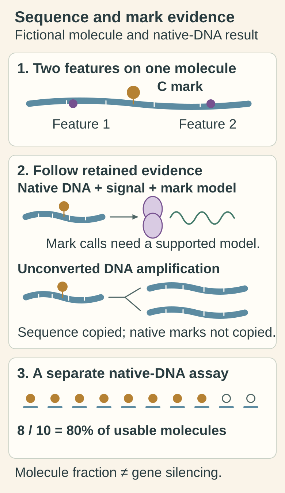

# Long-read and methylation sequencing

## In one sentence

Long-read sequencing follows extended DNA or RNA molecules; methylation sequencing measures specified chemical marks through a separately defined workflow.

## The intuition

A longer photograph of a sentence helps connect words that short snippets might separate. Reading pencil marks on that sentence is a second question. The analogy stops at the instrument: sequence length and chemical-mark detection depend on different preparation and signal-analysis choices. A long photograph is not automatically a pencil-mark assay.

## How it works

A [sequencing read](/wiki/education/concepts/measurement/sequencing-basics/sequencing-reads) is sequence information derived from a prepared molecule. Long reads can span repetitive regions, rearrangement boundaries or multiple nearby variants. **Phasing** connects variants carried on the same DNA molecule or inherited sequence version. A human reference-genome experiment demonstrated the utility of long nanopore reads for difficult regions and phasing; it did not establish universal clinical detection in every tumor specimen. [Jain 2018](https://www.nature.com/articles/nbt.4060).

[DNA methylation](/wiki/education/concepts/biology-basics/genetics/epigenetics-and-methylation) is a chemical modification, rather than a change in the base sequence. Its detection requires an appropriate workflow:

- **Native-DNA nanopore sequencing** measures electrical current as a molecule moves through a pore. A separately trained modification caller can use current patterns to infer specified methylated bases. Ordinary sequence letters alone are insufficient. [Simpson 2017](https://pubmed.ncbi.nlm.nih.gov/28218898/).
- **Single-molecule real-time (SMRT) sequencing** measures DNA synthesis. A validated model can infer certain modifications from polymerase timing and related signals. A long-read sequence report does not imply that this analysis was performed. [Tse 2021](https://pubmed.ncbi.nlm.nih.gov/33495335/).
- **Bisulfite sequencing** chemically changes unmodified cytosines so they are read differently from protected cytosines. It can use sequencing without long reads. Retain which modifications the chosen chemistry distinguishes. [Frommer 1992](https://pubmed.ncbi.nlm.nih.gov/1542678/).

Amplifying unconverted DNA copies its sequence without faithfully copying the original methylation marks. By contrast, a conversion workflow encodes chemical-state information before amplification. Ask about preparation, retained instrument signals, modification model and controls, rather than inferring capability from a platform name.

*Connected sequence information and chemical-mark evidence depend on different workflow choices. Copied products of ordinary unconverted-DNA amplification do not faithfully copy original methylation marks; conversion can encode chemical state before amplification. The separate 8/10 example describes usable molecules at one site.*

[Open the light diagram](./images/long-sequence-and-mark-workflows-v1-light.svg) · [Open the dark diagram](./images/long-sequence-and-mark-workflows-v1-dark.svg)

## Why it matters in cancer

Long reads can help characterize structural changes or connect nearby variants. Methylation patterns can support questions about regulation or cell origin. Neither signal alone establishes that a gene is active, that a finding came from malignant cells, or that it predicts treatment benefit.

Mixed tissue contains several cell types. A methylation fraction at one site describes measured molecules under the assay's rules; it is not automatically the proportion of cancer cells with a silenced gene. Paired sequence and modification information can be useful, but its biological interpretation still needs context.

## Assay card

| Field | What to retain |
|---|---|
| Measures and method | Read sequence/length and, only when performed, chemical-state inference or conversion-based mapping |
| Input and tissue cost | Method-specific DNA or RNA input. Long DNA workflows depend on suitable molecule integrity; extraction and preparation consume an aliquot |
| Output and units | Read length in bases or kilobases; sequence/structural calls; site-specific modification probabilities or fractions, often percent of usable molecules |
| Thresholds | Separate base, alignment and modification filters; model confidence is different from a specimen's methylation fraction |
| Failure modes | Fragmented input, amplification loss of native marks, unsupported modification models, conversion failure or inadequate site coverage |
| Validation limits | Check input type, exact chemical feature, change class and caller version. No universal input mass, tissue cost or clinical cutoff follows from “long read” |

## Common confusions

- **Long read versus methylation assay:** either can exist without the other.
- **DNA versus RNA:** a long RNA or complementary-DNA read does not measure tumor DNA methylation.
- **Confidence versus percentage:** a confident mark call on one molecule is not a high fraction across molecules.
- **More methylation versus less expression:** site, gene and cell context matter.

## Try it

A fictional lab sequences long DNA molecules after ordinary amplification. It supplies excellent sequence calls but no validated chemical-state workflow. Can those calls establish the original specimen's methylation? In a separate native-DNA assay, eight of ten usable molecules are called methylated at one site; what is that fraction?

**Answer:** The first report does not establish original methylation. The second yields 80% of those usable molecules at that site, subject to its calling error and sampling limits. It does not establish 80% malignant cells or 80% gene silencing.

## Explain it back

“Read length tells me ______; modification analysis tells me ______.”

One answer: “how much sequence a read connects; the supported chemical-state information under a particular workflow.”

## Takeaway

**Specify the molecule, preparation, signal and caller before treating sequence and methylation as one assay.**

## Related concepts

- [Panel, exome and genome sequencing](/wiki/education/concepts/measurement/sequencing-basics/panel-exome-genome).
- [Alleles and zygosity](/wiki/education/concepts/biology-basics/genetics/allele-and-zygosity).
- [Blood methylation and fragment patterns](/wiki/education/concepts/measurement/liquid-biopsy/fragmentomics-and-methylation).

## Sources and scope

Source check: October 10, 2026. Method categories, not a platform ranking or clinical recommendation. Exercises are fictional. Expert and learner review remain pending.

- [Jain and colleagues 2018: long nanopore reads in human reference-genome sequencing](https://www.nature.com/articles/nbt.4060).
- [Simpson and colleagues 2017: nanopore-current methylation inference, primary abstract](https://pubmed.ncbi.nlm.nih.gov/28218898/).
- [Tse and colleagues 2021: SMRT kinetic methylation inference, primary abstract and figure descriptions](https://pubmed.ncbi.nlm.nih.gov/33495335/).
- [Frommer and colleagues 1992: bisulfite mapping of methylated cytosines, primary abstract](https://pubmed.ncbi.nlm.nih.gov/1542678/).

<!-- BEGIN GENERATED USED IN -->
## Used in

- [Read a DNA assay as a coverage-and-confidence claim](/wiki/education/molecular-profiling/01-dna-the-blueprint)
<!-- END GENERATED USED IN -->
