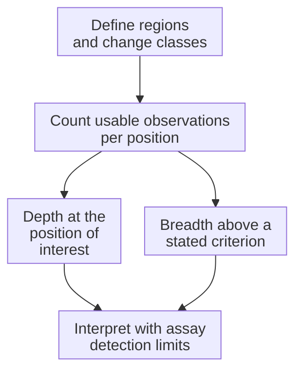

# Sequencing depth and coverage

## In one sentence

Sequencing depth counts usable observations at a position, while coverage breadth describes how much of a defined target meets an explicitly stated measurement criterion.

## The intuition

Think of rain falling on a garden. Depth describes the water at one spot; breadth asks how much of the garden received enough water under a stated rule. A wet average can hide a dry corner. Sequencing differs because observations have qualities and may come from copied fragments, so counting them requires additional rules.

## How it works

At a [DNA (deoxyribonucleic acid)](/wiki/education/concepts/biology-basics/molecules/dna) position, **depth** commonly means the number of aligned [reads](/wiki/education/concepts/measurement/sequencing-basics/sequencing-reads) covering that base after specified filters. A value of 40× means forty counted observations under those rules. Overlapping read pairs, duplicate fragments, low-quality bases and uncertain alignments may be handled differently by different pipelines. A depth without its counting rule is incomplete.

**Mean depth** averages positions. **Coverage breadth** reports a fraction of a named target, often the percentage of bases reaching a stated minimum usable depth. The denominator is the number of target bases, not reads or cells. Neither summary tells you which important positions were missed. Ask for the per-position view when the question depends on one location.

Read depth also differs from **molecular depth**, the number of independently represented molecules under the assay's rules. Two overlapping ends of one fragment, or many amplification copies, can inflate read counts without adding independent fragments. Counting software makes explicit choices: for example, HTSlib documents filters and options for overlapping pairs. Its defaults are software definitions, not clinical validation criteria.

More sequencing can increase observation counts, but cannot recover a region absent from the library or create new original molecules from duplicates. **Library complexity** describes the diversity of represented fragments. Input amount, preservation, capture and alignment affect the usable evidence.

## Why it matters in cancer

A variant present in only a small fraction of sampled DNA needs enough usable evidence to distinguish it from error. [Variant allele fraction](/wiki/education/concepts/measurement/sequencing-basics/variant-allele-fraction-and-cancer-cell-fraction) depends on tumor mixture, copies and subpopulations, not just depth. Even deep sequencing can struggle with damage artifacts or an untested rearrangement class.

A negative report is a statement about tested regions, detectable change classes and validated sensitivity. It cannot become “this gene has no relevant change” when a consequential location was poorly measured or never tested. The Association for Molecular Pathology (AMP) and College of American Pathologists (CAP) guideline connects depth to end-to-end validation, rather than a single universal requirement.

## Assay card

| Field | What to retain |
|---|---|
| Measures and method | Define regions, count usable observations at each position, then summarize across the target |
| Input and tissue cost | Existing alignment files need no new tissue; obtaining more diverse library molecules may require another DNA aliquot and consumes material |
| Output and units | Per-position depth in ×, mean or median depth, and breadth as % of named bases meeting a specified rule; molecular counts if established |
| Thresholds | The summary depth criterion is separate from the validated limit of detection for each change class and specimen |
| Failure modes | Uneven capture, repeats, damaged input, duplicate inflation and misleading averages |
| Limits | Depth does not establish variant origin, protein function or clinical actionability |
| Validation context | Check reference materials, low-fraction performance, reproducibility, filters and reportable regions for the intended assay |

## Common confusions

- **Coverage as a vague word:** establish whether it means targeted territory, depth or breadth.
- **Deep versus broad:** a narrow panel can be deep; a genome assay can be broader with less depth per position.
- **Depth versus sensitivity:** identical depths can support different detection limits under different errors and change classes.

## Try it

A fictional report has mean depth 100×. Of 1,000 target bases, 900 reach its illustrative reporting criterion of 20×; the position you care about has four usable observations.

**Answer:** Breadth at that criterion is 90%. Mean depth does not establish adequate evidence at your position. The 20× rule is a fictional summary criterion, not a recommended diagnostic cutoff. Ask whether the assay supports the proposed claim there.

## Explain it back

Why can high mean depth coexist with an uninformative negative at one position?

One answer: observations are unevenly distributed, and the local evidence must meet that assay's validated requirements.

## Takeaway

**Keep the target, counting rules and local evidence attached to every depth or breadth number.**

## Related concepts

- [Sequencing reads](/wiki/education/concepts/measurement/sequencing-basics/sequencing-reads): observations versus independent fragments.
- [Variant calling](/wiki/education/concepts/measurement/sequencing-basics/variant-calling): evidence, error models and filters.

## Sources

Source check: October 10, 2026. Expert and learner review remain pending. Examples are fictional; no universal diagnostic cutoff is proposed.

- [AMP/CAP 2017: validation of sequencing-based oncology panels](https://pmc.ncbi.nlm.nih.gov/articles/PMC6941185/).
- [HTSlib samtools depth 1.24: counting and filter options](https://www.htslib.org/doc/samtools-depth.html).
- [HTSlib samtools coverage 1.24: breadth and mean-depth outputs](https://www.htslib.org/doc/samtools-coverage.html).

<!-- BEGIN GENERATED USED IN -->
## Used in

- [Authenticate and attribute the finding](/wiki/education/guides/from-variant-to-drug/01-authenticate-and-attribute-the-finding)
- [Read a DNA assay as a coverage-and-confidence claim](/wiki/education/molecular-profiling/01-dna-the-blueprint)
- [What does multi-omics tell us about a tumor?](/wiki/education/reading-a-tumor/omics-and-multi-omics)
<!-- END GENERATED USED IN -->
