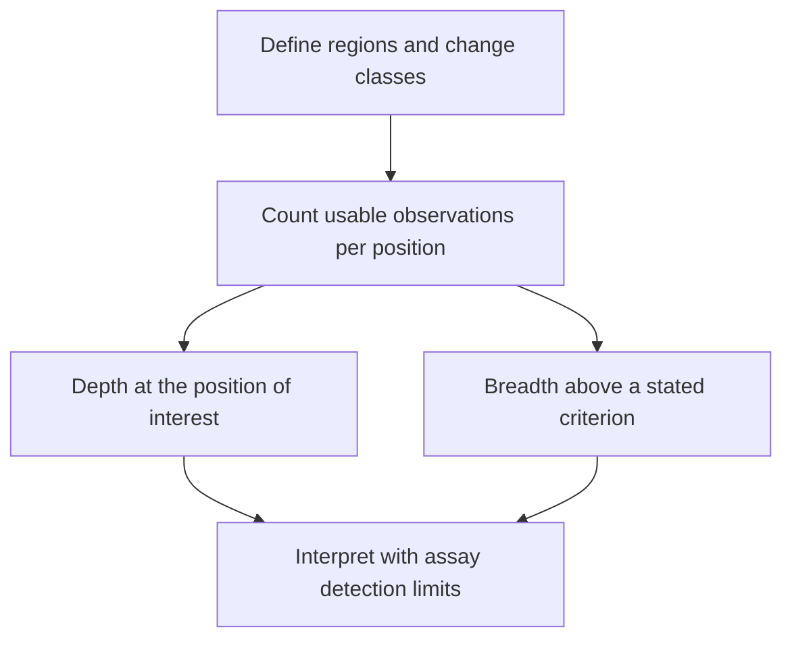

# Sequencing depth and coverage

## In one sentence

Sequencing depth counts usable observations at a position, while coverage breadth describes how much of a defined target meets an explicitly stated measurement criterion.

## The intuition

Think of rain falling on a garden. Depth describes the water at one spot; breadth asks how much of the garden received enough water under a stated rule. A wet average can hide a dry corner. Sequencing differs because observations have qualities and may come from copied fragments, so counting them requires additional rules.

## How it works

At a DNA position, **depth** commonly means the number of aligned reads covering that base after specified filters. A value of 40× means forty counted observations under those rules. Overlapping read pairs, duplicate fragments, low-quality bases and uncertain alignments may be handled differently by different pipelines. A depth without its counting rule is incomplete.

**Mean depth** averages positions. **Coverage breadth** reports a fraction of a named target, often the percentage of bases reaching a stated minimum usable depth. Neither tells you which important positions were missed. Ask for the per-position view or a list of low-coverage regions when the question depends on one location.

More sequencing can increase observation counts, but cannot recover a region absent from the library or create new original molecules from duplicates. **Library complexity** describes the diversity of represented fragments. Input amount, preservation, capture and alignment affect the usable evidence.

## Why it matters in cancer

A variant present in only a small fraction of sampled DNA needs enough usable evidence to distinguish it from error. [Variant allele fraction](variant-allele-fraction-and-cancer-cell-fraction.md) depends on tumor mixture, copy state and subpopulations, not just depth. Even deep sequencing can struggle with damage artifacts or an untested rearrangement class.

A negative report is therefore a statement about tested regions, detectable change classes and validated sensitivity. It cannot become “this gene has no relevant change” when a consequential location was poorly covered or never tested. The Association for Molecular Pathology (AMP) and College of American Pathologists (CAP) panel guideline connects these quantities to end-to-end validation rather than a single universal depth requirement.

## Assay card

| Field | What to retain |
|---|---|
| Measures and method | Observations at each defined position, then summaries across a specified target |
| Input and tissue cost | Existing alignment files need no new tissue; obtaining more diverse library molecules may require another DNA aliquot and consumes material |
| Output and units | Per-position depth in ×, mean or median depth, and breadth as a percentage of named bases meeting a specified rule |
| Thresholds | Report the chosen depth criterion separately from the assay's validated limit of detection for each relevant change class and specimen |
| Failure modes | Uneven capture, repeats, damaged input, duplicate inflation and misleading averages |
| Limits | Depth does not establish variant origin, protein function or clinical actionability |
| Validation context | Check low-fraction reference materials, reproducibility, quality filters and reportable regions for the intended assay |

## Common confusions

- **Coverage as a vague word:** establish whether the author means regions targeted, depth, or breadth.
- **Deep versus broad:** a narrow panel can be deep; a genome assay can be broader with less depth per position.
- **Depth versus sensitivity:** the same depth can support different detection limits under different errors and variant classes.

## Try it

A fictional report has mean depth 100×. Of 1,000 target bases, 900 reach its illustrative reporting criterion of 20×; the position you care about has four usable observations.

**Answer:** Breadth at that criterion is 90%. Mean depth does not establish adequate evidence at your position. The 20× rule here is a fictional summary criterion, not a recommended diagnostic cutoff. Ask whether the assay supports the proposed positive or negative claim there.

## Related concepts

- [Sequencing reads](sequencing-reads.md): observations versus independent fragments.
- [Variant calling](variant-calling.md): evidence, error models and filters.

## Sources

Source check: October 9, 2026. Expert and learner review remain pending. Examples are fictional.

- [AMP/CAP, validation of sequencing-based oncology panels (2017)](https://pmc.ncbi.nlm.nih.gov/articles/PMC6941185/).
- [HTSlib, depth counting and filter options](https://www.htslib.org/doc/samtools-depth.html).
- [Cibulskis et al., somatic mutation detection across depth and allele fraction (2013)](https://pmc.ncbi.nlm.nih.gov/articles/PMC3833702/).

<!-- BEGIN GENERATED USED IN -->
## Used in

- [Read a DNA assay as a coverage-and-confidence claim](/wiki/education/molecular-profiling/01-dna-the-blueprint)
- [Understand multi-omics, one question at a time](/wiki/education/reading-a-tumor/omics-and-multi-omics)
<!-- END GENERATED USED IN -->
