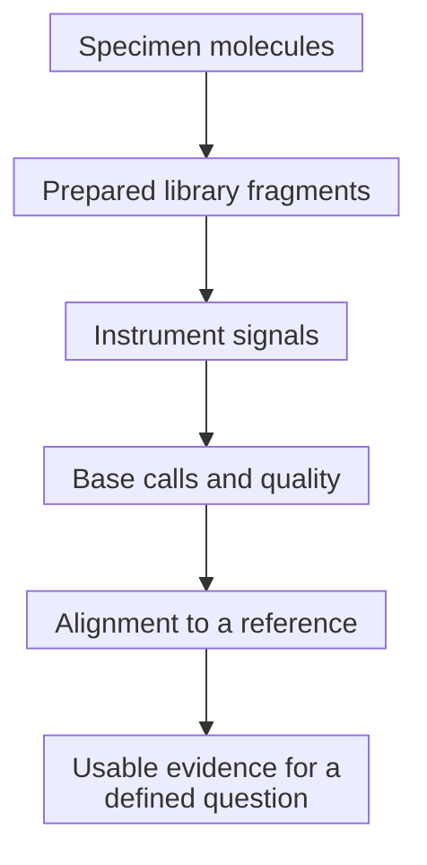
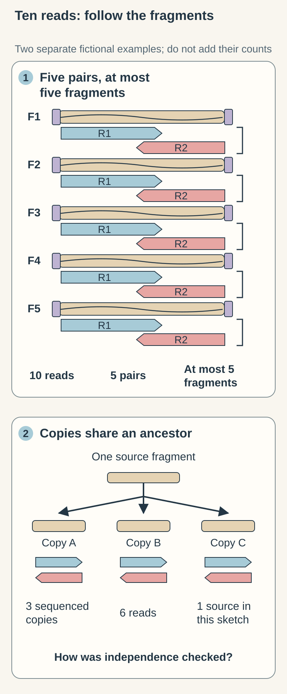

# Sequencing reads

## In one sentence

A sequencing read is an instrument-derived sequence of bases from a prepared molecule, with quality information that helps assess how reliably those bases were identified.

## The intuition

Imagine reconstructing a book from photographed snippets. A read is one snippet; alignment proposes where it belongs. A clear photograph can still fit several nearly identical passages. The analogy stops at the chemistry: preparation can copy, shorten or selectively recover molecules before the instrument sees them.

## How it works

A sequencing **library** is prepared material derived from a specimen. In a common short-read [DNA (deoxyribonucleic acid)](/wiki/education/concepts/biology-basics/molecules/dna) workflow, DNA is fragmented, adapters are added, and fragments are sequenced. Many [RNA (ribonucleic acid)](/wiki/education/concepts/biology-basics/molecules/rna-and-mrna) workflows first make DNA copies of selected RNA molecules. **Next-generation sequencing** reads many prepared molecules in parallel. Long-read methods recover longer sequences using different preparation and measurement strategies.

**Base calling** translates instrument signals into letters. A FASTQ file commonly stores a read identifier, sequence and per-base quality values. A **Phred quality score** is a logarithmic estimate of base-call error: Q20 corresponds to an estimated 1% error probability for that base, and Q30 to 0.1%. These are model-based estimates, not probabilities that a reported mutation is biologically real. [Ewing and Green](https://doi.org/10.1101/gr.8.3.186) established the error-probability framework; the [SAM specification](https://samtools.github.io/hts-specs/SAMv1.pdf) defines the scale.

**Alignment** compares a read with a reference genome or transcript collection. Mapping confidence concerns the proposed location; base quality concerns a letter. Repeated regions can make placement ambiguous even when the letters are clear. An alignment record is not necessarily a new read: one read can have more than one proposed alignment.

In **paired-end** sequencing, two reads come from opposite ends of one library fragment. They provide complementary placement information, but are not two independent original molecules. Amplification can make multiple copies of a fragment. Duplicate recognition or validated molecular tags help assess independent support; neither automatically repairs an error introduced before tagging.

Duplicate rules must fit the preparation. In an **amplicon** assay, primers define the same endpoints for many independently sampled molecules. Identical start and end coordinates alone therefore cannot distinguish copies from independent input molecules. The Association for Molecular Pathology (AMP) and College of American Pathologists (CAP) guideline explains this library-complexity limitation.

## Why it matters in cancer

A small tumor population may contribute few variant-containing molecules. Many reads copied from those molecules cannot replace independent observations. A sequence change or fusion can also be difficult to align. Ask what the reads support, where they map, and how original molecular support was assessed.

## Assay card

| Field | What to retain |
|---|---|
| Measures and method | Sequence observations produced by preparation and base calling, then interpreted through alignment |
| Input and tissue cost | Extracted DNA or RNA; extraction and preparation consume an aliquot. Reanalysis of existing files consumes no new tissue |
| Output and units | Sequences, lengths in bases, quality scores, read/read-pair counts and alignment records; original molecule counts require additional evidence |
| Thresholds | Platform- and pipeline-specific base, mapping and fragment filters; Q30 is a scale value, not a universal diagnostic pass rule |
| Failure modes | Contamination, damage, amplification artifacts, adapters or ambiguous placement |
| Limits | A read does not identify a cell, establish function or alone prove a somatic mutation |
| Validation context | Check specimen types, change classes, independent support rules and the full workflow validated for the reported use |

## Common confusions

- **Read versus molecule:** paired ends and amplification copies can share one fragment.
- **Base versus mapping quality:** a confidently read letter can occupy an uncertain location.
- **Raw versus usable reads:** filtering changes the denominator for downstream support.

## Try it

<!-- BEGIN INDEPENDENT INSERTION PROOF brief-098: scratch SVG candidate, independent G3 pending, not adopted -->
Start at the left of the picture, where the fragments live. Each bracket joins two observations from the same fragment: one read from each end. You can count ten reads, but those ten observations are grouped into five pairs. Reading the second end adds information about that fragment; it does not add another original molecule. [Illumina's paired-end explanation](https://www.illumina.com/science/technology/next-generation-sequencing/plan-experiments/paired-end-vs-single-read.html)

Now follow the separate copy example. Several sequenced copies can trace back to one fragment. The instrument has made more observations, while the molecular ancestry remains shared. That is why a read count needs the preparation and counting rules beside it. A list of alignment records is another count again: one read may appear in several records. [SAM specification, sections 1.2 and 1.4](https://samtools.github.io/hts-specs/SAMv1.pdf)

Fictional example: ten overlapping paired-end reads represent at most five distinct library fragments; copies can reduce independent support further. The separate copy vignette shows ancestry, not a universal duplicate-filter rule or a count of cells.

**Explain it back:** “The two ends help me place the fragment, but ____.”  
**One answer:** “…they still come from the same fragment, and copies may share an earlier ancestor.”
<!-- END INDEPENDENT INSERTION PROOF brief-098 -->

A fictional finding has ten supporting reads, comprising five overlapping read pairs from five library fragments. Are there ten independent fragments?

**Answer:** No. There are at most five represented library fragments. Duplicates may reduce that number further. Ask how the workflow establishes independent molecular support.

## Explain it back

What would you ask when two reports give the same read count but different molecule counts?

One answer: how they handle paired ends, duplicates, molecular tags and alignment records.

## Takeaway

**Read support becomes meaningful when preparation, placement and molecular independence are specified.**

## Related concepts

- [Depth and coverage](/wiki/education/concepts/measurement/sequencing-basics/sequencing-depth-and-coverage): how observations are distributed.
- [Variant calling](/wiki/education/concepts/measurement/sequencing-basics/variant-calling): how evidence becomes a candidate finding.

## Sources

Source check: October 10, 2026. Expert and learner review remain pending. Examples are fictional.

- [NCBI SRA: file formats and read records](https://www.ncbi.nlm.nih.gov/sra/docs/submitformats/).
- [Ewing and Green 1998: Phred error probabilities](https://doi.org/10.1101/gr.8.3.186).
- [SAM format specification: quality scale, templates and alignment records](https://samtools.github.io/hts-specs/SAMv1.pdf).
- [AMP/CAP 2017: oncology sequencing validation and library complexity](https://pmc.ncbi.nlm.nih.gov/articles/PMC6941185/).

<!-- BEGIN GENERATED USED IN -->
## Used in

- [Read a DNA assay as a coverage-and-confidence claim](/wiki/education/molecular-profiling/01-dna-the-blueprint)
- [What does multi-omics tell us about a tumor?](/wiki/education/reading-a-tumor/omics-and-multi-omics)
<!-- END GENERATED USED IN -->
