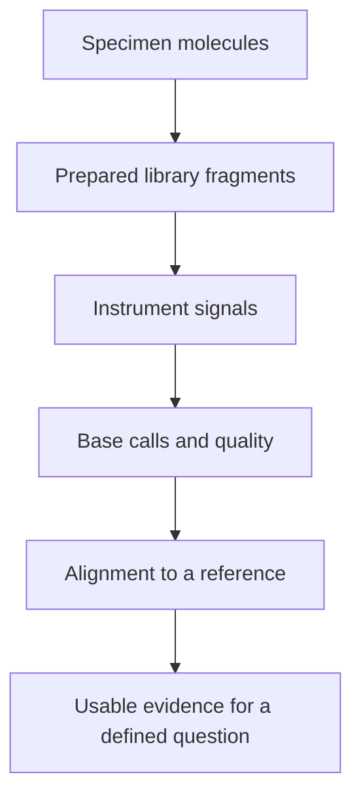

# Sequencing reads

## In one sentence

A sequencing read is an instrument-derived sequence of bases from a prepared molecule, with quality information that helps assess how reliably those bases were identified.

## The intuition

Imagine reconstructing a book from photographed snippets. A read is one snippet; alignment proposes where it belongs. A clear photograph can still fit several nearly identical passages. The analogy stops at the chemistry: preparation can copy, shorten or selectively recover molecules before the instrument ever sees them.

## How it works

A sequencing **library** is prepared material derived from a specimen. In a common short-read DNA workflow, DNA is fragmented, adapters are added, and fragments are sequenced. Many RNA workflows first make DNA copies of selected RNA molecules. Long-read methods recover longer sequences using different preparation and measurement strategies.

**Base calling** translates instrument signals into letters. A FASTQ file commonly stores a read identifier, sequence and per-base quality values. A Phred quality score is a logarithmic estimate of base-call error: Q20 corresponds to an estimated 1% error probability for that base, and Q30 to 0.1%. These are model-based estimates, not probabilities that a reported mutation is biologically real. [Ewing and Green](https://doi.org/10.1101/gr.8.3.186) established the error-probability framework.

**Alignment** compares a read with a reference genome or transcript collection. Mapping confidence concerns the proposed location; base quality concerns a letter. Repeated regions can make placement ambiguous even when the letters are clear.

In **paired-end** sequencing, two reads come from opposite ends of one library fragment. They provide complementary placement information, but are not two independent original molecules. Amplification can also make multiple copies of a fragment. Recognizing duplicates or using validated molecular tags helps assess independent support; neither automatically repairs an error introduced before tagging.

## Why it matters in cancer

A small tumor population may contribute few variant-containing molecules. Many reads copied from those few molecules cannot replace genuinely independent observations. Meanwhile, a sequence change or fusion can be difficult to align. Before trusting a finding, ask what the reads support, where they map, and how many original fragments they represent.

## Assay card

| Field | What to retain |
|---|---|
| Measures and method | Sequence observations produced by library preparation, base calling and alignment |
| Input and tissue cost | DNA or RNA extracted from a specified specimen; extraction and library preparation consume an aliquot, while reanalyzing existing files consumes no new tissue |
| Output and units | Sequences, read lengths in bases, quality scores, read or read-pair counts, and alignment information |
| Thresholds | Base, mapping and fragment-support filters set for the particular platform, pipeline and intended question; Q30 is a quality scale, not a universal diagnostic pass rule |
| Failure modes | Contamination, damaged input, amplification artifacts, adapters or ambiguous placement |
| Limits | A read does not identify a cell, establish function, or by itself prove a somatic mutation |
| Validation context | Check the specimen types, change classes and full workflow validated for the reported use |

## Common confusions

- **Read versus molecule:** paired ends and amplification copies can share one original fragment.
- **Base quality versus mapping quality:** a confidently read letter can occupy an uncertain location.
- **Raw versus usable reads:** filtering changes the denominator used for downstream support.

## Try it

A fictional finding has ten supporting reads, comprising five overlapping read pairs from five library fragments. Are there ten independent fragments?

**Answer:** No. There are at most five represented library fragments. Duplicates may reduce that number further. Ask how the workflow establishes independent molecular support.

## Related concepts

- [Depth and coverage](../sequencing-basics/sequencing-depth-and-coverage.md): how observations are distributed.
- [Variant calling](../sequencing-basics/variant-calling.md): how sequence evidence becomes a candidate finding.

## Sources

Source check: October 9, 2026. Expert and learner review remain pending. Examples are fictional.

- [NCBI SRA, file formats and read records](https://www.ncbi.nlm.nih.gov/sra/docs/submitformats/).
- [Ewing and Green, Phred error probabilities (1998)](https://doi.org/10.1101/gr.8.3.186).
- [AMP/CAP, oncology sequencing validation (2017)](https://pmc.ncbi.nlm.nih.gov/articles/PMC6941185/).

<!-- BEGIN GENERATED USED IN -->
## Used in

- [Read a DNA assay as a coverage-and-confidence claim](/wiki/education/molecular-profiling/01-dna-the-blueprint)
- [Understand multi-omics, one question at a time](/wiki/education/reading-a-tumor/omics-and-multi-omics)
<!-- END GENERATED USED IN -->
