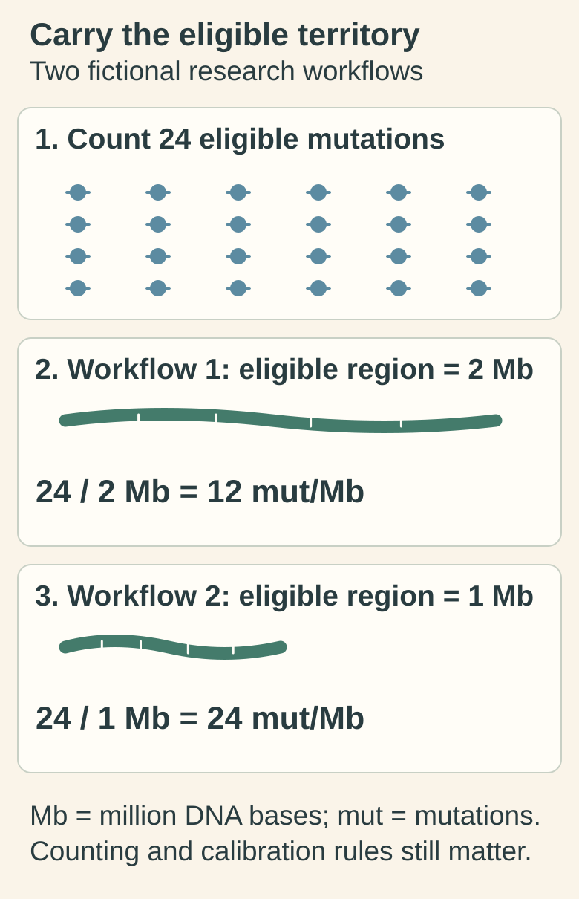

# Tumor mutational burden

## In one sentence

Tumor mutational burden is the density of eligible somatic DNA mutations reported by a specified assay, usually in mutations per megabase.

## The intuition

To compare spelling changes in two documents, you need both a count and the amount of text examined. Twenty changes across two million letters differ from twenty across one million. The analogy breaks when biological meaning enters: a mutation count does not reveal whether a changed protein is made, presented to immune cells or recognized.

## How it works

**Tumor mutational burden (TMB)** counts eligible [somatic](/wiki/education/concepts/biology-basics/genetics/germline-vs-somatic) changes, those arising after conception, across the assay's reporting region. A **megabase (Mb)** is one million DNA bases. A simplified density calculation divides the eligible count by the eligible region's size; a clinical assay may also apply calibration.

What qualifies for the numerator matters. Laboratories can differ in mutation classes counted, inherited-variant filtering, artifact removal and other exclusions. The denominator also matters: [panel, exome and genome sequencing](/wiki/education/concepts/measurement/sequencing-basics/panel-exome-genome) examine different regions. A region enriched for particular cancer genes need not behave like a random sample of the genome.

The Friends of Cancer Research harmonization study found variation between panel estimates when laboratories analyzed the same underlying exome dataset using their own regions and pipelines. It was a computational comparison, not a trial proving every assay interchangeable for treatment selection. [Merino 2020](https://friendsofcancerresearch.org/wp-content/uploads/JITC_Establishing_guidelines_to_harmonize-TMB_2.pdf).

Low tumor content, sequencing quality and origin filtering can affect the count. A research exome estimate and a validated clinical panel result should retain their separate methods, rather than be treated as identical because both use mut/Mb.

## Why it matters in cancer

More mutations can offer more candidate [neoantigens](/wiki/education/concepts/immunology/antigen-presentation/neoantigen), but candidate number is only one part of immune recognition. Processing, [human leukocyte antigen (HLA)](/wiki/education/concepts/immunology/antigen-presentation/hla) display and immune-cell function still matter. High TMB is neither a guarantee of benefit from an [immune checkpoint inhibitor](/wiki/education/concepts/therapeutics/immunotherapy/immune-checkpoint-inhibitor) nor a universal rule for all cancers.

The current U.S. pembrolizumab label's TMB-high use specifies at least 10 mut/Mb by an FDA-authorized test, unresectable or metastatic disease, progression after prior treatment and no satisfactory alternatives, for adults and children. It remains an accelerated-approval indication; safety and effectiveness are not established for children with TMB-high central nervous system cancers. This is a particular regulatory setting, not a threshold for every early breast cancer decision. The supporting KEYNOTE-158 analysis was nonrandomized and does not establish TMB selection for early triple-negative breast cancer. [FDA label, sections 1.18 and 14.18](https://www.accessdata.fda.gov/drugsatfda_docs/label/2026/125514s194lbl.pdf).

## Assay card

| Field | What to retain |
|---|---|
| Measures and method | Eligible mutation density, using explicit region, counting, filtering and calibration rules |
| Input and tissue cost | DNA from a specimen type validated by that assay; extraction consumes material. Tissue and blood methods require their own validation |
| Output and units | Numeric mut/Mb, quality/uncertainty information and any assay-specific high/low category |
| Thresholds | The assay and clinical use's validated cutoff; a research estimate does not automatically satisfy a labeled-test requirement |
| Failure modes | Inherited variants or artifacts counted as somatic, insufficient tumor signal, uneven coverage and denominator differences |
| Validation limits | Measurement accuracy and evidence of usefulness must both match specimen, cancer population and treatment setting |

## Common confusions

- **TMB versus mutation total:** density needs a defined denominator.
- **TMB versus copy-number instability:** chromosome gains and losses are a different quantity.
- **TMB versus [microsatellite instability](/wiki/education/concepts/measurement/sequencing-basics/msi):** related in some tumors, but not interchangeable assays.
- **High versus certain response:** a biomarker category does not settle an individual's outcome.

## Try it

*The same count size produces different densities when eligible territory differs: 24/2 Mb is 12 mut/Mb, while 24/1 Mb is 24 mut/Mb. Token placement does not assert mutation locations or identical variants. Counting, origin filtering and calibration rules remain method-specific.*

[Open the light diagram](./images/tmb-count-and-eligible-territory-v1-light.svg) · [Open the dark diagram](./images/tmb-count-and-eligible-territory-v1-dark.svg)

A fictional research workflow counts 24 eligible mutations across 2 Mb. A second workflow counts 24 across 1 Mb. Are these the same TMB, and does the first establish clinical eligibility?

**Answer:** The simplified densities are 12 and 24 mut/Mb. They cannot be compared clinically without the counting and calibration rules. The research result alone does not establish the authorized-test or disease-setting requirements.

## Explain it back

“TMB is a count per ______ under ______, not a direct measure of ______.”

One answer: “eligible DNA region; specified assay rules; immune recognition or treatment benefit.”

## Takeaway

**Carry the assay, denominator and clinical setting with the TMB number.**

## Related concepts

- [Analytical validity, clinical validity and utility](/wiki/education/concepts/measurement/computational-analysis/analytical-validity-clinical-validity-and-utility).
- [Tumor–normal versus tumor-only sequencing](/wiki/education/concepts/measurement/sequencing-basics/tumor-normal-vs-tumor-only-sequencing).

## Sources and scope

Source check: October 10, 2026. Measurement education and a bounded U.S. label example; the arithmetic is fictional. Expert and learner review remain pending.

- [NCI: tumor mutational burden](https://www.cancer.gov/publications/dictionaries/cancer-terms/def/tumor-mutational-burden).
- [Merino and colleagues 2020: TMB harmonization and assay variation](https://friendsofcancerresearch.org/wp-content/uploads/JITC_Establishing_guidelines_to_harmonize-TMB_2.pdf).
- [FDA: 2026 pembrolizumab label, sections 1.18 and 14.18](https://www.accessdata.fda.gov/drugsatfda_docs/label/2026/125514s194lbl.pdf).

<!-- BEGIN GENERATED USED IN -->
## Used in

- [Measure presentation, binding and response](/wiki/education/designing-a-vaccine/03-immunopeptidomics)
- [Read a DNA assay as a coverage-and-confidence claim](/wiki/education/molecular-profiling/01-dna-the-blueprint)
<!-- END GENERATED USED IN -->
