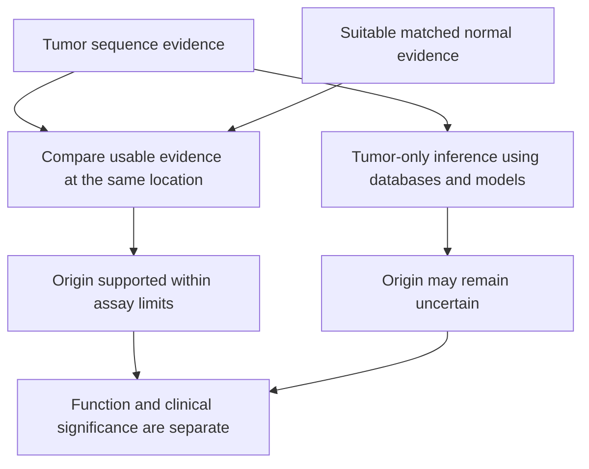

# Tumor–normal versus tumor-only sequencing

## In one sentence

Tumor–normal sequencing compares tumor DNA with a suitable normal sample from the same person to help attribute variants, while tumor-only sequencing must infer their origin without that paired comparison.

## The intuition

If you find an edit in a photocopy, comparing it with that person's starting version helps establish whether the edit was already there. Comparing it only with a public template leaves more uncertainty. The analogy has limits: a normal specimen is another biological sample, with its own cells, measurement quality and possible contamination.

## How it works

The tumor contains a mixture of malignant and nonmalignant cells. A **matched normal** is a separately collected specimen from the same person, selected to represent their constitutional DNA for the intended analysis. “Normal” describes its analytical role; it is not a guarantee that every cell or genomic position is uncomplicated.

Both samples are sequenced, aligned and assessed at relevant locations. Evidence in the normal can support a constitutional origin; adequate tumor evidence with no corresponding normal evidence can support a somatic origin under the assay's rules. Insufficient normal [depth and coverage](sequencing-depth-and-coverage.md) leaves an attribution gap. Sample identity, contamination and the selected normal tissue must also be checked.

Tumor-only pipelines use population databases, allele fractions and other models to distinguish possible origins. A rare constitutional variant may be absent from population databases. A familiar cancer-associated gene or hotspot does not by itself prove that a variant arose only in the tumor. [Jones et al.](https://pmc.ncbi.nlm.nih.gov/articles/PMC4442685/) directly examined the interpretive consequences of omitting the matched normal.

## Why it matters in cancer

Origin matters for biological interpretation, possible inherited-risk questions and immune-target design. But an authentic somatic variant may be a passenger; a constitutional variant may still matter for cancer biology. Attribution and function are different questions.

Paired research sequencing is not automatically a validated hereditary-cancer test. An inherited-risk question requires the appropriate clinical workflow, consent, interpretation and confirmation when indicated. Likewise, “not present in this normal sample” should remain a scoped measurement claim, not a guarantee about every cell in the person.

## Assay card

| Field | What to retain |
|---|---|
| Measures and method | Compare tumor and matched-normal sequence support, or use a clearly labeled tumor-only inference workflow |
| Input and tissue cost | Tumor DNA plus a suitable normal DNA sample for the paired design; each extraction uses material, although normal sampling need not use another tumor biopsy |
| Output and units | Variant coordinates, tumor and normal support counts and allele fractions, attribution labels and uncertainty |
| Thresholds | Separate usable coverage and detection criteria for tumor and normal; absence in an inadequately measured normal is uninformative |
| Failure modes | Sample mismatch, contamination, limited normal coverage, tumor mixture and rare constitutional variants missed by database filtering |
| Limits | Origin does not establish functional damage, inheritance counseling conclusions or drug benefit |
| Validation context | Check the intended somatic or germline use, sample types, analysis rules and confirmation policy |

## Common confusions

- **Matched normal versus a healthy reference cohort:** the latter is not this person's paired DNA.
- **Tumor-only versus automatically somatic:** specimen location does not establish variant origin.
- **Variant fraction versus inheritance:** copy changes and cellular mixtures can alter the fraction.

## Try it

A fictional tumor-only test finds a rare repair-gene variant at 48% allele fraction. A database does not list it. Can you label it inherited or somatic?

**Answer:** Neither conclusion follows from those facts alone. Review copy state and the assay's attribution model; suitable normal or clinical germline testing can address the origin question. Function remains another question.

## Related concepts

- [Germline versus somatic](../../biology-basics/genetics/germline-vs-somatic.md): biological origins.
- [Variant calling](variant-calling.md): how sequence evidence is evaluated.

## Sources

Source check: October 9, 2026. Expert and learner review remain pending. Examples are fictional.

- [Jones et al., paired and tumor-only genomic interpretation (2015)](https://pmc.ncbi.nlm.nih.gov/articles/PMC4442685/).
- [AMP/CAP, assay validation and specimen limitations (2017)](https://pmc.ncbi.nlm.nih.gov/articles/PMC6941185/).
- [NCI, genetic testing for inherited cancer risk](https://www.cancer.gov/about-cancer/causes-prevention/genetics/genetic-testing-fact-sheet).

<!-- BEGIN GENERATED USED IN -->
## Used in

- [Read a DNA assay as a coverage-and-confidence claim](/wiki/education/molecular-profiling/01-dna-the-blueprint)
- [Understand multi-omics, one question at a time](/wiki/education/reading-a-tumor/omics-and-multi-omics)
<!-- END GENERATED USED IN -->
