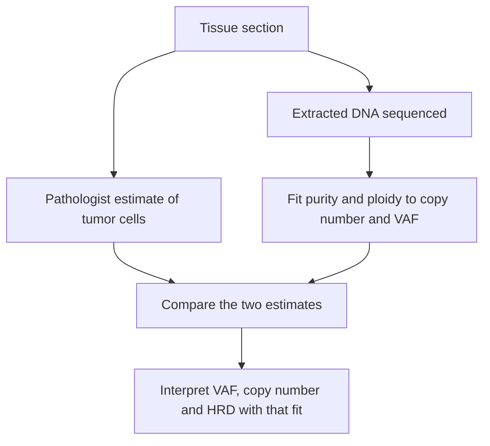

# Tumor purity and ploidy

## In one sentence

Tumor purity is the share of cells in a tested sample that are cancer cells; ploidy is the average number of genome copies in those cancer cells. Together they set how DNA changes appear in sequencing.

## The intuition

Imagine a jar of marbles poured from two bags. The cancer bag holds marbles from cancer cells; the normal bag holds marbles from the healthy cells mixed into the same piece of tissue. **Purity** is how much of the jar came from the cancer bag. **Ploidy** is how many marbles each cancer cell adds: a cancer cell that has doubled its genome adds twice as many. Sequencing only sees the mixed jar, so you need both numbers to work backward to what one cancer cell carries.

The analogy is too tidy in one way. Copy number varies along the genome, and cancer cells in one sample are not all identical.

## How it works

**Purity changes the size of every tumor signal.** Normal cells dilute it. The [variant allele fraction (VAF)](/wiki/education/concepts/measurement/sequencing-basics/variant-allele-fraction-and-cancer-cell-fraction) of a mutation carried by every cancer cell falls as purity falls. So does the copy-number shift of a [deletion or gain](/wiki/education/concepts/measurement/sequencing-basics/copy-number-and-loh). The table assumes near-diploid cancer cells, one mutant copy out of two, and diploid normal cells.

| Purity | Expected VAF of a mutation in every cancer cell | Average copy number where cancer cells lost one copy |
|---|---|---|
| 80% | 40% | 1.2 |
| 50% | 25% | 1.5 |
| 20% | 10% | 1.8 |

At 20% purity a fully clonal mutation looks like a minor one, and a deletion barely moves the signal away from two copies. Read depth and the caller's threshold then decide whether it is reported at all.

**Ploidy changes the baseline.** Many cancers duplicate their whole genome. Whole-genome doubling was found in nearly 30% of 9,692 sequenced advanced cancers ([Bielski 2018](https://pubmed.ncbi.nlm.nih.gov/30013179/)). In an early-stage breast-cancer series, 45% of tumors were aneuploid (more than 2.7 genome copies), and basal-like tumors often lost DNA and then doubled, ending near three copies ([Van Loo 2010](https://pubmed.ncbi.nlm.nih.gov/20837533/)). Gain and loss depend on the baseline: in a doubled genome averaging four copies, a region with three copies is a relative loss, even though it carries more copies than a normal cell's two. A fit that wrongly assumes a near-diploid cancer misplaces that baseline and mislabels such regions.

### Two ways to estimate purity

1. **Pathology.** A pathologist estimates the percentage of tumor cells on a [hematoxylin and eosin (H&E)](/wiki/education/concepts/measurement/pathology-readouts/h-and-e-morphology) slide, often marking the area to cut for DNA. These estimates vary. When nine pathologists scored the same 47 lung-tumor slides, a third of estimates missed the manually counted value by at least three categories, most of them ten points wide ([Smits 2014](https://pubmed.ncbi.nlm.nih.gov/23887293/)).
2. **Sequencing.** Tools such as ASCAT and ABSOLUTE fit copy-number and allele-frequency data together. They choose the purity and ploidy that best explain every segment at once ([Van Loo 2010](https://pubmed.ncbi.nlm.nih.gov/20837533/); [Carter 2012](https://pubmed.ncbi.nlm.nih.gov/22544022/)). The same data can fit more than one answer, for example a purer near-diploid tumor or a less pure doubled one. The tools pick using clonal mutations and other constraints, and can still pick wrongly.

*Purity and ploidy are fitted numbers with uncertainty, not direct counts.*

### Why scar scores depend on the fit

[Homologous recombination deficiency (HRD)](/wiki/education/concepts/cancer-biology/genome-instability-and-repair/homologous-recombination-and-hrd) scores count genomic scars: loss of heterozygosity, telomeric allelic imbalance and large-scale state transitions. Each is read from allele-specific copy-number segments, which exist only after purity and ploidy are estimated. The original large-scale transition test used different cutoffs for near-diploid and near-tetraploid tumors ([Popova 2012](https://pubmed.ncbi.nlm.nih.gov/22933060/)). In triple-negative breast cancer trials of platinum chemotherapy, a combined score of 42 or more was used as the HRD threshold ([Telli 2016](https://pubmed.ncbi.nlm.nih.gov/26957554/)). A wrong ploidy, or too little tumor to call segments, can therefore move a score across the line.

## Why it matters in cancer

- **Clonal or subclonal?** A 25% VAF means "every cancer cell" at 50% purity and "a subclone" at 100%. The [cancer cell fraction](/wiki/education/concepts/measurement/sequencing-basics/variant-allele-fraction-and-cancer-cell-fraction) calculation needs purity.
- **Missed findings.** Low purity can hide mutations, [tumor mutational burden](/wiki/education/concepts/measurement/sequencing-basics/tumor-mutational-burden) and [loss of a human leukocyte antigen (HLA) haplotype](/wiki/education/concepts/measurement/sequencing-basics/hla-loh). A negative result from a low-purity sample is weaker than one from a pure sample.
- **After preoperative treatment.** Residual tumor beds are often sparse; [tumor-bed cellularity](/wiki/education/concepts/breast-cancer/surgery-and-pathology-results/tumor-bed-cellularity) describes how sparse. Sequencing such a specimen can mean low purity.

## Common confusions

- **Purity versus tumor-bed cellularity.** Cellularity is an area fraction of a defined tumor bed, used to score residual cancer burden. Sequencing purity is the cancer share of cells, or DNA, that went into the test.
- **Purity versus tumor fraction in blood.** Plasma has its own "purity," the [tumor fraction of cell-free DNA](/wiki/education/concepts/measurement/liquid-biopsy/ctdna-units), usually far lower than in tissue.
- **Ploidy versus local copy number.** Ploidy is a genome-wide average; one gene can have many more or fewer copies.
- **A purity number is not a measurement.** It is a model fit or a visual estimate, and the two can disagree.

## How it is measured

| Assay-card field | What to retain |
|---|---|
| Measures | Cancer-cell share of the tested material and average cancer genome copies |
| How | Pathology estimate on the slide; model fit to sequencing copy number and allele fractions |
| Input and tissue cost | The same DNA used for sequencing; no extra tissue for the model fit |
| Output and units | Purity as a percentage or fraction; ploidy as average copies (for example 2.1 or 3.8) |
| Thresholds | Laboratories set minimum tumor content for each assay; check the report's limit |
| Failure modes | Too few tumor cells, several equally good fits, subclonal copy changes, contamination |
| Cannot show alone | Which mutations matter or which treatment will work |

## Try it

A report shows a *TP53* mutation at 18% VAF. The pathologist estimated 40% tumor cells; the sequencing fit gives 36% purity and near-diploid cancer cells. Is the mutation likely in every cancer cell?

**Answer:** Probably yes. At 36% purity with two copies per cell, a mutation on one copy of every cancer cell is expected near 18%. If the fit had said 90% purity, 18% would suggest a subclone or a copy-number change.

## Explain it back

"The same VAF can mean different things because ___ and ___ change how much cancer DNA is in the tube."

**One possible answer:** "purity (how many cells are cancer) and ploidy (how many genome copies each cancer cell has)."

## Takeaway

**Read every tumor DNA number together with the sample's purity and ploidy, and remember both are estimates.**

## Related concepts

- [Variant allele fraction and cancer cell fraction](/wiki/education/concepts/measurement/sequencing-basics/variant-allele-fraction-and-cancer-cell-fraction)
- [Copy number and loss of heterozygosity](/wiki/education/concepts/measurement/sequencing-basics/copy-number-and-loh)
- [Tumor-bed cellularity](/wiki/education/concepts/breast-cancer/surgery-and-pathology-results/tumor-bed-cellularity)
- [Tumor-normal versus tumor-only sequencing](/wiki/education/concepts/measurement/sequencing-basics/tumor-normal-vs-tumor-only-sequencing)

## Sources and scope

Source-checked November 8, 2026 against primary abstracts. The table values are idealized arithmetic. Expert and learner review pending.

1. [Van Loo and colleagues, PNAS 2010](https://pubmed.ncbi.nlm.nih.gov/20837533/) — ASCAT; joint purity and ploidy estimation; aneuploidy in 45% of early breast cancers.
2. [Carter and colleagues, Nature Biotechnology 2012](https://pubmed.ncbi.nlm.nih.gov/22544022/) — ABSOLUTE; purity, ploidy and genome doubling.
3. [Smits and colleagues, Modern Pathology 2014](https://pubmed.ncbi.nlm.nih.gov/23887293/) — variability of pathologist tumor-cell estimates.
4. [Bielski and colleagues, Nature Genetics 2018](https://pubmed.ncbi.nlm.nih.gov/30013179/) — whole-genome doubling in nearly 30% of 9,692 advanced cancers.
5. [Popova and colleagues, Cancer Research 2012](https://pubmed.ncbi.nlm.nih.gov/22933060/) and [Telli and colleagues, Clinical Cancer Research 2016](https://pubmed.ncbi.nlm.nih.gov/26957554/) — ploidy-specific scar cutoffs and the combined HRD score threshold in TNBC.

<!-- BEGIN GENERATED USED IN -->
## Used in

- [Read DNA: coverage, calls, copies and cell fractions](/wiki/education/guides/what-multi-omics-tells-us/03-read-dna)
<!-- END GENERATED USED IN -->
