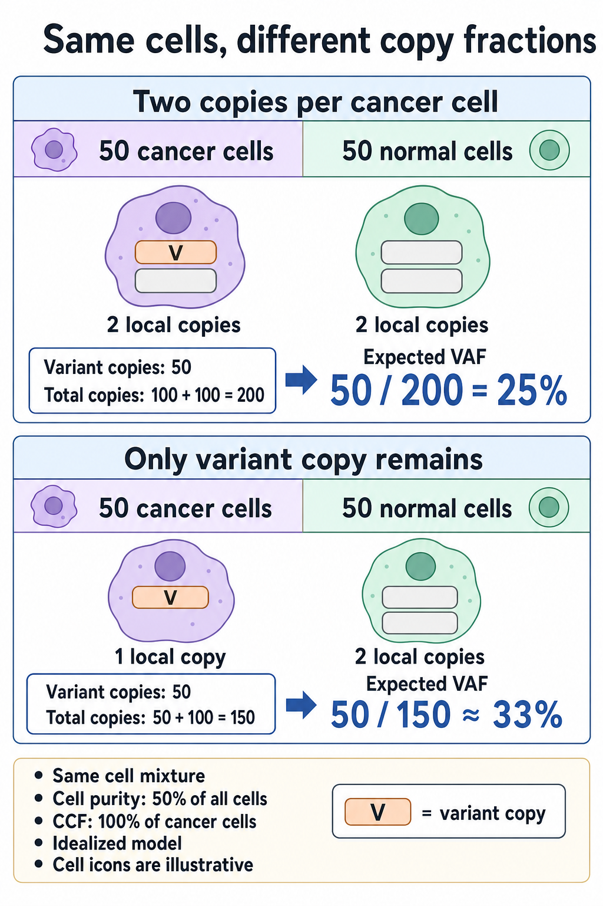

# Variant allele fraction vs cancer cell fraction

## In one sentence

Variant allele fraction measures variant-supporting sequence observations, while cancer cell fraction estimates how many cancer cells carry the change.

## The intuition

Cells contribute different numbers of red and blue beads to a jar. Counting red beads does not count carrier cells. [DNA (deoxyribonucleic acid)](/wiki/education/concepts/biology-basics/molecules/dna) sequencing counts observations; cell fractions are modeled. The analogy omits mapping, recovery and sampling errors.

## How it works

**Variant allele fraction (VAF)** is the proportion of usable reads, or assay-defined molecules, at a location supporting the alternate sequence. Keep the denominator: 25 alternate observations among 100 usable observations gives 25% VAF.

**Cancer cell fraction (CCF)** estimates the fraction of cancer cells carrying the change. Its inputs have distinct denominators:

| Quantity | Denominator or scope |
|---|---|
| **Cell purity**, `p` | Cancer cells / all nucleated cells in the tested sample |
| **DNA contribution** | Tumor-derived / total recovered DNA; more genome copies can contribute more DNA |
| **[Pathology cellularity](/about/Terminology#tumor-cellularity)** | Method-defined tissue measurement; for [residual cancer burden (RCB)](/wiki/education/concepts/breast-cancer/surgery-and-pathology-results/residual-cancer-burden), cancer occupies a percentage of the defined tumor-bed area |
| **Global ploidy**, `P` | Average genome-copy content per cancer cell |
| **Local copy number**, `C` | Copies of the particular region per cancer cell under the model |
| **Mutant multiplicity**, `m` | Variant-containing copies per carrier cancer cell |
| **CCF**, `f` | Carrier cancer cells divided by all sampled cancer cells |

A pathology estimate may inform a model, but definitions and sampled regions must match. Tumor-bed area does not count cells in the sequencing aliquot.

With equal recovery per genome copy and diploid normal cells, tumor DNA contribution is `p × P / [p × P + 2 × (1 − p)]`. If half the cells are cancer cells with ploidy four, their expected DNA contribution is two-thirds, not one-half. Local copy gains alter the site-specific contribution further. [Carter 2012](https://pmc.ncbi.nlm.nih.gov/articles/PMC4383288/).

## Worked example

*In this idealized model, both mixtures contain 50 cancer cells and 50 normal cells: cell purity is 50%, and all cancer cells carry the variant, so cancer cell fraction (CCF) is 100%. Normal cells are diploid; local cancer-copy counts are uniform, and recovery and sequencing are unbiased. Losing the other local cancer-cell copy changes expected variant allele fraction (VAF) from 50/200 = 25% to 50/150 ≈ 33%. Icons are illustrative; the bars represent one DNA region, not gene activity.*

These are invented, idealized mixtures with diploid normal cells and unbiased sequencing.

| Mixture | Variant copies | Total local copies | Expected VAF |
|---|---|---|---|
| 50 cancer cells plus 50 normal cells; every cell has two local copies | One mutated copy in each cancer cell: 50 | 200 | 25% |
| Same cells; cancer cells retain only the mutated copy | 50 | 50 cancer copies plus 100 normal copies: 150 | About 33% |

Every cancer cell carries the mutation: CCF is 100% in both rows. Changed denominators change the read fraction.

For a simple uniform-copy mixture, expected VAF is:

`p × f × m / [p × C + (1 − p) × 2]`.

Assumptions: two normal copies, uniform local cancer copies, fixed mutant multiplicity among carriers and unbiased observations. Subclonal copy changes require a richer model. Uncertain purity, copies and multiplicity yield alternative CCF fits, not directly counted cells. [Roth 2014](https://www.nature.com/articles/nmeth.2883).

## Why it matters in cancer

A CCF compatible with 100% describes the analyzed cancer population under model uncertainty. [Truncal ancestry](/wiki/education/concepts/cancer-biology/what-cancer-is/tumor-heterogeneity) requires comparisons across sampled branches; high VAF alone cannot establish it. VAF does not establish origin or function. A rise after treatment can reflect mixture or copy changes as well as carrier expansion.

## Assay card

| Field | What to retain |
|---|---|
| Measures and method | Filter sequence support for VAF; infer CCF using purity, local copies, multiplicity and an explicit mixture model |
| Input and tissue cost | Sequencing and copy data from suitable material; extraction consumes DNA. Reanalysis alone uses no new tissue |
| Output and units | VAF/CCF as fractions or %, copies and alternative fits |
| Thresholds | Assay-specific detection limits and model-specific fit rules; no VAF cutoff universally establishes a clonal target |
| Failure modes | Limited molecules, artifacts, recovery bias and uncertain mixture or copy inputs |
| Limits and validation | Retain model/version and intended-use validation; software PASS is not independent confirmation or drug-benefit evidence |

## Common confusions

- **25% VAF versus 25% CCF:** the observations and cancer cells have different denominators.
- **Ploidy versus local copies:** a genome-wide average cannot replace the site's copy state.
- **[LOH and phasing](/wiki/education/concepts/measurement/sequencing-basics/copy-number-and-loh) versus CCF:** version loss and assignment to chromosome copies answer different questions.

## Try it

Two fictional models have cell purity 50% and one mutant copy per carrier. A has four local copies and CCF 100%; B has two local copies and CCF two-thirds. What VAF does each predict?

**Answer:** A gives `0.5 / 3 = 1/6`; B gives `(0.5 × 2/3) / 2 = 1/6`, about 16.7%. Different copy-and-cell models fit the same VAF. Copy evidence helps distinguish them. CCF above 100% signals incompatible assumptions or data, not extra cells.

## Explain it back

What is needed before converting VAF into CCF?

One answer: defined cell purity, local copies, mutant multiplicity and model uncertainty.

## Takeaway

**Read fraction, DNA contribution, tissue area and cancer-cell fraction are different measurements.**

## Related concepts

- [Tumor heterogeneity](/wiki/education/concepts/cancer-biology/what-cancer-is/tumor-heterogeneity): clones and sampling.
- [Germline versus somatic](/wiki/education/concepts/biology-basics/genetics/germline-vs-somatic): origin of a change.

## Sources and scope

Source check: October 10, 2026. Fictional mixture arithmetic; expert and learner review pending.

- [Carter and colleagues 2012: ABSOLUTE, cell purity, ploidy and mutation multiplicity](https://pmc.ncbi.nlm.nih.gov/articles/PMC4383288/).
- [Roth and colleagues 2014: PyClone, allele-aware cellular prevalence inference](https://www.nature.com/articles/nmeth.2883).
- [MD Anderson pathology protocol: RCB cellularity is defined over tumor-bed area](https://www.mdanderson.org/content/dam/mdanderson/documents/for-physicians/clinical-calculators/PLM_protocol_RCB_calculators_BRO.pdf).

<!-- BEGIN GENERATED USED IN -->
## Used in

- [Read a neoantigen design board](/wiki/education/designing-a-vaccine/04-how-to-read-a-neoantigen-design-board)
- [Authenticate and attribute the finding](/wiki/education/guides/from-variant-to-drug/01-authenticate-and-attribute-the-finding)
- [Connect repair biology to PARP sensitivity](/wiki/education/guides/from-variant-to-drug/02-connect-repair-biology-to-parp-sensitivity)
- [From a variant to a drug claim](/wiki/education/guides/from-variant-to-drug/index)
- [Read tumor and normal data before choosing targets](/wiki/education/guides/personalized-cancer-vaccine/02-reading-tumor-and-normal-data)
- [Read a DNA assay as a coverage-and-confidence claim](/wiki/education/molecular-profiling/01-dna-the-blueprint)
- [Read blood measurements as a time series](/wiki/education/molecular-profiling/06-ctdna-and-mrd)
- [Separate DNA copies from cancer-cell fractions](/wiki/education/multi-omics-foundations/04-copies-alleles-and-clones)
- [Understand multi-omics, one question at a time](/wiki/education/reading-a-tumor/omics-and-multi-omics)
<!-- END GENERATED USED IN -->
