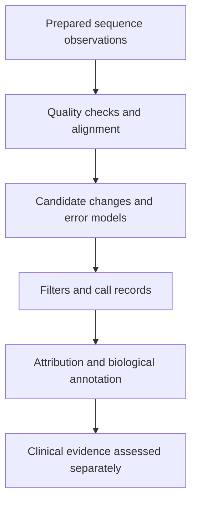

# Variant calling

## In one sentence

Variant calling is the computational process of evaluating sequence evidence and error models to identify candidate differences from a reference or comparison sample.

## The intuition

A caller is like an editor deciding whether several apparent typos represent a real change or a copying problem. Repeated evidence helps only if it is trustworthy. The analogy stops at judgment: callers apply specified statistical models and filters, and their performance must be tested for the kinds of changes they report.

## How it works

A workflow checks sequence quality and aligns [reads](sequencing-reads.md), sometimes assembling a local sequence to resolve an uncertain region. A caller then compares possible explanations for observed letters, fragment patterns or regional signals. Different methods handle substitutions, small insertions or deletions, copy changes and structural rearrangements; a workflow that calls one class may not call another.

Evidence includes usable depth, base and mapping quality, strand and fragment distribution, and comparison-sample support where available. Models account for expected sequencing errors and other artifacts. A somatic caller must also consider low-frequency evidence in a mixed sample. These are inference choices, not automatic proof of the true biological state.

The **Variant Call Format (VCF)** can record coordinates, reference and alternative alleles, quality values, filters and sample-specific fields. Read the definitions supplied with that file. **PASS** means the call passed the stated filters. A dot in the FILTER field is not the same as PASS; the VCF specification uses it when filters have not been applied. Counts and allele fractions also need their defined denominators.

**Annotation** adds information about a call, such as the affected gene or a predicted protein consequence. Calling asks whether evidence supports a sequence change; annotation and interpretation ask what that change might mean. Machine learning is one possible method, not the definition of calling.

## Why it matters in cancer

Tumor mixture, low allele fractions, repeats and damaged tissue can complicate inference. Two callers may agree because they share the same misleading alignment. Confirmation with another suitable method can add independent evidence, but its sensitivity and specimen must fit the question too.

A negative call set also depends on the regions, change classes and fractions the workflow could detect. A clinically usable pipeline needs validation from specimen preparation through reporting, not just impressive performance on a convenient computer dataset.

## Assay card

| Field | What to retain |
|---|---|
| Measures and method | Computational evidence for candidate sequence or copy differences under a specified model |
| Input and tissue cost | Existing sequence files, reference assembly and comparison data; reanalysis consumes no new tissue, while a new confirming assay may use an aliquot |
| Output and units | Coordinates, alleles, filter states, quality scores, support counts and assay-defined allele fractions or copy estimates |
| Thresholds | Caller version, filters, validated detection limits and reportable regions; a filter threshold is not a treatment threshold |
| Failure modes | Misalignment, contamination, damage, inadequate depth, reference mismatch or unsupported change classes |
| Limits | A call does not prove functional loss, cancer-cell fraction, pathogenicity or response to a medicine |
| Validation context | Check the complete workflow, specimen and variant class; research discovery and clinical reporting are distinct uses |

## Common confusions

- **PASS versus confirmed:** passing filters is one layer of evidence.
- **Caller agreement versus independent experiments:** shared input can produce shared error.
- **Calling versus pathogenicity:** authenticity and biological consequence need separate support.

## Try it

A fictional call is PASS in two tools, but all supporting reads align ambiguously to duplicated genomic regions. Has tool agreement resolved the location?

**Answer:** No. The shared mapping problem remains. Inspect the evidence and use a suitable resolving method before attributing the change to a particular gene.

## Related concepts

- [Depth and coverage](sequencing-depth-and-coverage.md): where negative claims are supported.
- [Mutation types](../../biology-basics/genetics/mutation-types.md): different classes of change.

## Sources

Source check: October 9, 2026. Expert and learner review remain pending. Examples are fictional.

- [Cibulskis et al., somatic point-mutation inference (2013)](https://pmc.ncbi.nlm.nih.gov/articles/PMC3833702/).
- [GA4GH/HTS, VCF 4.5 specification](https://samtools.github.io/hts-specs/VCFv4.5.pdf).
- [AMP/CAP, end-to-end oncology panel validation (2017)](https://pmc.ncbi.nlm.nih.gov/articles/PMC6941185/).

<!-- BEGIN GENERATED USED IN -->
## Used in

- [Read a DNA assay as a coverage-and-confidence claim](/wiki/education/molecular-profiling/01-dna-the-blueprint)
- [Understand multi-omics, one question at a time](/wiki/education/reading-a-tumor/omics-and-multi-omics)
<!-- END GENERATED USED IN -->
