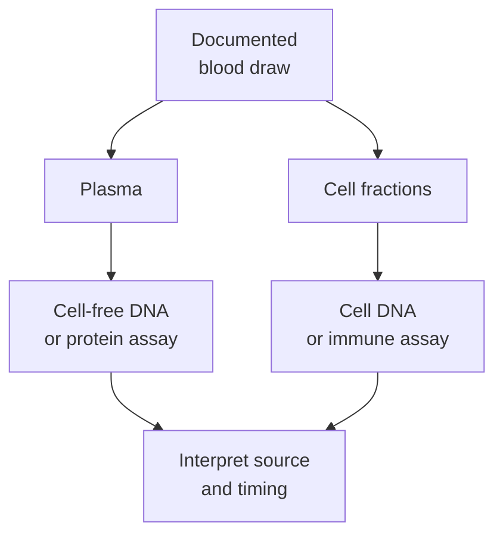

# Blood as a renewable sample: repeatable collection, different biology

## In one sentence

Blood can often be sampled repeatedly to follow changing biology, but each draw is a new, finite specimen whose contents and handling determine what its results mean.

## The intuition

A series of weather readings lets you follow change over time. It does not mean every reading measures the same feature or that an absent signal proves nothing is happening elsewhere. Repeat blood sampling has a similar strength and limit. Blood is also collected from a person, so repeatability never means collection is free of burden, risk or consent requirements.

## How it works

Whole blood contains cells and a fluid component. Processing can separate **plasma**, the liquid separated from anticoagulated blood, and cell fractions. **Serum** is obtained after clotting and is not an interchangeable input for every plasma assay.

Blood supports several distinct questions. [[wiki/education/concepts/measurement/liquid-biopsy/cfdna-vs-ctdna|Cell-free DNA (cfDNA)]] is DNA outside cells; **[[wiki/education/concepts/measurement/liquid-biopsy/cfdna-vs-ctdna|circulating tumor DNA (ctDNA)]]** is its tumor-derived subset. White-cell DNA can provide a comparator for a tumor sequencing assay. [[wiki/education/concepts/measurement/immune-monitoring/peripheral-blood-mononuclear-cells|Peripheral blood mononuclear cells]] support selected immune measurements. Plasma proteins can come from many tissues. The tube is a shared starting point, not a shared biological interpretation.

Tumor release into blood varies. A negative plasma result can reflect low shedding, limited sample molecules or assay limitations. Conversely, a mutation detected in plasma can arise from a clone of blood-forming cells rather than the tumor. [Razavi et al.](https://pubmed.ncbi.nlm.nih.gov/31768066/) demonstrated this interpretive problem using matched plasma, white-cell DNA and tumor tissue in a defined sequencing study; its findings do not supply a universal correction for every assay.

Handling also affects the signal. Collection tube, time to separation and storage must match the method. Cell breakdown after collection can add DNA to the fluid fraction, changing what the assay measures.

## Why it matters in cancer

Repeat draws can support longitudinal measurement without repeatedly sampling a tumor. Yet circulating immune cells are not the same population as immune cells inside a tumor, and a plasma signal does not directly preserve tissue architecture. A later draw also reflects a later biological and treatment time point. Comparisons need the same named question, compatible method and documented context.

## How it is measured

| Assay-card field | What to retain |
|---|---|
| Measures | A named analyte or cell population, not “the cancer” in general |
| How | Draw → process appropriate fraction → run assay → compare with suitable context |
| Input and tissue cost | Finite blood volume and derived aliquots; repeat draws have practical and health burdens |
| Output and units | Method-specific concentrations, molecule/variant estimates or cell counts/frequencies |
| Thresholds | Limit of detection, input adequacy and intended-use cutoffs belong to the assay |
| Failure modes | Wrong tube, delayed processing, cell breakdown, low input or an origin misassignment |
| Cannot show alone | Tumor-wide cell composition, tissue localization or absence of all cancer |
| Validation context | Monitoring, diagnosis and research assays require separate intended-use evidence |

## Common confusions

- “Renewable” means future collection may be possible; the stored tube itself remains finite.
- Not every molecule in plasma comes from cancer.
- A blood immune response does not automatically establish recognition inside the tumor.
- The same numerical change can have different meanings when methods or collection times differ.

## Try it

A fictional plasma assay finds a variant also present in matched white-cell DNA, but not in the available tumor sample. A learner calls it a proven new tumor mutation. What should be reconsidered?

**Answer:** Its biological source. A blood-cell clone is one possibility, alongside assay and sampling uncertainty. The result needs integrated interpretation; neither the plasma label nor one negative tissue sample settles origin alone.

## Explain it back

Why does repeat collection not make blood a replacement for every tissue assay? **One answer:** Blood measures circulating material at a time point, while tissue can preserve local cells and architecture that may not appear in circulation.

## Takeaway

Blood offers repeat sampling, but every result still needs its fraction, biological source, handling, method and time point.

## Related concepts

- [[wiki/education/concepts/measurement/sequencing-basics/tumor-normal-vs-tumor-only-sequencing|Choosing a sequencing comparator]]
- [[wiki/education/concepts/measurement/specimens/tissue-is-non-renewable|How an archived tissue budget differs]]

## Sources and scope

Source check: October 10, 2026. General measurement teaching; expert and learner review remain pending.

- [WHO: guidelines on drawing blood](https://www.who.int/publications/i/item/9789241599221) — official collection risks and sample-quality principles.
- [NCI: Cell-free DNA biospecimen collection and processing, version 1 protocol](https://www.protocols.io/view/nci-biospecimen-evidence-based-practices-bebp-cell-dc8k2zuw.pdf) — plasma handling scope; no collection schedule is prescribed here.
- [Razavi et al., 2019: sources of plasma cell-free DNA variants](https://pubmed.ncbi.nlm.nih.gov/31768066/) — matched-compartment primary evidence for blood-cell-derived mutations.

<!-- BEGIN GENERATED USED IN -->
## Used in

- [Match each measurement to its claim](/wiki/education/local-treatment-modalities/05-tissue-and-sample-budget)
<!-- END GENERATED USED IN -->
